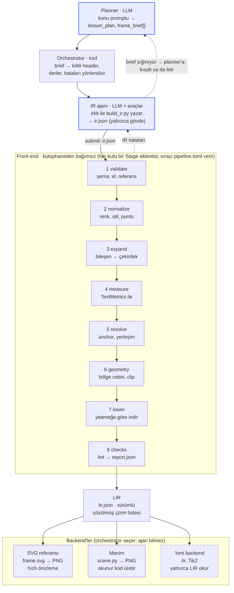
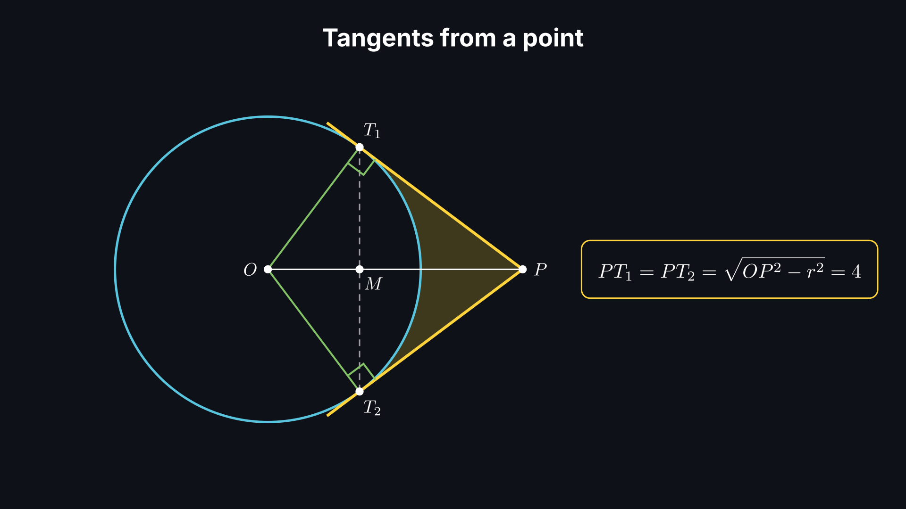
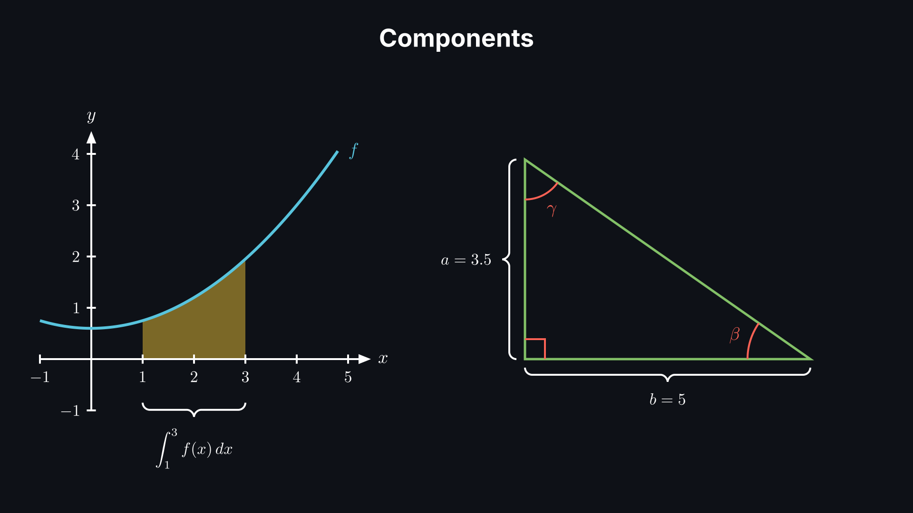
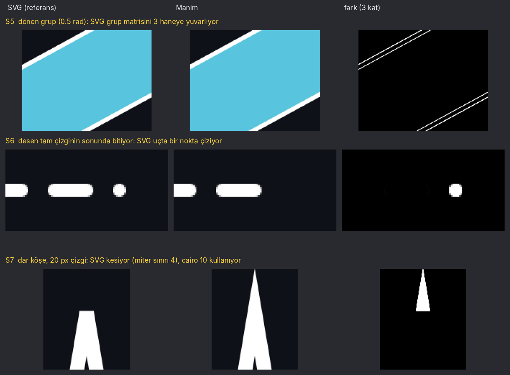
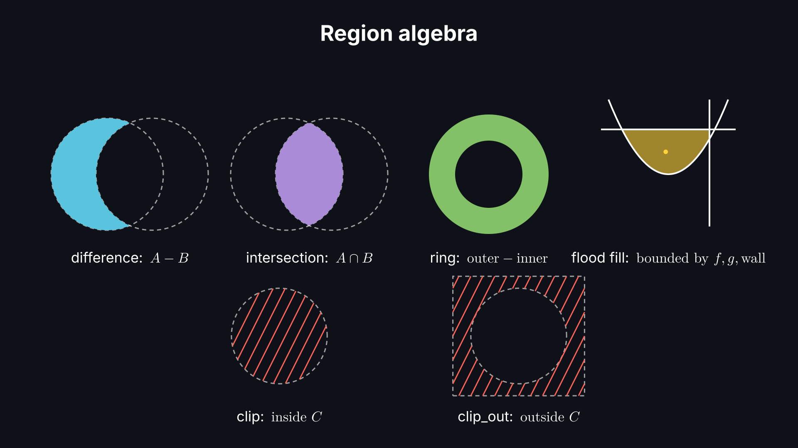
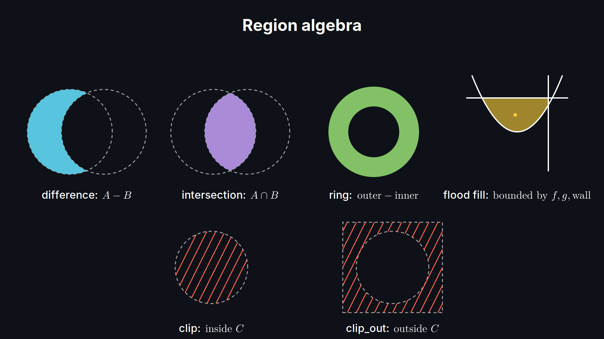
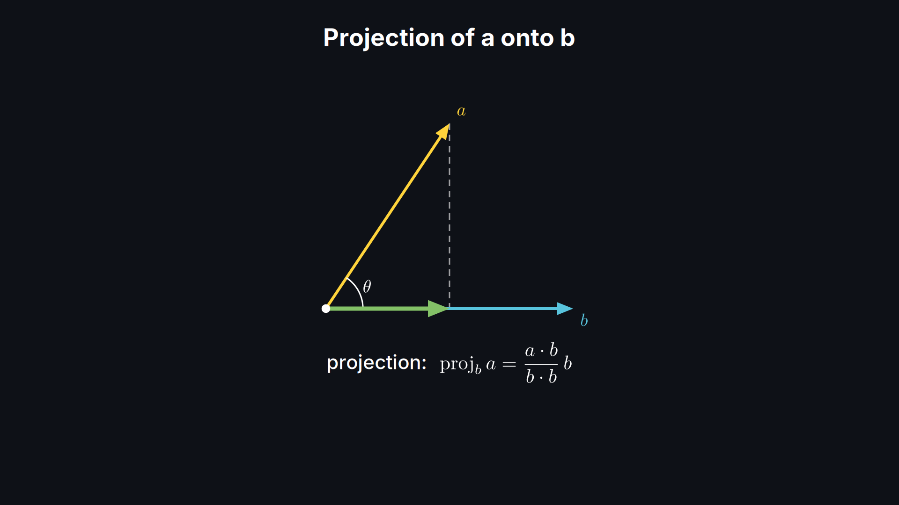
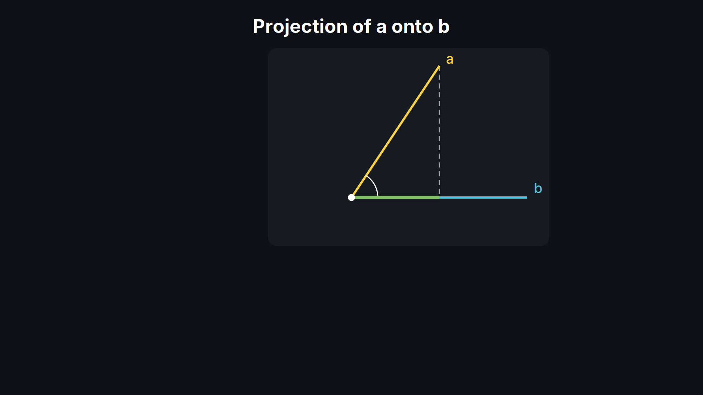

# IR Image Pipeline — Uygulama Planı

> Bu dosya, ekibin plan dokümanının 10 Kasım 2026 tarihli dışa aktarımıdır (14. adım commit'lendikten sonra). Resimler `docs/plan/` altında.

8 Kasım 2026 · Halil

## Amaç ve kapsam

Hedef: bir konu promptundan, kütüphaneden bağımsız bir IR üzerinden resim (frame.png) ve okunur Manim kodu (scene.py) üreten bir Python pipeline'ı. Aşamaları, kontrolleri ve backend'leri kod değiştirmeden eklenip çıkarılabilir olacak.

Mimarinin kaynağı `mimari-analiz.pdf` (3 Kasım 2026, 2. sürüm). Analizin §7'deki 8 kararında önerilen seçenekleri varsayıyorum; itiraz ettiğiniz karar olursa plan ona göre değişir (bkz. Varsayımlar).

İş üç dalgada ilerler:

1. **Deterministik derleyici (LLM yok).** Şemalar, front-end, LIR, SVG ve Manim backend'leri, kontroller, orchestrator. Elle yazılmış bir brief ve `build_ir.py` ile uçtan uca resim.
2. **IR ajanı.** irkit SDK, ajan araçları, sandbox, tur döngüsü ve hata yönlendirme.
3. **Planner ve eval.** Planner'ın yapılandırılmış brief üretmesi, planner'a geri dönüş yolu, alanlar × oranlar eval matrisi.

Şimdilik kapsam dışı: animasyon, 3D projeksiyon (yalnızca kancalar bırakılır: `space.kind`, LIR'de `depth`), görsel eleştirmen, Motion Canvas ve TikZ backend'leri.

Çalışma şekli: her adımın sonunda durur, Adım raporları bölümüne ne yaptığımı, neyi varsaydığımı ve hangi kararı aldığımı yazarım. Sonraki adıma onayınızla geçerim.

## Mimari özeti

Pipeline iki LLM'den (planner, IR ajanı) ve deterministik koddan oluşur: orchestrator, front-end ve backend'ler. Aralarındaki sözleşmeler IR ve LIR; yeni bir kütüphane eklemek yeni bir backend yazmak demektir.



*Anlam ve yerleşim front-end'de; backend'ler yalnızca LIR'i çizer. Vurgulu kutular LLM, diğerleri deterministik kod; kesikli kutu eklenti yuvası, kesikli oklar geri besleme.*

Kesikli oklar geri beslemedir: IR kaynaklı hatalar ajana IR terimleriyle, sığmayan brief planner'a döner. Compiler ya da ortam hatası döngüyü durdurur ve insana bildirilir; ajan Manim traceback'i hiç görmez.

## Tasarım ilkeleri: tak-çıkar yapı

Pipeline, her biri tek bir iş yapan ve yalnızca paylaşılan bir çalışma bağlamı üzerinden konuşan aşamalardan oluşur. Hangi aşamaların, kontrollerin ve backend'lerin çalışacağını kod değil `pipeline.toml` belirler.

### Aşama arayüzü

Her aşama neyi okuduğunu (`requires`) ve neyi ürettiğini (`provides`) bildirir. Pipeline kurulurken bu zinciri doğrular: bir aşama çıkarıldığında ondan beslenen aşama varsa, daha hiçbir şey çalışmadan eksik artıfaktın adıyla hata verir.

```python
class Stage(Protocol):
    name: ClassVar[str]                    # kayıttaki adı, ör. "validate"
    requires: ClassVar[tuple[str, ...]]    # okuduğu artıfakt anahtarları, ör. ("ir",)
    provides: ClassVar[tuple[str, ...]]    # yazdığı artıfakt anahtarları, ör. ("ir_valid",)

    def run(self, ctx: RunContext) -> None: ...
```

`RunContext` artıfaktları (ir, lir, report…), bulunan sorunları (`Issue` listesi) ve ayarları taşır. Aşamalar birbirini import etmez.

```toml
[pipeline]
stages   = ["validate", "normalize", "expand_components", "measure",
            "resolve", "geometry", "lower", "checks"]
backends = ["svg", "manim"]

[checks]
enabled = ["offscreen", "subtitle", "text_overlap", "contrast", "min_text_size"]

[metrics]
provider = "pango"
```

### Beş eklenti noktası

| Eklenti noktası | Yeni bir tane eklemek | Arayüz |
| --- | --- | --- |
| Aşama (stage) | `frontend/` altına bir dosya + `@stages.register` | `Stage.run(ctx)` |
| Bileşen (component) | `components/` altına bir dosya; şeması + çekirdeğe açılan fonksiyon | `expand(obj, ctx) -> list[CoreObject]` |
| Kontrol (check) | `checks/` altına bir dosya; issue kodu kayıtta | `check(lir, ctx) -> list[Issue]` |
| Backend | `backends/<ad>/` paketi; yetenek listesi + çizici | `capabilities`, `render(lir, out_dir)` |
| Metin ölçümü (metrics) | `metrics/` altına bir dosya | `TextMetrics.text(...)`, `.math(...)` |

Beşi de aynı `Registry` sınıfını kullanır. Eklemek bir dosya yazmak, çıkarmak `pipeline.toml`'dan adını silmektir.

### Kod kuralları

- **Sözleşmeler pydantic modelleri.** IR, LIR, brief ve render\_profile birer model; JSON Schema ve spec belgesi bunlardan üretilir.
- **Girdi değiştirilmez.** Her aşama yeni nesne üretir; bir aşama başka bir aşamanın gördüğü veriyi bozamaz.
- **Her sorun bir `Issue`.** Kod, önem, mesaj, JSON yolu, nesne id'leri, ipucu ve yönlendirme kaynağı (ir / capability / internal / environment / infeasible). Kodlar tek bir kayıtta tanımlı.
- **Her modülün başında docstring:** neden var, ne alır, ne verir.
- **Tip ipuçları her yerde;** mypy ve ruff temiz. Dosya başına tek sorumluluk, hedef üst sınır \~300 satır.
- **Testler Manim'siz koşar:** deterministik sahte bir `TextMetrics` sağlayıcısıyla. Manim ve LaTeX isteyen testler ayrı işaretlenir.
- **SEMANTICS.md disiplini:** spec'in açık bıraktığı her davranış oraya yazılır; tüm backend'ler ona uyar.

## Klasör ve modül yapısı

Tek bir `irpipe` paketi, `src/` düzeninde. Klasörler mimarideki katmanlarla birebir eşleşir; bir klasörün içi yalnızca altındaki katmanları import eder. Aşağıdaki ağaç hedef hali; dosyalar ilgili adımda oluşur.

```text
IR-image-pipeline-1.0/
├─ pyproject.toml          bağımlılıklar, ruff/mypy/pytest ayarları
├─ pipeline.toml           hangi aşama/kontrol/backend açık
├─ docs/
│  ├─ SEMANTICS.md         spec'in açık bıraktığı davranışlar
│  └─ spec/                pydantic'ten üretilen JSON Schema + IR spec
├─ examples/               elle yazılmış brief'ler ve build_ir.py örnekleri
├─ tests/                  birim + uçtan uca + backend uygunluk testleri
└─ src/irpipe/
   ├─ core/                stage, context, pipeline, registry, issues, config
   ├─ schema/              render_profile, brief, ir/ (header, objects), lir
   ├─ canvas.py            oran → birim/piksel, güvenli alan, altyazı bandı
   ├─ expr/                güvenli ifade dili (eval yok)
   ├─ metrics/             TextMetrics arayüzü; pango, fixed (test) sağlayıcıları
   ├─ frontend/            validate, normalize, expand, measure, resolve, lower
   │  └─ geometry/         region, flood_fill, clip (shapely)
   ├─ components/          axes, graph, brace, angle… (eklenti)
   ├─ checks/              offscreen, subtitle, text_overlap, contrast… (eklenti)
   ├─ backends/
   │  ├─ base.py           Backend arayüzü + yetenek listesi
   │  ├─ svg/              LIR → frame.svg → frame.png
   │  └─ manim/            LIR → scene.py → frame.png (+ harness)
   ├─ orchestrator/        header kilitleme, ortam kontrolü, run klasörü, yönlendirme
   ├─ irkit/               ajanın build_ir.py'de kullandığı builder SDK
   ├─ agent/               (dalga 2) IR ajanı ve araçları
   ├─ planner/             (dalga 3) planner
   └─ cli.py               irpipe compile / run / check komutları
```

Bir run'ın çıktısı `runs/<id>/` altında analizin §1'deki dosyalarıdır: frame.png, frame.svg, ir.json, scene.py, brief.json, build\_ir.py, lir.json, report.json, meta.json, alt.txt.

## Adım adım uygulama planı

24 adım, 7 faz; ilk resim 7. adımda çıkar. Her adımın sonunda durur, rapor yazar ve onayınızla sonrakine geçerim. Durum sütununu siz de güncelleyebilirsiniz.

Fazlar: F0 temel · F1 ilk resim · F2 front-end · F3 Manim · F4 bileşenler · F5 orchestrator ve SDK · F6 LLM ve eval.

| # | Faz | Adım | Ana çıktılar | Kabul kriteri | Durum |
| --- | --- | --- | --- | --- | --- |
| 0 | F0 | Proje iskeleti | pyproject.toml, .venv, README, ruff/mypy/pytest ayarı | `pytest` ve `ruff check` temiz çalışır | Tamam |
| 1 | F0 | Pipeline çekirdeği | core/: stage, context, pipeline, registry, config; pipeline.toml | İki sahte aşamalı pipeline çalışır; bir aşama çıkarılınca eksik artıfaktı adıyla söyleyen hata | Tamam |
| 2 | F0 | Issue kaydı ve rapor | core/issues.py, report modeli | Her kod tek yerde; allow + gerekçe; READY hesabı testli | Tamam |
| 3 | F1 | render\_profile ve canvas | schema/render\_profile.py, canvas.py | Analizdeki oran tablosunun birim ve pikselleri tutar; pikseller çift | Tamam |
| 4 | F1 | IR 1.0 çekirdek şeması (ilk alt küme) | schema/ir/: header; circle, rect, line, path, text, group | Analizdeki header taslağı doğrulanır; header ve gövde ayrı modeller | Tamam |
| 5 | F1 | LIR şeması + spec üretimi | schema/lir.py; docs/spec/ (IR ve LIR JSON Schema) | Elle yazılmış bir lir.json doğrulanır; şemalar üretilir | Tamam |
| 6 | F1 | validate (ilk hali) + basit resolve | frontend/validate.py, resolve.py | Mutlak konumlu IR → LIR; E-SCHEMA, E-ID, E-REF testli | Tamam |
| 7 | F1 | Backend arayüzü + SVG backend | backends/base.py, backends/svg/ | **İlk resim:** örnek IR → frame.svg ve frame.png | Tamam |
| 8 | F2 | İfade dili + validate'in tamamı | expr/; E-EXPR, E-CYCLE, header hash | "44/17" gibi tam değerler hesaplanır; döngülü referans yakalanır | Tamam |
| 9 | F2 | normalize | renk çözümü, stil kademesi, punto rolleri | tema → sınıf → nesne önceliği testli; beyan edilmemiş renk uyarısı | Tamam |
| 10 | F2 | TextMetrics + measure | metrics/: base, pango, fixed | Ölçümler önbellekli; LaTeX hatası render'dan önce E-TEX olarak döner | Tamam |
| 11 | F2 | Yerleşim | uzaylar (`in`), anchor referansları, place, next\_to, group/stack, etiketler | `v.tip` referansı ve `left_baseline` anchor testli | Tamam |
| 12 | F2 | Geometri çekirdeği | frontend/geometry/: region, flood\_fill, clip / clip\_out | Analizin Şekil 2'sindeki dört örnek doğru çözülür | Tamam |
| 13 | F2 | Kontroller (lint) | checks/: offscreen, safe area, subtitle, text overlap, contrast, min text size… | Her kontrol ayrı dosya; config'den kapatılabilir; report.json yazılır | Tamam |
| 14 | F3 | Yetenek listesi + lowering | frontend/lower.py | Desteklenmeyen özellik basit primitive'lere iner ya da IR terimleriyle hata döner | Tamam |
| 15 | F3 | Manim kod üretici | backends/manim/: scene.py üretimi, render, harness | `manim -s scene.py Frame` çalışır; değişken adları IR id'leri | Tamam |
| 16 | F3 | Backend uygunluk testleri | tests/conformance/ | SVG ve Manim çıktıları tolerans içinde piksel farkıyla eşleşir | Tamam |
| 17 | F4 | Bileşen mekanizması + ilk bileşenler | components/: axes, graph, brace, angle | Bileşen eklemek tek dosya; açıldıktan sonra yalnızca çekirdek nesne kalır | Tamam |
| 18 | F5 | brief ve lesson\_plan şeması | schema/brief.py | Örnek brief doğrulanır; must\_show id'leri benzersiz | Tamam |
| 19 | F5 | Orchestrator | header kilitleme, ortam kontrolü, run klasörü, meta.json, alt.txt, hata yönlendirme | `irpipe run brief.json build_ir.py` tüm çıktı klasörünü yazar | Tamam |
| 20 | F5 | irkit SDK | irkit/ | Örnek build\_ir.py sayıları hesaplayıp geçerli ir.json yazar | Tamam |
| 21 | F6 | IR ajanı | agent/: araçlar, sandbox, tur sınırı, en iyi turun seçimi | Ajan elle yazılmış brief'ten READY resim üretir | Bekliyor |
| 22 | F6 | Planner + geri dönüş yolu | planner/ | Konu promptundan brief üretilir; sığmayan brief planner'a döner | Bekliyor |
| 23 | F6 | Eval + regresyon | eval matrisi; kendi `examples/` örneklerimizle regresyon (K27) | `examples/` altındaki her örnek her değişiklikte derlenir; READY sayısı ve resim farkları raporlanır | Bekliyor |

## Varsayımlar ve açık sorular

Bu varsayımlarla başlıyorum; yanlış olanını yorumla işaretlerseniz planı ona göre değiştiririm.

### Varsayımlar

1. **Analizin §7 önerileri geçerli.** Basit çizici backend'ler, SDK script'i, kilitli header, sıfırdan katmanlı paket, `none / reserve / burn_in` altyazı, font beyaz listesi + tip ölçeği, `lang` header'da.
2. **Proje sıfırdan yazılır.** Önceki denemelere fikir almak için bakılabilir; kodları, adları, örnekleri ve gerekçeleri projeye girmez, kodda ve belgelerde onlara atıf yapılmaz (K26).
3. **Ortam.** Sistemdeki Python 3.14, proje içinde `.venv`. Manim CE 0.22.1'e sabitlenir. Pango 1.57, Cairo 1.18, pdflatex/xelatex ve Inter + DejaVu fontları kurulu; manim, shapely ve cairosvg `.venv`'e kurulacak.
4. **Varsayılan font çifti Inter + Latin Modern** (analizdeki header taslağındaki gibi).
5. **SVG → PNG için cairosvg.** Cairo zaten kurulu; Inkscape daha yavaş.
6. **Geometri için shapely 2.** Bézier eğriler boolean işlemden önce kısa doğru parçalarına bölünür; tolerans SEMANTICS.md'ye yazılır. Eğri korumak gerekirse skia-pathops sonra eklenir.
7. **Kod dili İngilizce, belge dili Türkçe.** Tanımlayıcılar, docstring'ler ve yorumlar İngilizce; plan, raporlar ve dosya açıklamaları Türkçe.
8. **LLM'ler dalga 2'ye kadar yok.** Dalga 1'deki her şey deterministik ve API anahtarı gerektirmez.

### Açık sorular

Bir soruyu işaretlemek, yazılı varsayılanı kabul etmek demek. Farklı bir şey istiyorsanız satırı düzenleyin ya da yorum bırakın; işaretsiz sorularda varsayılanla ilerlemem.

- [x] Her adımdan sonra mı durmalıyım, yoksa faz sonlarında mı? Varsayılan: her adım.
- [x] Klasör git deposu değil. Adım 0'da `git init` yapayım mı? Varsayılan: evet; commit'leri yalnızca siz isteyince atarım.
- [x] Testlerde ve örneklerde varsayılan oran hangisi olsun? Varsayılan: 16:9 ve 9:16 birlikte test edilir.
- [x] İçerik dili Türkçe mi? Hayır içerik dili ingilizce olacak
- [x] Ekipteki diğer makinelerde de Python 3.14 var mı? Varsayılan: en düşük desteklenen sürüm 3.12, geliştirme 3.14'te.
- [x] Dalga 2 için hangi LLM API'si ve anahtarı kullanılacak? Analiz IR ajanı için claude-haiku-5-5'i anıyor; varsayılan: karar dalga 2'ye ertelenir. Api için subscribe olduğumuz claude aboneliğinden çalıştırılacak. claude -p den kullan. Ve kullanırken claude un kendi harnessini değil kendi harnessimizde iyi çalışmasını önemsiyoruz.

## Karar günlüğü

Analizin ötesinde aldığım her karar burada, onayınızı bekleyen "Öneri" durumunda durur. Yeni kararlar en alta eklenir.

| # | Karar | Gerekçe | Durum |
| --- | --- | --- | --- |
| K1 | Paket adı `irpipe`, `src/` düzeni; SDK `irpipe.irkit` alt paketi | Analizdeki irkit adı korunur; tek kurulumla hepsi gelir | Onaylandı |
| K2 | Aşamalar `requires` / `provides` bildirir; pipeline kurulurken zinciri doğrular | Ekle-çıkar güvenli olur; eksik bağımlılık çalışmadan önce görünür | Onaylandı |
| K3 | Beş eklenti noktası (aşama, bileşen, kontrol, backend, metrics) tek `Registry` sınıfıyla | Her eklenti türü aynı kalıpla eklenir; öğrenilecek tek desen | Onaylandı |
| K4 | Pipeline içeriği `pipeline.toml`'dan okunur | Aşama, kontrol ve backend kod değişmeden açılıp kapanır; kullanılan ayar meta.json'a yazılır | Onaylandı |
| K5 | Önce ince bir dikey dilim: ilk resim adım 7'de. Analizin §8 sırasından tek sapma | Arayüzler gerçek kullanımla erken sınanır; önce tüm şemaları yazmak ilk resmi çok geciktirir | Onaylandı |
| K6 | Testler için deterministik sahte `TextMetrics` sağlayıcısı | Birim testleri Manim ve LaTeX olmadan saniyeler içinde koşar | Onaylandı |
| K7 | brief şeması adım 18'e (F5) taşındı | F1–F4'te header elle yazılır; brief yalnızca orchestrator'ın girdisi | Onaylandı |
| K8 | İçerik dili İngilizce: header'da `lang: "en"`, standart LaTeX şablonu | Ekibin kararı (Açık sorular) | Onaylandı |
| K9 | LLM çağrıları `claude -p` ile, Claude aboneliği üzerinden; ajan döngüsü ve araçlar bizim harness'imizde | Ekibin kararı (Açık sorular) | Onaylandı |
| K10 | LLM erişimi bir `LLMClient` arayüzünün arkasında; ilk sağlayıcı `claude -p` (adım 21) | Sağlayıcı değişirse tek dosya değişir; testlerde sahte istemci kullanılır | Onaylandı |
| K11 | Ağır bağımlılıklar katman başına opsiyonel extra: `geometry`, `svg`, `manim` | Çekirdek ve testler hafif kalır; Manim yalnızca onu kullanan makinede gerekir | Onaylandı |
| K12 | Geliştirme komutları `Makefile`'da; her komut `PYTHONPATH`'i temizler | ROS ortamı pytest'i bozuyordu; ekip aynı komutları kullanır | Onaylandı |
| K13 | mypy strict + ruff (E, W, F, I, B, UP, SIM, N, RUF), satır uzunluğu 100 | Arayüzlerin tipleri zorunlu olur; stil tartışması kalmaz | Onaylandı |
| K14 | `Stage` soyut bir taban sınıf (ABC); planda yazan Protocol değil | Eksik `name` ya da yazılmamış `run()` kayıt anında açık hatayla reddedilir; tüm aşamalar tek taban sınıftan bulunur | Onaylandı |
| K15 | `StageContext` bildirilmemiş okuma ve yazmayı anında reddeder; söz verilen her artıfakt tam bir kez yazılmalı | `requires` / `provides` beyanı kodla hiç ayrışmaz; zincir kontrolü bu beyana güvenebilir | Onaylandı |
| K16 | Bir artıfaktın tek üreticisi vardır (girdiler ya da tek bir aşama); hiçbir artıfaktın üzerine yazılmaz | Veri akışı tek yönlü ve izlenebilir kalır | Onaylandı |
| K17 | Artıfaktlar tipli anahtarlarla (`ArtifactKey`) adreslenir; tip hem çalışırken hem mypy ile denetlenir | Aşamanın beyanı veri akışını belgeler; yanlış tipte yazma kod çalışmadan yakalanır | Onaylandı |
| K18 | `pipeline.toml`'daki `plugins` paketleri otomatik yüklenir; paketin içindeki her modül import edilir | Yeni aşama eklemek = pakete bir dosya eklemek + adını `stages`'e yazmak; başka dosya değişmez | Onaylandı |
| K19 | Listede olmayan (kapalı) bir aşamanın `[options.x]` tablosu durabilir; hiç kayıtlı olmayan bir ad yazım hatası sayılır | Aşamayı geçici kapatmak ayarlarını silmeyi gerektirmez; yazım hataları yine yakalanır | Onaylandı |
| K20 | Issue kodları tek bir kayıtta (`ISSUE_CODES`) toplanır; her kod, onu bildiren modülde bir kez tanımlanır (tek bir büyük dosyada değil) | Yeni kontrol eklemek tek dosya olarak kalır; aynı kodu iki kez tanımlamak da kayıtsız bir kodu bildirmek de hata verir; tüm kodların listesi kayıttan okunur | Onaylandı |
| K21 | Önem derecesi kodun harfinden okunur: `E-` hata, `W-` uyarı; başka derece yok | Kodla önem birbiriyle çelişemez; analizdeki E-SUBTITLE adlandırmasıyla uyumlu | Onaylandı |
| K22 | Yönlendirme kaynağı (`origin`: ir, capability, internal, environment, infeasible) her issue'nun değil, kodun özelliği; yalnızca `ir` kökenli uyarılar (W-) `allow` ile kabul edilebilir | Aynı kodlu sorun hep aynı yere gider; hatalar her zaman düzeltilir (READY: hata yok); ajan eksik bir fontu ya da bir compiler hatasını kabul edemez | Onaylandı |
| K23 | Bir aşama ya söz verdiği her şeyi yazar ya da neden yazamadığını bir hatayla bildirir; ikinci durumda pipeline orada durur (`STOPPED`). Çıktısını yazıp hata bildiren aşama (ör. lint) pipeline'ı durdurmaz | Kırık bir IR'de sonraki aşamalar çalışmaz; kadraj dışına taşan bir resim ise yine çizilir ve önizlemede görülür | Onaylandı |
| K24 | `allow` eşleşmesi: kod aynı olmalı ve girdinin adını verdiği her nesne issue'daki bir nesneyi kapsamalı (`v`, `v.label`'ı kapsar). Nesnesiz bir girdi yalnızca nesnesiz sorunları kabul eder, o kodun tamamını değil. | Toptan kabul sorunları sessizce saklayamaz; `allow` gerçek istisnalar için kalır (analiz §5) | Onaylandı |
| K25 | Rapor durumu üç değerli: `READY`, `NOT_READY`, `STOPPED`; sayıları issue listesiyle çelişen bir `report.json` okunurken reddedilir | "Hiç çizilmedi" ile "çizildi ama sorunlu" ayrılır; rapor kendi içinde çelişemez | Onaylandı |
| K26 | Proje sıfırdan yazılır: önceki denemelere fikir almak için bakılabilir, ama kodları, adları, örnekleri ve gerekçeleri projeye girmez; kodda ve belgelerde onlara atıf yapılmaz | Ekibin kararı (9 Kasım). Her kural kendi gerekçesiyle savunulur, başka bir projeye dayanarak değil | Onaylandı |
| K27 | Adım 23'teki 0.1 → 1.0 dönüştürücü ve eski run'larla regresyon plandan çıkar; eval ve regresyon kendi examples/ örneklerimizle yapılır | Dönüştürücü önceki projenin biçimini projeye taşırdı; K26 ile çelişir | Onaylandı |
| K28 | render\_profile'daki uzunluklar (kenar payı, platform payı, punto) referans pikselde: kısa kenar 1080 iken piksel. Birime çeviriyi canvas yapar; 120 katsayısı 9 ve 1080'den türetilir | Aynı profil 1080p'de ve 4K'da aynı resmi verir; analiz katsayının koda gömülmemesini istiyor | Onaylandı |
| K29 | Pikseller bir üst çift sayıya yuvarlanır; birimler yuvarlanmış referans pikselden okunur (birim × 120 = piksel, tam). Çıktı çözünürlüğü yalnızca birim başına pikseli değiştirir | Video kodlayıcıları tek sayı kabul etmez; yukarı yuvarlamak çerçeveyi oranından dar bırakmaz; analizin tablosu (2064, 1528) bu kuralla birebir çıkar | Onaylandı |
| K30 | Oran 1:4 ile 4:1 arasındaki her W:H olabilir, ondalıklı da; hazır liste analizin tablosu. Oranlar kesir olarak tam tutulur | Analiz her W:H'ye izin istiyor; sınır 100:1 gibi saçma boyutları engeller; kesir, kayan nokta yüzünden 1920'nin 1922'ye yuvarlanmasını önler | Onaylandı |
| K31 | Platformlar bir kayıtta (PLATFORMS): plain, tiktok, instagram\_reels, youtube\_shorts ve vertical\_social (üçünün her kenardaki en büyüğü). Arayüz payı olan bir platform yalnızca kendi oranını kabul eder | Yeni platform tek kayıt satırı; paylar o oranda ölçüldü, başka oranda anlamsız | Onaylandı |
| K32 | Altyazı bandı = satır × satır aralığı × caption + bir caption dolgu. Alt kenar payı ile platform alt payının hemen üstünde, yan paylar arasında durur; güvenli alan bandın üstünde biter | Analiz §2.2: yükseklik sabit olmasın, hesaplansın; konumunu platform belirlesin | Onaylandı |
| K33 | Tip ölçeği bir hazır ayar (compact, comfortable, large) ya da {base, ratio}. İkincisinde her rol bir oran adımı: caption = base / r², label = base / r, heading = base · r, title = base · r² | Analiz §2.5: planner tek punto değil bir ölçek seçer, rollerin puntosunu kod hesaplar | Onaylandı |
| K34 | Yalnızca aspect zorunlu. Varsayılanlar: kenar payı 48 px, altyazı none, platform plain, arka plan #0E1117, font Inter + Latin Modern, dil en | Analizin header örneği ve ekip kararı K8; oran her resimde bilinçli seçilmeli | Onaylandı |
| K35 | ir.json analizdeki taslak gibi tek ve düz bir nesne. Header (IRHeader) ve gövde (IRBody) yine ayrı modeller, IRDocument ikisini birleştirir; hiçbir alan ikisine birden ait değil | Taslak düz; header'ı orchestrator, gövdeyi ajan yazar; ileride header hash'i yalnızca header alanlarını kapsar | Onaylandı |
| K36 | Her şeyin tek bir yazılışı var: path yalnızca başlangıç noktası + parçalar (line, quad, cubic), nokta listesi kısayolu yok; renk "#RRGGBB" ya da \[r, g, b\], alfa yok | Analiz §2.4: aynı şey iki yoldan söylenemesin. Çoklu doğru gibi kısayollar SDK'da (adım 20) | Onaylandı |
| K37 | Yazılmayan boya alanları miras alınır: tema → stil sınıfları (sonra yazılan kazanır) → nesne. "none" açıkça boya yok demek ve bir renk adı olamaz | Analiz §2.8: CSS gibi kademe. "none", bir sınıfın verdiği dolguyu kapatmanın tek yolu | Onaylandı |
| K38 | Alan adları: color (çizgi ve metin rengi), fill, fill\_opacity, opacity; stroke\_width ve dash referans pikselde; size rol adı ya da px; line start/end; text at + anchor (12 ad); circle center/radius; rect center/width/height/corner\_radius | Analizin örnekleri ("color": "a", "fill", "size": "label", left\_baseline) ve LIR'in ayrı dolgu ve çizgi opaklığı | Onaylandı |
| K39 | group: çocuklar id ile verilir. Dönüşüm önce ölçek, sonra döndürme (derece, saat yönünün tersine), ikisi de pivot etrafında; en son öteleme. Grup opaklığı her çocuğa çarpılır. matrix ve clip sonraki adımlarda | Analiz §2.8 ve §2.4; sıra SEMANTICS.md'de sabit, backend'ler ayrışamaz | Onaylandı |
| K40 | Bu alt kümede ifade ("44/17"), anchor referansı ("v.tip"), uzaylar (in), etiket, ok ucu ve math yok; tipler 8. ve 11. adımda genişler. Space şimdilik yalnızca id + kind | Plan: ilk alt küme; 7. adımdaki ilk resim için yeterli | Onaylandı |
| K41 | LIR'de konumlar birimde, çizgi kalınlığı ve punto referans pikselde. Canvas (birim, çıktı pikseli, arka plan) LIR'in içinde; backend ölçek katsayılarını ondan türetir | IR ile aynı birimler; analiz katsayının koda gömülmemesini istiyor; lir.json tek başına çizilebilir | Onaylandı |
| K42 | LIR tamamen çözülmüş: renkler yalnızca hex, opaklıklar son hali, grup opaklığı ve clip yok, metin kutuları ölçülmüş. En üst öğeler yalnızca grup; her IR nesnesi bir grup, id'ler tekil, parçalar noktalı id alır | Analiz §3: backend'ler arası fark sonuca yansımasın; geri bildirim, kod ve animasyon nesneyi id'siyle bulsun | Onaylandı |
| K43 | Çizim sırası liste sırasıdır. Front-end z'ye göre sıralar; kardeş gruplarda z azalırsa LIR reddedilir | "Backend sırayı değiştirmez" kuralı kontrol edilebilir olur | Onaylandı |
| K44 | Grup dönüşümü altı sayılı afin matris \[a, b, c, d, e, f\] (SVG sırası); varsayılan birim matris | Ölçek, döndürme ve ötelemenin hepsi tek biçimde; SVG doğrudan, Manim apply\_matrix ile kullanır | Onaylandı |
| K45 | LIR, IR şemasından hiçbir şey import etmez; kendi geometri tiplerini tanımlar. Bir test bunu denetler | IR büyüdükçe (ifade, referans) backend'lerin okuduğu biçim değişmez | Onaylandı |
| K46 | Spec: ir, lir, render\_profile ve report için JSON Schema docs/spec/'te, make spec ile üretilir. Dosya eskiyse test kalır; yayımlanan şemaları jsonschema (yalnız geliştirme) gerçek örneklerle sınar | Modeller tek doğruluk kaynağı kalır; şema dosyası koddan ayrışamaz | Onaylandı |
| K47 | Aşamalar arası veri anahtarları tek bir modülde (irpipe/artifacts.py): ir\_source (metin) → ir → lir. Aşamalar birbirini değil, bu anahtarları import eder | requires / provides veri akışını okunur yapar; bir aşama çıkarılınca başka bir aşamanın kodu kırılmaz | Onaylandı |
| K48 | validate'in sırası: JSON → şema → adlar; sorun bulunan ilk tür pipeline'ı durdurur. Bozuk bir allow girişi (E-ALLOW) durdurmaz | resolve var olmayanı çizemez; bozuk bir allow ise resmi çizmeye engel değil, yalnızca READY olmasına engel | Onaylandı |
| K49 | Yeni kodlar: E-JSON, E-SCHEMA, E-ID, E-REF (nesne, stil ve renk adları) ve E-GROUP (paylaşılan çocuk, döngü, grupta def). Her biri onu bildiren modülde tanımlı (K20) | Renk adı için ayrı kod yerine E-REF; grup yapısı için E-GROUP. Döngü kodu E-CYCLE 8. adımdaki ifadelere kalıyor | Onaylandı |
| K50 | Pydantic hataları ajanın diline çevrilir: JSON yolu (objects\[3\].radius), "did you mean" önerisi; birden çok biçimi olan alanda tek issue + izin verilen biçimler; yalnızca bir yan etki olan "çok kısa" hataları atılır | Analiz: her hata IR terimleriyle dönsün; ajan bir hatayı bir kez, kendi dosyasının diliyle görsün | Onaylandı |
| K51 | Boya kademesi ve renk çözümü 9. adımdan öne alındı (frontend/paint.py): tema varsayılanları (arka plana göre beyaz ya da siyah, 4 px çizgi, dolgu yok, body punto) → sınıflar → nesne; mix = kanal ortalaması | LIR çözülmüş renk istiyor; yarım bir hal yazıp 9. adımda yeniden yazmak boşa iş olurdu | Onaylandı |
| K52 | Metin ölçümü arayüzü (TextMetrics, METRICS kaydı) ve fontsuz "fixed" sağlayıcı 10. adımdan öne alındı; resolve hangisini kullanacağını pipeline.toml'dan okur | LIR ölçülmüş metin kutusu istiyor; Pango, measure aşaması ve önbellek 10. adımda kalıyor | Onaylandı |
| K53 | Bir gruptaki nesne grubun içinde, grubun listedeki yerinde çizilir. Hiçbir şey boyamayan bir nesne boş bir grup olarak kalır | "Dizi sırası çizim sırası" kuralının gruplara uzanışı; nesnenin id'si LIR'de kaybolmaz | Onaylandı |
| K54 | IR çekirdeğine ellipse, polygon, polyline, arc, sector ve regular\_polygon eklendi. Her şekil front-end'de path'e çevrilir ve LIR'e adıyla ipucu olarak geçer. Açılar derece, saat yönünün tersine; regular\_polygon düz bir alt kenar üstünde durur; açık şekiller dolgu almaz. K36'nın "tek yazılış" kuralı daraldı: adı olan bir şekil, path'in de çizebileceği bir figürü anlatır | Ekibin isteği (10 Kasım). Backend şekil değil path gördüğü için yeni şekil backend'den destek istemez; adı olan şekil anlam taşır (okunur kod, kontroller, ajan için kolaylık) | Onaylandı |
| K55 | Backend arayüzü: BACKENDS kaydı. Her backend bir yetenek listesi (quadratic, cubic, dash, evenodd, transform, text, math, image) ve render(lir, out\_dir) → dosyalar + issue'lar sunar. Ayarları \[options.render.\<ad>\] tablosundan gelir; yazım hatası reddedilir | Analiz §3: yetenek listesi + çizici; yeni bir backend tek bir paket | Onaylandı |
| K56 | Tek bir "render" aşaması backend'i pipeline.toml'dan seçer ve çizmeden önce LIR'i yeteneklere karşı denetler. Çizilemeyecek bir özellik E-CAPABILITY olur: özellik ve nesne id'leri yazılır, backend adı geçmez; hiçbir şey çizilmez | İndirme (14. adım) gelene kadar bir emniyet; analiz: ajan backend adını görmesin | Onaylandı |
| K57 | Çıktı klasörü pipeline'a bir girdi (out\_dir); render dosyaları oraya yazar ve klasör yoksa açar | Hangi klasöre yazılacağına aşama değil, orchestrator karar verir (19. adım) | Onaylandı |
| K58 | SVG backend: frame.svg çıktı pikselinde (y aşağı), her IR nesnesi \<g id> + data-source; frame.png cairosvg ile aynı boyutta. cairosvg yoksa E-ENVIRONMENT, ama frame.svg yine yazılır | SVG bir insanın açıp okuyabileceği sayılarla dursun; PNG eksikliği vektör çıktıyı engellemesin | Onaylandı |
| K59 | Yeni kodlar: E-CAPABILITY (köken capability) ve E-ENVIRONMENT (köken environment), backends/base.py'de | Analizdeki yönlendirme tablosunun iki satırı; ikisi de ajanın değil, başkasının çözeceği sorunlar | Onaylandı |
| K60 | irpipe render komutu ve make render (geliştirici aracı): pipeline.toml'u çalıştırır, runs/\<ad>/ altına frame.svg, frame.png, lir.json ve report.json yazar, raporu basar; READY ise 0, değilse 1, kendisi çalışamazsa 2 döner | Ekip bir IR'yi tek komutla deneyebilsin; tam run klasörü 19. adımda | Onaylandı |
| K61 | İfade dili sympy'nin yazdığı biçim: sayılar, + - \* / \*\*, parantez, pi, E ve sqrt, sin, cos, tan, asin, acos, atan, atan2, exp, log, Abs, Min, Max. Kendi ayrıştırıcımız okur; eval yok | Ajan tam değerleri sympy ile hesaplıyor (analiz §4), çıktısı doğrudan geçerli olur; IR veri olarak kalır | Onaylandı |
| K62 | Tam aritmetik: kesirlerle + - \* / ve tam sayı üsleri tam kalır (0.1 + 0.2 = 3/10, 44/17·17 = 44); pi, fonksiyonlar ve diğer kökler float olur; saklanan değer en yakın float | Analiz: tam değerler için ifade dili; zincirleme hesap yuvarlamayla kaymaz | Onaylandı |
| K63 | Yalnızca geometri sayıları ifade olabilir (konum, yarıçap, boyut, açı, döndürme, grup dönüşümü). Diğer her sayı JSON sayısı olmak zorunda; metin sayıya çevrilmez, boolean yalnızca true/false. Ajanın ir.json'u JSON modunda katı doğrulanır | Tek yazılış: "0.5" sessizce kabul edilip "1/2" reddedilmesin | Onaylandı |
| K64 | Gövdeye bir values tablosu: ifadelerin kullanabileceği adlı sayılar. Birbirini herhangi bir sırada kullanabilir, birbirleri arasında tam kalır; döngü E-CYCLE; sabit ya da fonksiyon adı alınamaz | Planın "döngülü referans yakalanır" kriteri adlı değer gerektiriyor; IR kendi sayılarını açıklar | Onaylandı |
| K65 | İfadeler validate'te hesaplanır; sonraki aşamalara giden IR yalnızca düz sayı taşır. Yeni kodlar: E-EXPR ve E-CYCLE; bir alanda hem ifade hem başka biçim hatalıysa ifade hatası bildirilir | resolve ve backend'ler ifade bilmek zorunda kalmaz; hata, alanın JSON yoluyla döner | Onaylandı |
| K66 | Header hash'i: doğrulanmış header'ın sıralı anahtarlı JSON'unun SHA-256'sı. check\_header aşaması kilitli header'la karşılaştırır; E-HEADER değişen alanları sayar. Varsayılan pipeline'da yok, orchestrator ekler | Analiz §1: header hash ile kontrol edilsin; ajan neyi geri koyacağını bilsin | Onaylandı |
| K67 | normalize ayrı bir aşama (validate → normalize → resolve). Her nesnenin boyası açıkça yazılır (hex renk ya da "none", opaklık, çizgi kalınlığı, dash, metinde px punto), stil sınıfları kalkar; resolve boyayı yalnızca nesneden okur. Yeni artıfakt: ir\_normal | Planın 9. adımı; sonraki aşamalar (ölçüm, bileşenler, kontroller) header'ın adlarını bilmek zorunda kalmaz; aşama çıkarılırsa zincir resolve'u adıyla durdurur | Onaylandı |
| K68 | Header'a theme: metin rengi, çizgi rengi ve çizgi kalınlığı (varsayılan 4 px). Renk verilmezse arka plana göre beyaz ya da siyah. Render profile'ın teması da aynı alanları taşır | Analiz §2.8: tema = arka plan, varsayılan metin ve çizgi rengi, çizgi kalınlığı; 6. adımda bunlar koddaki sabitlerdi | Onaylandı |
| K69 | W-UNDECLARED-COLOR: nesneye doğrudan yazılan renk (hex ya da \[r, g, b\]) uyarı verir ve allow ile kabul edilebilir. Header renkleri, extra\_colors, "none" ve header'ın stil sınıflarındaki renkler uyarı vermez | Analiz §2.4: doğrudan renk serbest kalsın ama uyarı versin; "bir kavram, bir renk" ilkesi | Onaylandı |
| K70 | Metin ölçücü "pango": pangocffi ile sistemin Pango'su, Manim'in kullandığı motor. İpucu ve glif konumu yuvarlama kapalı; kutu fontun mantıksal kutusu (her metin aynı yükseklikte). Yeni geliştirme paketi: pango | Analiz §3: ölçüm hedef backend'in motoruyla yapılsın; pangocffi derleme istemiyor | Onaylandı |
| K71 | Formüller front-end'de LaTeX + dvisvgm ile dizilir: \\displaystyle, 10 pt, header'ın matematik fontu (şimdilik yalnızca latin-modern). Glif çizimleri LIR'e gider; kutu gliflerin mürekkep kutusu | Analiz §3: LaTeX hatası render'dan önce yakalansın, LaTeX'i olmayan bir backend de formülü çizebilsin; Manim 15. adımda aynı şablonu kullanacak | Onaylandı |
| K72 | measure ayrı bir aşama (normalize → measure → resolve); ölçücü seçimi \[options.measure\]'a taşındı. resolve ölçmez, ölçümleri okur | Analizdeki front-end sırası; önbellek ve hata bildirimi tek yerde | Onaylandı |
| K73 | E-TEX: LaTeX'in kendi mesajı ve formülde durduğu yer, şablon gösterilmez; koşu measure'da durur. Ölçücü ya da LaTeX yoksa E-ENVIRONMENT ve koşu durur; metin fontu yoksa E-ENVIRONMENT ama yedek fontla devam edilir | Ajan yalnızca kendi yazdığı TeX'i görsün; eksik font resmi engellemesin ama READY olmasını engellesin | Onaylandı |
| K74 | Ölçüm önbelleği: her ölçüm bellekte, formüller ayrıca diskte (\~/.cache/irpipe/metrics; cache\_dir ile değişir). Dosyalar atomik yazılır, kilit gerekmez | Bir formülü dizmek yaklaşık 0.4 saniye sürüyor; ajan aynı formülleri her turda yeniden ölçer | Onaylandı |
| K75 | IR'ye math nesnesi (tex, at, anchor, size, color) 11. adımdan öne alındı; metin gibi yerleştirilir | 10. adımın E-TEX kriteri bir formül nesnesi gerektiriyor | Onaylandı |
| K76 | Bir nokta \[x, y\], "id.anchor" ya da {"on": id, "t"\|"x"} olabilir. Anchor sözlüğü: her nesnenin kutusunun 9 noktası; metin, formül ve stack'e 3 taban çizgisi noktası; açık şekillere start, end, mid (tip ve tail eş adlar); center alanı olan şekillerde center o alan. Zone'lar, frame ve safe de referans hedefi; frame ve safe id olamaz | Analiz §2.3: anchor referansları; tek bir nokta söz dağarcığı hem metin anchor'larında hem referanslarda kullanılıyor | Onaylandı |
| K77 | Referans resimde okunur: iki nesne hangi uzay, grup ya da stack'te olursa olsun nokta tam anchor'a düşer; place her referansı onu tutan nesnenin kendi koordinatlarına çevirir. Tek istisna: grubun pivot'u kendi içindekine referans verirse grubun içeriğinde okunur | Analiz §2.3: bir nesne oynatılınca ona bağlı her şey birlikte hareket etsin | Onaylandı |
| K78 | Uzay ("in"): origin ve unit (tek sayı ya da \[ux, uy\]). Noktaları ve uzunlukları eşler; çizgi kalınlığını ve puntoyu eşlemez. resolve noktaları doğrudan eşler, grup dönüşümü gibi çizimi ölçeklemez; iki farklı ölçekte daire elips olur. origin bir referans olabilir | Analiz §2.3: matematik nesneleri kendi koordinat sisteminde tarif edilsin; §5: kind 3D için yer tutuyor | Onaylandı |
| K79 | Metin, formül ve stack üç yoldan yerleşir: at ve anchor; at ve dir (noktanın yanında); next\_to ve dir (bir nesnenin ya da zone'un yanında). Yanında: noktadan ya da kutunun merkezinden dir yönündeki ışın üzerinde, aralarında gap (varsayılan 0.2 birim). dir bir ad, derece cinsinden açı ya da \[dx, dy\] | Analiz §2.3: metin bir anchor noktasından konumlansın, yön adı, 135 ya da \[dx, dy\] olabilsin, next\_to opsiyonel kalsın; tek kural her açıda aynı çalışıyor | Onaylandı |
| K80 | stack ayrı bir tip: column, row ya da grid (columns ile); spacing; align bir anchor adı, baseline dahil. Stack'in taban çizgisi ilk çocuğununki; yerleştikten sonra düz bir grup olur. Bir nesne en fazla bir gruba ya da stack'e girer | Analiz §2.8: group her nesneyi alıp dönüştürsün, stack satır, sütun ya da ızgara yerleşimi yapsın | Onaylandı |
| K81 | label şekillerin bir alanı: text ya da tex, at (sahibinin noktası), dir, gap. Normalize'da \<id>.label nesnesine açılır; sahibinin rengini, opaklığını ve z'sini alır, punto label. Sahibi bir gruptaysa o grupta, değilse her şeyin üstünde çizilir | Analiz §2.7: label çekirdekte; rengi tekrar yazmak gerekmesin, etiketin kimliği sahibine bağlı kalsın | Onaylandı |
| K82 | Ok uçları: line, polyline, arc ve path'te arrows: \["start", "mid", "end"\], arrow\_size px. Çizgi renginde dolu üçgen; çizgi ok ucunun içinde biter. LIR'de ayrı bir dolu path, yeni yetenek gerekmez. Line ve polyline ipucunu korur, diğerleri ipucusuz gider | Analiz §2.7: marker (eğrinin ortasındaki ok ucu dahil) çekirdekte | Onaylandı |
| K83 | Yeni aşama place (measure ile resolve arasında, çıktısı ir\_placed). Konumlar ihtiyaç anında hesaplanır; döngüler E-CYCLE. Yeni kod E-PLACE: yeri olmayan kutu, kendi yerini veren stack çocuğu, eğrinin hiç ulaşmadığı x | resolve yalnızca çizsin; ajan nesneleri istediği sırayla yazabilsin; yerleşim hataları kendi adıyla dönsün | Onaylandı |
| K84 | shapely (GEOS) çekirdek bağımlılık; geometry extra'sı kaldırıldı, types-shapely geliştirme bağımlılığı | Analiz §2.6 bölge cebirini front-end'in geometri çekirdeğine koyuyor; her IR kullanabilir. Extra olarak kalsa çekirdek bir özellik çalışma anında E-ENVIRONMENT ile düşerdi | Onaylandı |
| K85 | region nesnesi ve ifade dili: id, union, intersection, difference (ilki eksi diğerleri), xor, half\_plane (p'den q'ya giden çizginin solu), under, between; iç içe yazılır. Operandlar içi olan nesneler (kapalı şekil, region, flood\_fill); grafik ve sınır her şekil olabilir | Analiz §2.6 tablosu: union, intersection, difference, xor; yarı düzlem, grafiğin altı, iki grafik arası | Onaylandı |
| K86 | Alanları place hesaplar ve nesnenin kendi koordinatlarında even-odd, delikli bir path olarak yazar. Bölgenin anchor'ı ve etiketi olur, başka bir bölgenin operandı olabilir. Boş çıkan bölge W-EMPTY-REGION (allow edilebilir) | Analiz §2.6: sonuç backend'e hazır path olarak gitsin; referanslar ve etiketler bölgelerle de çalışsın | Onaylandı |
| K87 | flood\_fill: sınır çizgileri kesiştikleri yerlerden düzlemi yüzlere böler, tohumun yüzü boyanır; açık çizgiler serbest. Tohum bir çizginin üstündeyse (hangisi olduğu söylenir) ya da yüz kapanmıyorsa E-REGION | Analiz §2.6: boya kovası; sınırlar kapalı olmak zorunda değil; anlaşılır hata (E-REGION) | Onaylandı |
| K88 | clip ve clip\_out her nesnede ve grupta. place kırpmayı \<id>.clip def'ine (çerçevede bir path) yazar; resolve dolguyu ve çizgiyi ayrı ayrı geometrik olarak keser; tamamen içerideki şekil olduğu gibi kalır. Metin ve formül bütün çizilir, W-CLIP-TEXT (allow edilebilir) | Analiz §2.6: yumuşak maske değil geometrik kırpma; metin kırpılmaz, uyarı verilir. Backend'ler arası fark sonuca yansımasın | Onaylandı |
| K89 | Alanlar düz parçalarla hesaplanır (çeyrek daire başına 64). Bir şeklin içi dolgu kuralına SVG'deki gibi uyar: alt yolların kestiği yüzlerin sarım sayısına bakılır | shapely/GEOS doğrusal çalışıyor; hata piksel altı. Sarım sayısı kesişen alt yollarda ve saat yönünde çizilmiş şekillerde de doğru sonuç veriyor | Onaylandı |
| K90 | region ve flood\_fill varsayılan olarak çerçevelenmez; color verilmezse çizgisi yok | Bunlar alan, çizgi değil; analizin Şekil 2'si de çerçevesiz | Onaylandı |
| K91 | Bir grafiğin x'i ve y = 0'ı grafiğin kendi koordinatlarında; grafik x0'a ilk vardığı noktadan x1'e ilk vardığı noktaya okunur | Uzaylarla (K78) uyumlu: grafik bir eksen uzayındaysa integral alanı o eksene oturur | Onaylandı |
| K92 | Kontroller bir eklenti noktası: irpipe/checks/ altında her kontrol ayrı dosya, kodları yanında kayıtlı, CHECKS kaydı, Check.check(picture) ve doğrulanan bir ayar modeli. check aşaması resolve ile render arasında; lir ve ir\_normal okur, checked yazar | Plandaki beş eklenti noktasından biri (check(lir, ctx) -> list\[Issue\]); analiz: lint'ler LIR üzerinde çalışsın | Onaylandı |
| K93 | Hangi kontrollerin çalışacağına pipeline.toml karar verir: \[options.check\] checks listesi (sıra; adı silmek kapatır; liste yoksa hepsi) ve her kontrolün \[options.check.\<ad>\] tablosu. Yanlış yazılmış ad ya da ayar reddedilir, ad için "did you mean" ile | Kabul kriteri: config'den kapatılabilir; aşamalar ve backend'lerle aynı kalıp | Onaylandı |
| K94 | Kontrol bulguları koşuyu durdurmaz: aşama çıktısını yazar, resim yine çizilir, READY kararını rapor verir. E-SUBTITLE hata; diğerleri allow edilebilir uyarı, W-MISSING-GLYPH hariç (boş kutu hiçbir zaman istenen şey değil) | Analiz: ajan lint ve önizlemeyi birlikte görür; altyazı bandına çizmek hata; uyarılar gerekçeyle kabul edilebilir | Onaylandı |
| K95 | Kontroller çizilen LIR'e bakar: Picture onu bir kez düzleştirir (grup dönüşümleri uygulanmış, çerçevede shapely geometrisi, çizen nesnenin id'si ve JSON yolu). IR yalnızca ilişkiler ve header (güvenli alan, altyazı bandı) için okunur | Analiz §6: kontroller ayrı bir simülatörde değil, gerçekten çizilen geometri üzerinde çalışsın; bulgular IR diliyle dönsün | Onaylandı |
| K96 | Kasıtlı ilişki: biri ötekine referansla yerleşmiş ("v.tip", on, next\_to), ötekinden kurulmuş (bölge operandı, flood\_fill çizgisi, clip) ya da ikisi aynı grupta veya stack'te. İlişkili nesnelerin dolgu örtüşmesi bildirilmez; okunabilirlik kontrolleri (metin örtüşmesi, metni kesen çizgi, kontrast) ilişkiye bakmaz | Analiz §5: kasıtlı temas referanslardan çıkar; muafiyet temas ve örtüşme uyarısını kaldırır ama metni okunmaz yapan çizgi yine raporlanır | Onaylandı |
| K97 | Eşikler (hepsi pipeline.toml'dan değişir): kontrast WCAG AA 4.5:1, 48 px'ten büyük metinde 3:1; en küçük punto 28 px; ΔE00 en az 10; dolgu örtüşmesi küçüğün %2'si ile %98'i arası; metni kesen çizgi kutunun onda biri küçültülmüş halinin içinde 0.02 birimden uzun | WCAG AA metin standardı; caption 34 px olduğu için 28 altı okunmaz; ΔE 10 bir bakışta ayırt edilir; %98 üstü katmanlama | Onaylandı |
| K98 | Renk hesabı tek yerde: irpipe/colormath.py (WCAG parlaklık ve kontrast, karışım, D65 Lab, CIEDE2000; yayımlanmış test çiftleriyle doğrulandı). paint.py de buradan alır. Metnin arkasındaki renk: arka plan ve metinden önce çizilen dolgular, opaklıklarıyla | Analiz §2.4: kontrast metnin altındaki gerçek renge göre; kavram renkleri ΔE ile ayırt edilebilir olsun | Onaylandı |
| K99 | Font kapsamı fontconfig'e sorulur (metrics/fonts.py): Pango'nun o aile için seçeceği fontta olmayan karakter W-MISSING-GLYPH. fontconfig yoksa bir şey bildirilmez | Analiz §2.5: font kapsama kontrolü; 12. adımın örneğinde "∩" boş kutu olarak çıkmıştı | Onaylandı |
| K100 | Lowering render aşamasının içinde, backend çizmeden hemen önce çalışır; kodu frontend/lower.py'de saf fonksiyonlar. lir.json backend'den bağımsız kalır | Backend yalnızca \[options.render\] backend'de seçiliyor; ayrı bir aşama aynı seçimi ikinci kez isterdi ve iki yer birbirini tutmayabilirdi. Analiz §3: front-end bağımsız LIR'i üretir, indirme ayrı bir adım | Onaylandı |
| K101 | math yeteneği: formül öğesini çizmek, TeX'i kendisi dizmek. Her formül bunu ister; dizemeyen backend'e formül glif çizimi olarak iner. SVG writer formül çizmez | Analiz §3: formül → glif path'leri bir indirme; tek yol olsun diye writer'daki kopya kalktı | Onaylandı |
| K102 | İndirme kuralları: kübik → kuadratik, olmazsa doğru (0.001 birim içinde); kuadratik → kübik (birebir), olmazsa doğru; kesik çizgi → her kesik bir path, SVG'nin dizdiği gibi; even-odd → alt yolları çevrilmiş nonzero, kesişenler çokgen olarak yeniden; grup dönüşümü çocuklara uygulanır, çizgi kalınlığı alan çarpanının kareköküyle ölçeklenir | Analiz §3 örnekleri; resim değişmesin diye her kural geometriyi korur ya da görünmez bir tolerans içinde kalır | Onaylandı |
| K103 | İndirilemeyen IR terimleriyle bildirilir (nesnenin id'si ve JSON yolu, backend adı asla) ve hiçbir şey çizilmez: metin çizemeyen yerde metin, dönüşüm çizemeyen yerde dönen metin, çizimsiz formül ya da görsel, görsel çizemeyen yerde görsel E-CAPABILITY. TeX dizemeyen yerde glif çizimi olmayan formül E-ENVIRONMENT (ölçücü dizmeden ölçmüş) | Analiz §1 ve §3: yetenek sorunları ajana backend adı geçmeden döner; ortam sorunları insana gider | Onaylandı |
| K104 | Manim backend'inin yetenekleri: cubic, transform, text, math. Kuadratik eğri, kesikli çizgi ve even-odd dolgu ona lowering ile basitleşmiş gelir; görsel (image) şimdilik yok | Manim'in cairo kamerası yalnızca nonzero dolduruyor ve kesikleri SVG'nin desenine göre dizmiyor; IR'de henüz görsel nesnesi yok | Onaylandı |
| K105 | scene.py'de her IR nesnesi bir `make_<id>()` fonksiyonu, üstünde `# ir: <yol> id=<id>` yorumu. `construct` döneni id'siyle aynı adlı değişkende tutar; başka nesneleri tutan nesne onları argüman olarak alır. Python adı olamayan id en az değişiklikle çevrilir: `a.label` → `a_label`, `class` → `class_`, çakışmada `_2` | Analiz §3: değişken adları IR id'leri olsun; harness her nesneyi tek başına çağırabilsin | Onaylandı |
| K106 | Şekil ipucu (`Circle`, `Line`, `Arc`…) yalnızca yolun tamamını anlatırken kullanılır: kapalı şekilde tek kapalı alt yol, açık şekilde şeklin kendi uçlarıyla tek açık alt yol. Değilse yol nokta nokta çizilir | Manim yolun noktalarını değil ipucunun şeklini çizer; ikisi ayrışırsa resim değişir (bkz. berkerdnmz cihazında bulunan sıkıntılar, 1. madde) | Onaylandı |
| K107 | Metin Manim'in `Text`'iyle, `font_size` = 0.6 × px olarak yazılır ve mürekkep kutusunun merkezine taşınır. Kutu, front-end'in Pango ayarlarıyla backend'de ölçülür (`backends/manim/ink.py`) | Manim metnin taban çizgisini tutmuyor; Manim'in çizdiği glifler Pango'nun mürekkep kutusunu %0.1 içinde dolduruyor. Ölçümün asıl yeri front-end olurdu, ama o 5. ve 10. adımları değiştirmek demekti | Onaylandı |
| K108 | Formül `MathTex` ile, front-end'in kendi TeX şablonuyla (`TexTemplate.body`, `tex_environment=None`) yazılır; `font_size` = 0.803 × px, sonra LIR kutusuna taşınır | K71: formül ölçüldüğü gibi dizilsin. Genişlik ve yükseklik ölçümle 5 haneye kadar tutuyor | Onaylandı |
| K109 | Çizgi kalınlığı px / 1.2 yazılır (Manim'de 1 kalınlık 0.01 birim). Grup dönüşümü `apply_matrix` ile uygulanır; çizgi kalınlıkları alan çarpanının kareköküyle ölçeklenir | Katsayı 120 px/birim ve Manim'in 0.01'inden türer; ölçekleme lowering'in kuralıyla aynı | Onaylandı |
| K110 | frame.png'yi ayrı süreçte bir harness çizer: önce her nesneyi tek başına kurar, sonra `Frame`'i `manim -s` gibi çizer. Yeni kod E-DRAW (köken internal); eksik araç E-ENVIRONMENT. Hata olsa da scene.py yazılır; harness'e giden yollar hep mutlak | Analiz §3'teki harness; Manim'in global config'i pipeline'a karışmasın; run klasörü göreli olabilir (runs/<ad>) | Onaylandı |
| K111 | Varsayılan backend `manim`; SVG referansı `backend = "svg"` ile seçilir. Bir koşuda tek backend çalışır, iki backend'in aynı run klasörüne yazması 19. adımda | Ekibin kararı (10 Kasım). `make venv` artık Manim'i de kurar; 6. ve 7. adımın uçtan uca testleri iki backend'i de çizer | Onaylandı |
| K112 | Manim'in formül ve metin önbelleği `~/.cache/irpipe/manim`'de, çalışma klasörü geçici. Ayarlar `[options.render.manim]`: `png`, `timeout`, `cache_dir`. manim extra'sı pangocffi'yi de kurar | Run klasörüne yalnızca scene.py ve frame.png düşer; mürekkep ölçümü Pango ister | Onaylandı |
| K113 | ruff format Markdown dosyalarını biçimlendirmez (`[tool.ruff.format] exclude = ["*.md"]`) | ruff 0.17 Markdown içindeki Python bloklarını da biçimlendiriyor ve PLAN.md yüzünden `make check` kalıyordu; belgeler yazıldıkları gibi kalsın | Onaylandı |
| K114 | Uygunluk ölçütü: SVG backend'i referans; Manim aynı LIR'den aynı resmi çizmeli. Metin dışında, mürekkep piksellerinin en fazla %0.1'i 128'den (255 üzerinden) fazla farklı olabilir ve tüm karedeki ortalama fark en fazla 0.1 | Ölçüldü: temiz durumların hepsi 0'da ya da birkaç gri tonunda; bilinen ayrışmalar %0.7'nin üstünde. Sınır ikisini net ayırıyor | Onaylandı |
| K115 | Düz metin piksel piksel değil, mürekkebinin yeriyle karşılaştırılır: kutusu karşılaştırmadan çıkarılır, her kenarı 1.5 px artı o eksendeki boyunun %3'ü içinde olmalı | Analiz §3: metin bölgelerinde tolerans gerekir; her backend metni kendi motoruyla çiziyor (SVG cairosvg, Manim Pango) | Onaylandı |
| K116 | Durumlar üç kaynaktan: boya (çizgi, uç, köşe, kesik, dolgu, opaklık, z sırası) doğrudan LIR'den; şekiller, dönüşümler ve metin IR'den, front-end'den geçerek; altı oran ve çözünürlükte aynı sahne ve mutlak çizgi kalınlığı | LIR iki backend'e tam aynı sayıları verir; ipuçları ve metin kutuları ise ancak front-end'den gelince gerçekle tutarlı | Onaylandı |
| K117 | Bilinen her ayrışma, nedenini (bir S satırı ya da kabul edilmiş bir varsayım) söyleyen katı bir xfail; yalnızca resim farkıyla düşebilir (`raises`). Düzeltildiği gün test kırmızıya döner | Önceki adımlar bu adımda değiştirilemez; fark görünür ve izlenir kalsın | Onaylandı |
| K118 | Uygunluk testleri `manim` işaretli; Manim ya da cairosvg yoksa atlanır; formüller oturum boyunca tek önbellekte dizilir. `pytest -m "not manim"` hızlı yol | `make check` ~50 s; Manim'siz koşu 9 s | Onaylandı |
| K119 | Bileşenler ayrı bir aşamada değil, validate'in içinde açılır: şema kontrolünden sonra, ad ve referans kontrolünden önce. validate'ten çıkan IR yalnızca çekirdek nesne taşır | Ad, referans ve bölge kontrolleri nesne türüne göre dallanıyor; açılımdan önce çalışırlarsa her biri bileşenleri tanımak zorunda kalır. validate'ten önce açılsalar doğrulanmamış JSON üzerinde, ifadeler hesaplanmadan çalışırlardı. Bu sırayla geri kalan her aşama değişmeden kalıyor | Onaylandı |
| K120 | Çekirdek IR şeması değişmez. `components/expand.py`'deki `document_model()`, IRDocument'tan kayıtlı bileşenleri de alan bir model türetir (yalnızca `objects`); bileşen kayıtlı değilse IRDocument'ın kendisi. Bilinmeyen tür ve alan önerileri bileşenleri de kapsar | Plan Adım 4'te listenin nasıl açılacağını 17'ye bırakmıştı; çekirdek model ve yayımlanan şeması olduğu gibi kalıyor | Onaylandı |
| K121 | Açılım: bileşenin yerinde aynı id'li tek bir çekirdek nesne (kök) durur; parçalar noktalı id'lerle (`ax.x_tick_3`) listenin sonuna eklenir. Bir parçanın JSON yolu bileşeninki (`source_paths`, `body_objects`, normalize'ın renk uyarısı); parçalarda bulunan ad ve renk sorunları bileşen adına bir kez söylenir | Bileşene verilen referanslar (`focus`, gruplar, `"ax.center"`, bölgeler) çalışmaya devam eder, başka hiçbir nesnenin yolu kaymaz, ajan aynı hatayı parça sayısı kadar görmez. Noktalı id'nin parça olması SEMANTICS'te zaten kural (`v.label`, `axes.tick_3`) | Onaylandı |
| K122 | Açılan her nesnenin `tags`'ine bileşenin türü eklenir (`"graph"`) | Analiz §2.7: anlam kaybolmasın; görsel eleştirmen ve animasyon kullanır | Onaylandı |
| K123 | Bileşenler place'ten önce açıldığı için geometrilerini kurdukları noktalar (ayracın uçları, açının köşesi ve kolları) sayı ya da ifade olur, referans olmaz. Görünümle ilgili boyutlar (tik boyu, aralıklar, okun taşması, varsayılan derinlik ve yarıçap) çerçevede sabittir ve uzayın birimine çevrilir | Tik sayıları gibi metinlerin ölçülmesi gerekiyor; ölçüm place'ten önce. Analiz bileşenleri kendi argümanlarının saf fonksiyonu olarak tanımlıyor; sayıları SDK (20. adım) hesaplayacak | Onaylandı |
| K124 | Yeni kod E-COMPONENT (köken ir, `components/base.py`): bir bileşen alanlarıyla açılamıyor; o alanın yoluyla. Grafiğin okunamayan fonksiyonu E-EXPR | Hata ajana IR terimleriyle, kendi dosyasındaki alanla döner | Onaylandı |
| K125 | İlk dört bileşen: `axes` bir grup ve parçaları; `graph` tek bir path (bölgelerde `under`, flood fill sınırı, `{"on": ...}` olarak kullanılabilir); `brace` tek bir path, `angle` tek bir yay (dik açıda kare köşe). Ayracın ve açının etiketi çekirdeğin label mekanizmasıyla şeklin `mid` noktasına (ayracın ucu, yayın ortası), dışa doğru yerleşir | Her bileşen mümkün olduğunca az ve tanıdık çekirdek nesneye açılıyor; mevcut mekanizmalar (etiket, bölge, referans) yeniden yazılmadan kullanılıyor | Onaylandı |
| K126 | `graph` örnekleri kübik Hermite parçalarıyla bağlar (eğimler x'e göre, tutamaçlar her parçanın x aralığında: eğri her x'e bir kez uğrar); örnek x'ler tam kesir olarak hesaplanır; `y_range` kesimi ikiye bölmeyle eğrinin gerçek kesişiminde | Bölgelerin `under` kuralı grafiğin her x'e bir kez uğramasını istiyor; tam kesir S8'i polinomlarda aşıyor; kesim 2⁻⁴⁰ adım içinde | Onaylandı |
| K127 | Planner'ın çıktısı iki sözleşme: `lesson_plan.json` (hedefler, yanılgılar, anlatım sırasıyla kareler, stil) ve kare başına `brief.json` (amaç, intent, focus, must_show, metinler, kısıtlar, karenin stil değişiklikleri, kompozisyon notu). İkisi `schema/brief.py`'de; JSON Schema'ları `docs/spec/`'te (`lesson_plan.schema.json`, `brief.schema.json`) | Analiz §1'deki `lesson_plan.json` ve `frame_briefs[]`; run klasöründe her resmin kendi `brief.json`'u var | Onaylandı |
| K128 | `must_show` id'leri brief içinde benzersiz ve IR'nin ad kuralında (`Name`), böylece bir nesnenin `covers` alanı onları adlandırabilir; `focus` yalnızca `must_show` id'lerini adlar (planner nesne id'lerini bilmez); dersin kare id'leri benzersiz | Kabul kriteri; analiz: kontrol edilebilir id'ler ve statik kapsam kontrolü (`covers`) | Onaylandı |
| K129 | Kare dersin stilini miras alır, kendi değişiklikleri kazanır: kavram renkleri ve notasyon girdi girdi; render profile alan alan (`ProfileChanges`, yalnızca yazılan alanlar), iç içe parçalar da alan alan; başka türde bir parça bütünü değiştirir; boş alan alttakini bırakır. Dersi olmayan brief profilin tamamını verir, en az `aspect` | Analiz: "her frame miras alsın; frame düzeyinde override serbest olsun". Alan alan birleştirme bir karenin tek bir şeyi (altyazı modu gibi) değiştirmesine izin veriyor | Onaylandı |
| K130 | Aynı katmanlama sonraki kararlar için de: `overlay(planner, proje, kullanıcı)`, sonraki katman kazanır | Analiz §1'in öncelik sırası: kullanıcının açık isteği > proje ayarı > planner'ın seçimi. Orchestrator 19. adımda kullanacak | Onaylandı |
| K131 | `purpose` kapalı bir liste: `introduce`, `define`, `example`, `counterexample`, `summary`. Metinler `title`, `labels`, `subtitle`; kısıtlar `must` ve `should` | Analizin brief tablosu (tanıtma, tanım, örnek, karşı örnek, özet; birebir metinler; must / should ayrımı) | Onaylandı |
| K132 | Orchestrator `src/irpipe/orchestrator/` paketi, her dosya tek iş (run, inputs, header, environment, script, coverage, routing, records). Komut `irpipe run brief.json build_ir.py [--lesson] [-o] [--config]`, kısayolu `make run` | Analiz §1: LLM değil deterministik kod; plan K60'ta tam run klasörünü 19'a bırakmıştı | Onaylandı |
| K133 | Header brief'ten yazılır: intent brief'ten, renkler karenin stilinden, frame, typography (rollerin puntosuyla) ve theme render profile'dan (Canvas). Stil sınıfları projenin standart seti: ekibin örneğindeki `muted` ve `construction`. Sayılar milyonda bire yuvarlanır | Analiz §1 ve header taslağı. Projeksiyon brief'inden çıkan header ekibin elle yazdığı örnek header'la birebir aynı (testli) | Onaylandı |
| K134 | `build_ir.py` run klasöründe, pipeline'ın kendi Python'ıyla (izole: kullanıcı site'ı ve PYTHONPATH yok) en fazla 120 s çalışır; `header.json`'u okur, `ir.json`'u (header ve gövde) yazar. Hata, zaman aşımı ya da ir.json'un olmaması E-SCRIPT (köken ir), betiğin kendi traceback'inin sonuyla | Analiz §4: ajan IR'yi script ile yazar. Kum havuzu 21. adımda ajanla gelecek; şimdilik script'i insan yazıyor | Onaylandı |
| K135 | Orchestrator `check_header`'ı `validate`'in hemen arkasına ekler; değişmiş bir header E-HEADER, resim yine çizilir ve ajana döner | Adım 8'in kararı (K66): aşama varsayılan pipeline'da yok, orchestrator ekler | Onaylandı |
| K136 | Açılışta ortam kontrolü: metin fontu (fontconfig), `latex`, `dvisvgm`, formül şablonunun TeX dosyaları (standalone, lmodern, amsmath, amssymb), pipeline.toml'un seçimlerinin istediği paketler (pangocffi, manim, cairosvg). Eksik olan E-ENVIRONMENT; script çalışmaz | Analiz §1: "açılışta font ve LaTeX kurulumunu kontrol etmek"; Adım 7: eksik fontu yakalayan kontrol 19'da | Onaylandı |
| K137 | Font çifti beyaz listesi projenin: şimdilik Inter ile latin-modern; brief başka bir çift seçerse E-BRIEF | Analiz §2.5: planner kurulu ve lisanslı çiftlerden seçsin; Adım 10: beyaz liste 19'da | Onaylandı |
| K138 | Brief ve ders planındaki her sorun E-BRIEF (köken infeasible: planner'a döner): JSON ya da şema hatası (IR'nin çeviricisiyle, JSON yolu ve "did you mean" ile, başında dosyanın adı), dersine ait olmayan brief, beyaz listede olmayan font çifti, kare çıkarmayan render profile | Hatalar kaynağına göre yönlenir (analiz §1); planner da ajan gibi okunur geri bildirim alır | Onaylandı |
| K139 | Kapsam: brief'in her `must_show` maddesini çizilen en az bir nesne `covers` ile karşılamalı; karşılanmayan madde W-UNCOVERED (köken ir, allow edilebilir), hiçbir maddeyi adlamayan `covers` E-REF ("did you mean" ile). Kontrol orchestrator'da, çünkü brief'i bilen o | Analiz §2.7: statik kapsam kontrolü; Adım 6'daki açık soru | Onaylandı |
| K140 | Yönlendirme: açık sorunların kökeni bir sonraki adımı seçer: yoksa bitti; varsa önce insan (internal, environment), sonra planner (infeasible), sonra ajan (ir, capability) | Adım 2'nin açık sorusu (kökenlerin önceliği): ajan eksik bir aracı düzeltemez, planner kareyi değiştirirse ajanın düzeltmeleri boşa gider | Onaylandı |
| K141 | Çöken bir aşama E-INTERNAL (köken internal), aşamanın adı ve istisnasıyla; koşu orada durur | Adım 2: beklenmeyen istisnayı orchestrator internal bir sorun olarak raporlayacaktı | Onaylandı |
| K142 | Run klasörü: brief.json, build_ir.py, header.json, ir.json, lir.json, backend'in dosyaları, frame.svg (resmi başka bir backend çizdiyse SVG referansı, PNG'siz), report.json, meta.json, alt.txt. Erken duran koşu ulaştığı kadarını yazar. Önceki koşudan kalan bu dosyalar önce silinir; klasördeki başka hiçbir şeye dokunulmaz | Analiz §1'in çıktı klasörü; Adım 7 ve K111'deki ad sorusu: `frame.png` seçilen backend'in, `frame.svg` referansın | Onaylandı |
| K143 | `meta.json` resmin bağlı olduğu her şeyi tutar: sürümler (IR, LIR, irpipe, Python, backend'in kütüphanesi, Pango, LaTeX, dvisvgm), font dosyası, çalışan aşamalar ve süreleri, header'ın hash'i. `alt.txt` IR'nin intent'i, brief'in `must_show` maddeleri, resimdeki metinler ve formüllerden yazılır, cümleleri İngilizce | Analiz §1: aynı resmi tekrar üretmek için meta.json; erişilebilirlik metni otomatik | Onaylandı |
| K144 | SDK `src/irpipe/irkit/` paketi (K1), her dosya tek iş: picture (resim ve builder'lar), handles, fields (modellerden alan bilgisi), numbers (tam sayılar), shapes (etiket, renk karışımı, bölge ifadeleri, yol kısayolları), geometry, measure. Betik `Picture.open()` ile header.json'u okur, nesneleri ekler, `write()` ile ir.json'u yazar | Analiz §4: pydantic modelleri üzerinde ince bir builder SDK; ajan JSON'u elle yazmaz, sayıları hesaplar | Onaylandı |
| K145 | Builder'lar modellerden: her çekirdek tip ve kayıtlı her bileşen için `pic.<tip>(id, **alanlar)` (`pic.add(tip, id, ...)` aynısı), `pic.defs.<tip>` çizilmeyen işlenenler için. Alan adları modelin Python adları (`"in"` için `space`). Bilinmeyen ya da eksik alan, bilinmeyen tip, alınmış id ve nesnede olmayan anchor betiğin kendi satırında istisna, "did you mean" ile; değerleri validate denetler (`pic.check()` ya da koşunun kendisi), JSON yoluyla | Modeller IR'nin tek tanımı kalır, SDK alan listesi tekrarlamaz; yeni bir bileşen SDK değişmeden kullanılır. Yapı hatası satırında, değer hatası pipeline'ın raporladığı biçimde yakalanır | Onaylandı |
| K146 | Builder'lar bir tutamaç (handle) döndürür: anchor'lar nitelik olarak (`a.tip` → `"a.tip"`), çizgi üstünde nokta (`f.at(x=2)`), etiket (`a.label`), bileşen parçası (`ax.part("x_axis")`); id istenen her yerde tutamaç kullanılabilir. Bileşenin kökü açılmadan bilinmediği için tutamacı kutu ve açık şekil anchor'larının hepsini sunar | Betik nesnelere değişkenle başvurur, id'ler yeniden yazılmaz; yazım hatası NameError ya da AttributeError olur | Onaylandı |
| K147 | Tam sayılar: Fraction `"p/q"` olarak yazılır (tam sayıysa int); sympy sayısı sympy'nin yazdığı biçimle, irpipe/expr onu aynı değere (1e-9 içinde) okuyabiliyorsa, okuyamıyorsa float olarak. Sembol kalmış, karmaşık ya da sonsuz sympy ifadesi reddedilir. İfade yalnızca ifade alan alanlarda (geometri, `Number`) kalır; almayan alan (çizgi kalınlığı, opaklık, etiketin `dir`'i) tamamen float alır. Seçimi alanın kendi tipi yapar: tam yazım alanın tipinden geçmezse float yazım denenir. numpy sayıları ve dizileri düz JSON olur | Analiz §4: sayılar kopyalanmaz ya da yuvarlanmaz, `"44/17"` gibi tam kalır; validate sıkı modda metni yalnızca geometride ifade sayar | Onaylandı |
| K148 | sympy opsiyonel bir extra (`irkit = ["sympy>=1.13"]`); irpipe onu import etmez, ajanın betikleri eder. `make venv` kurar | Analiz §4 tam değerler için sympy'yi anıyor; SDK onsuz da çalışır | Onaylandı |
| K149 | Geometri yardımcıları referansla değil sayıyla çalışır: `foot`, `line_line`, `line_circle`, `circle_circle`, `tangent_points`, `crossings` (iki Python fonksiyonu), `inside_point` (flood_fill tohumu), `midpoint`, `along`, `distance`. int ve Fraction girdiyle cevap rasyonel olduğu sürece tam kalır (tam karelerin kökü tam alınır); sıralar SEMANTICS'te | Analiz §4: kesişim, teğet, tohum noktası betikte. Referansları yalnızca front-end çözer | Onaylandı |
| K150 | K36'nın SDK'ya bıraktığı kısayollar: `through(noktalar)` (düz parçalı alt yol) ve `smooth(noktalar)` (Catmull-Rom, kübik parçalar); bölge ifadeleri (`union`, `intersection`, `difference`, `xor`, `half_plane`, `under`, `between`), `label` (alanları denetlenir), `mix` | IR'de her şeyin tek yazılışı kalır; kısayol betikte bir fonksiyon çağrısıdır | Onaylandı |
| K151 | `pic.measure_text` ve `pic.measure_tex` measure aşamasının varsayılan sağlayıcısıyla (`pango`), header'ın fontları ve puntolarıyla ölçer; cevap çerçeve biriminde ya da istenen uzayın biriminde. Sağlayıcı ilk ölçümde kurulur (`Picture(..., metrics="fixed")` testler için) | Analiz §2.5 ve §4: ajan tahmin etmez, ölçer; sonuç IR birimiyle döner | Onaylandı |
| K152 | Header okunduğu gibi geri yazılır; `pic.header` donmuş bir model. `pic.check()` validate aşamasını çalıştırır; bir koşunun bildiği her issue kodunu (kontroller, backend'ler, W-UNCOVERED) yükler ki `allow` girdisi bilinmeyen kod sayılmasın | Header orchestrator'ın (K132); ajanın aracı validate 21. adımda bunu sarar | Onaylandı |
| K153 | Örnek yeni bir kare: `examples/tangents/` (brief.json ve irkit'le yazılmış build_ir.py). `examples/projection/build_ir.py` değişmedi | 19. adımın testleri o betiğin metnini değiştirerek çalışıyor; yeniden yazmak 19'u bozardı. Teğet örneği tam değerlerin (9/5, 12/5) ve ölçümün işe yaradığı bir resim | Onaylandı |

Nov 8, 2026 — ekip isteğiyle K1–K7 ve K10–K19 "Onaylandı" yapıldı. Dayanak: K1–K7 ve K10 planla birlikte kabul edildi; K11–K13 0. adımda, K2–K4 ve K14–K19 1. adımda koda döküldü ve ekip bu kodu inceledi. Reddedilen karar ya da itiraz yorumu yok. Bundan sonra her yeni karar, adımı onaylandığında güncellenecek.

## berkerdnmz cihazında bulunan sıkıntılar

Tamamlanmış adımlarda bulunan, ama ekip kararıyla dokunulmayan sorunlar: önceki bir adım değiştirilmez, sorun burada not edilir. Yalnızca çalıştırılarak doğrulanmış hatalar yazılır; düzeltme kararı ekibindir. Yenileri en alta eklenir.

| # | Adım | Yer | Sorun | Nasıl doğrulandı | Durum |
| --- | --- | --- | --- | --- | --- |
| S1 | 14 | `frontend/lower.py`, `path()` (104–109. satırlar) | Yalnızca çizgisi olan kesikli bir yol kesiklere bölünürken şekil ipucu yolun üstünde kalıyor. SEMANTICS (LIR) ipucunun alt yollarla aynı geometriyi anlatmasını istiyor | 4 birimlik kesikli bir `line` lowering'den sonra 20 alt yol, ipucu hâlâ `line (0, 0)–(4, 0)`. İpucunu kullanan Manim backend'i ilk denemede örnekteki kesikli `drop` çizgisini düz çizdi | Değiştirilmedi. Manim backend'i ipucunu yalnızca yolun tamamını anlatırken kullanıyor (K106) |
| S2 | 12 | `frontend/geometry/areas.py`, `area()` (40–41. satırlar) ve `_valid()` | Tek alt yollu ve kendini kesen bir şekilde dolgu kuralı yok sayılıyor: alan hep even-odd gibi çıkıyor. K89 sarım sayısına uyulduğunu söylüyor | Tek alt yollu pentagram (R = 1): `area(nonzero)` = `area(evenodd)` = 0.7757. Nonzero'nun alanı, ortadaki beşgenle (0.3469) birlikte 1.1226 olmalı. Bu alanı kullanan bölgeler ve kontroller (`fill_overlap`, `contrast`) etkilenir | Değiştirilmedi |
| S3 | 14 | `frontend/lower.py`, `_nonzero()` (382. satır) | Even-odd → nonzero indirgemesi yalnızca farklı alt yolların kesişmesine bakıyor. Kendini kesen tek alt yol olduğu gibi kalıyor ve resim değişiyor | Tek alt yollu, even-odd dolgulu pentagram even-odd çizemeyen bir backend için indirildi: orta nokta önce boş (0), sonra dolu (255); hiçbir uyarı yok. Manim backend'i even-odd çizemediği için bu ona ulaşır | Değiştirilmedi |
| S4 | — (ortam) | `pyproject.toml`, `docs/PLAN.md` | Bu cihazdaki ruff 0.17.4 Markdown içindeki Python bloklarını da biçimlendiriyor; PLAN.md'nin `Stage` örneği yüzünden `make check` 15. adımdan önce de kalıyordu (`ruff>=0.6` sürüm sabitlemiyor) | `make check` → `docs/PLAN.md:74: File would be reformatted` | 15. adımda K113 ile giderildi; kod değişmedi |
| S5 | 7 | `backends/svg/writer.py`, `Frame.matrix()` | Grup matrisinin katsayıları 3 ondalığa yuvarlanıyor, ama mutlak piksel koordinatlarıyla (~1000) çarpılıyor: dönen ya da eğik bir grup 1080p'de ~0.6 px kayık çiziliyor, 4K'da iki katı | 0.5 rad dönen bir dikdörtgen: SVG ile Manim arasında 279 güçlü fark pikseli. Aynı SVG yalnızca matris tam değerle yazılınca o bölgede Manim'le piksel piksel aynı (ortalama fark 0.884 → 0.000) | Değiştirilmedi; uygunluk testinde xfail |
| S6 | 14 | `frontend/lower.py`, `_dashes()` | Desen tam bir alt yolun sonunda bittiğinde SVG'nin sona koyduğu sıfır uzunluklu kesiği lowering atıyor; yuvarlak ya da kare uçta SVG orada bir nokta çiziyor. SEMANTICS kesiklerin "SVG'nin dizdiği gibi" dizildiğini söylüyor | 14 birimlik çizgi, desen [20, 20], yuvarlak uç: SVG çizgi sonunda 8 px'lik nokta çiziyor, lowering'den geçen Manim çizmiyor | Değiştirilmedi; uygunluk testinde xfail |
| S7 | 5, 7 | LIR (`StrokePaint`), `SEMANTICS.md`, SVG yazıcısı | LIR ve SEMANTICS miter sınırını belirtmiyor; SVG backend'i SVG'nin varsayılanı 4'ü, Manim cairo'nun 10'unu kullanıyor. ~29°'den dar köşeler iki backend'de farklı | 20 px çizgili dar bir köşe: SVG ucu kesiyor, Manim sivri bırakıyor (mürekkebin %1.9'u farklı) | Değiştirilmedi; uygunluk testinde xfail |
| S8 | 8 | `expr/evaluate.py`, `_power()` (130–136. satırlar) | Ondalıklı (float) negatif bir tabanın tam sayı kuvveti "a negative number to a fractional power" diye reddediliyor; taban kesirken aynı işlem doğru. IR'de gerçek bir sayı olan `"(sqrt(2) - 2)**2"` (≈ 0.343) E-EXPR veriyor | `evaluate("(sqrt(2) - 2)**2")` → E-EXPR; `evaluate("(-1/2)**2")` → 1/4. Graph bileşeninin ilk sürümünde x negatifken eğri boş çıktı | Değiştirilmedi. Graph x'i tam kesir veriyor (K126): polinomlar sorunsuz, ama ondalığa geçen bir ifadenin negatif değerinin kuvveti eğride boşluk bırakır |
| S9 | 15 | `backends/manim/writer.py`, `function()` ve `_construct()` | Çok parçalı bir nesnenin `make_` imzası, `VGroup(...)` satırı ve `construct`'taki çağrısı satırlara bölünmüyor; `code.py`'nin "scene.py'nin en uzun satırı 99" sözü tutmuyor. Yalnızca okunabilirlik: kod çalışıyor | Bileşen örneğinin scene.py'sinde `def make_ax(...)` satırı ~600 karakter | Değiştirilmedi |

### Öneriler · 11 Kasım 2026

Adım 16'daki uygunluk testlerinin sonuçlarına göre, karar verecek kişiye öneri. Karar ekibin; hiçbiri yapılmadı.

**Genel ilke.** Altın standart herhangi bir backend değil, front-end'in hesapladığı sayılar (LIR) olsun: her backend bu sayılara göre değerlendirilir, SVG testlerde yalnızca basit ve hızlı referans. Uygunluk testleri toleranslı bir emniyet olarak kalsın. Ölçüt: konum ve boyut sapması düzeltilir, çünkü kontroller (örtüşme, kadraj, kontrast, güvenli alan) çizilen piksele değil LIR'e bakar; görünüm farkı ucuzsa düzeltilir, değilse "bilinen fark" olarak kalır. Bir backend'in hatası ajan feedback'iyle IR'de telafi edilmemeli: IR o backend'e göre ayarlanır, öbürlerinde bozulur.

| Öncelik | Sorun | Neden | Efor |
| --- | --- | --- | --- |
| 1. Yapılmalı: resmi değiştiriyor | S3 (Adım 14, lowering) | Kendini kesen tek parçalı, `evenodd` dolgulu bir şekil (ör. pentagram) Manim'de ortası dolu çıkıyor, uyarı yok. IR'deki `path` `fill_rule: "evenodd"` alabildiği için ajanın yazabileceği bir durum; Manim varsayılan backend olduğu için ana çıktıyı etkiliyor | Küçük: birkaç satır ve bir test |
| 1. Yapılmalı: resmi değiştiriyor | S1 (Adım 14, lowering) | Kesiklere bölünen yolda şekil ipucu kalıyor. Manim backend'i bunu karşılıyor (K106), ama ipucunu kullanacak her yeni backend (Motion Canvas, TikZ) kesikli çizgiyi düz çizer; tak-çıkar hedefi için önemli | Çok küçük: tek satır ve bir test |
| 2. Yapılmalı: kontrollerin doğruluğu | S2 (Adım 12, alan hesabı) | Kendini kesen tek parçalı şekilde dolgu kuralı yok sayılıyor. Resim doğru çıkıyor, ama bölge işlemleri ve kontroller çizilenden farklı bir alan hesaplıyor. S3 ile aynı yerde; birlikte yapılması mantıklı | Orta |
| 3. Ucuz, yapılabilir: referansı temiz tutar | S5 (Adım 7, SVG yazıcısı) | Dönen gruplar 1080p'de ~0.6 px, 4K'da ~1.2 px kayık. Ölçü aleti kayık olmamalı; ajanın hızlı önizlemesi de SVG | Çok küçük: tek satır |
| 3. Ucuz, yapılabilir: referansı temiz tutar | S7 (Adım 5 ve 7, miter sınırı) | SEMANTICS'e bir değer yazılsın. En ucuzu 10: Manim'in (cairo) kullandığı değer, SVG'ye tek öznitelik yetiyor. 4 seçilirse Manim tarafında ciddi uğraş gerekir; değmez | Çok küçük |
| 4. Uğraşmaya değmez: bilinen fark kalsın | S6 (Adım 14) | Desen tam çizginin sonunda bittiğinde uçtaki nokta eksik; nadir ve yalnızca görünüş | — |
| 4. Uğraşmaya değmez: bilinen fark kalsın | Düz metin | SVG metni ~%3 geniş ve biraz kalın, dikey konum 1 px içinde; font motoru farkı, ölçüme uyan Manim | — |
| 4. Uğraşmaya değmez: bilinen fark kalsın | Eşit olmayan ölçekte çizgi kalınlığı | Adım 14'te bilerek kabul edilmiş yaklaşım | — |

Birinci ve üçüncü gruplar küçük işler, ikinci grup orta; hepsi testleriyle birlikte yaklaşık yarım gün. Düzeltilen her sorun uygunluk testlerindeki bir xfail'i kırmızıya çevirir; o zaman işareti kaldırılır.

## Adım raporları

Her adım bittiğinde buraya, en yenisi en üstte olacak şekilde aşağıdaki düzende bir rapor eklenir; aynı özet sohbete de yazılır.

- **Yapılanlar:** adımın kabul kriteri karşılandı mı, neyle gösterildi (test çıktısı, resim).
- **Üretilen dosyalar:** her biri Dosya kaydı'na da işlenir.
- **Varsayımlar:** adım sırasında yaptığım yeni varsayımlar.
- **Kararlar:** Karar günlüğü'ne eklenen satırların numaraları.
- **Nasıl denenir:** sizin çalıştırabileceğiniz komutlar.
- **Açık kalanlar:** bilerek ertelenenler ve sorular.

### Adım 20 — irkit SDK · 11 Kasım 2026

**Yapılanlar.** Kabul kriteri karşılandı: örnek `build_ir.py` sayılarını hesaplıyor ve geçerli bir `ir.json` yazıyor. Örnek yeni bir kare, bir noktadan çembere çizilen teğetler: `examples/tangents/` (brief.json ve irkit'le yazılmış build_ir.py). Orchestrator onu bir ajanın betiği gibi çalıştırıyor; resim SVG ile de Manim ile de READY. Değme noktaları ir.json'a `"9/5"`, `"12/5"` olarak tam giriyor; formül kutusu ölçülen formüle göre boyutlanıyor. `make check` temiz: 984 test (35'i yeni), 4 bilinen ayrışma, mypy strict, ruff.



**Nasıl çalışıyor.** Betik header'ı açar, sayıları Python'da (Fraction, istenirse sympy) hesaplar, nesneleri builder'larla ekler ve ir.json'u yazar:

```python
from irpipe.irkit import Picture, label, geometry as g

pic = Picture.open()                                  # header.json: kilitli header
T1, T2 = g.tangent_points((5, 0), (0, 0), 3)          # tam olarak (9/5, 12/5), (9/5, -12/5)
M = g.line_line(T1, T2, (0, 0), (5, 0))               # kiriş OP'yi (9/5, 0)'da keser
formula = pic.measure_tex(r"PT_1 = PT_2 = \sqrt{OP^2 - r^2} = 4")   # çerçeve biriminde
S = pic.space("S", origin=(...), unit=Fraction(9, 10))
circle = pic.circle("circle", center=(0, 0), radius=3, space=S, color="circle")
t1 = pic.line("t1", start=(5, 0), end=g.along((5, 0), T1, Fraction(6, 5)), space=S)
pic.flood_fill("region", seed=(4, 0), bounded_by=[t1, t2, circle], space=S, fill="tangent")
pic.write()
```

Yazılan ir.json'dan:

```
{"id": "T1", "type": "circle", "center": ["9/5", "12/5"], "radius": "2/25", "in": "S", …,
 "label": {"tex": "T_1", "dir": [1.8, 2.4]}}
{"id": "t1", "type": "line", "start": [5, 0], "end": ["29/25", "72/25"], "in": "S", …}
{"id": "region", "type": "flood_fill", "seed": [4, 0], "bounded_by": ["t1", "t2", "circle"], …}
```

Etiketin `dir`'i ifade almadığı için (K147) orada aynı sayılar float olarak yazılıyor. Betiğin hataları kendi satırında yakalanıyor ve koşu E-SCRIPT olarak ajana dönüyor:

| Betikte | Sonuç |
| --- | --- |
| `pic.line("a", strat=(0, 0), end=(1, 1))` | `TypeError: line 'a' has no field 'strat'; did you mean 'start'?` |
| `pic.circle("c")` | `TypeError: circle 'c' needs center, radius` |
| `pic.cirle(...)` | `AttributeError: there is no object type 'cirle'; did you mean 'circle'?` |
| `a.tpi` | `AttributeError: 'a' (line) has no anchor 'tpi'; did you mean 'tip'?` |
| Aynı id iki kez | `ValueError: the id 'a' is taken already (by a line)` |
| `pic.circle("c", ..., radius=-1)` | Satırında değil: `pic.check()` ya da koşu `E-SCHEMA objects[0].radius` |
| `sympy.Symbol("x") + 1` | `ValueError: the sympy expression x + 1 still holds x; put numbers in first (.subs)` |
| `sympy.sqrt(2)/2`, `180*atan2(3, 2)/pi` | `"sqrt(2)/2"`, `"180*atan(3/2)/pi"` (tam) |
| `sympy.sec(1)`, `(sqrt(2) - 2)**2` | float: IR'nin ifade dili okuyamıyor (ikincisi S8) |

**Üretilen dosyalar.** `src/irpipe/irkit/` altında 8 dosya, `tests/irkit/` altında 5 dosya, `examples/tangents/` (brief.json, build_ir.py), `docs/plan/adim-20.png` (Dosya kaydı'nda). Önceki dosyalara yalnızca ekleme: `pyproject.toml` (`irkit` extra'sı), `Makefile` (`make venv` sympy'yi de kuruyor), README (Setup, yeni "Write a build_ir.py" bölümü, Layout), `SEMANTICS.md` (yeni irkit bölümü). Önceki adımların kodu ve testleri değişmedi.

**Plandan sapmalar.**

- Örnek, projeksiyon örneğinin betiği değil yeni bir kare (K153): 19. adımın testleri `examples/projection/build_ir.py`'nin metnini değiştirerek çalışıyor.
- Yeni bir bağımlılık: sympy, opsiyonel `irkit` extra'sı olarak (K148).
- Plan SDK'da doğrulama aracı saymıyordu; `pic.check()` validate aşamasını çalıştırıyor (K152). 21. adımda ajanın `validate` aracı bunu saracak.
- Builder'lar tip başına elle yazılmış metotlar değil, modellerden çıkan dinamik metotlar (K145): mypy alan adlarını statik denetleyemiyor, SDK çalışırken denetliyor. Karşılığında bir bileşen eklemek yine tek dosya.

**Bulunan sorunlar.** Yeni yok. S8 burada da çıktı: sympy `(sqrt(2) - 2)**2`'yi `(-2 + sqrt(2))**2` diye yazıyor, ifade dili onu reddediyor. SDK böyle bir sayıyı float yazıyor (K147); `expr`'e dokunulmadı.

**Varsayımlar.**

- Betik `header.json`'un olduğu yerde, run klasöründe çalışıyor (K134).
- Ölçüm measure aşamasının varsayılan sağlayıcısıyla (`pango`). Bir proje pipeline.toml'da başka bir sağlayıcı seçerse betiğin `Picture.open(metrics=...)` demesi gerekiyor, çünkü run klasöründe pipeline.toml yok.
- Formüllerin disk önbelleği measure aşamasınınkiyle aynı (`~/.cache/irpipe/metrics`). Kum havuzunda (21) bu klasör yazılamayabilir.
- Bileşenin anchor'ları açılmadan bilinmiyor; tutamaç geniş bir küme sunuyor, adı validate denetliyor.

**Kararlar.** K144–K153 (Karar günlüğü).

**Nasıl denenir.** `make run BRIEF=examples/tangents/brief.json SCRIPT=examples/tangents/build_ir.py`; dosyalar `runs/tangents/` altında, `ir.json`'da `"9/5"`. Bir hatayı görmek için betikte bir alanın adını bozun (`strat=`): koşu E-SCRIPT ile ve "did you mean" ile durur. Testler: `.venv/bin/pytest tests/irkit`.

**Açık kalanlar.** Ajanın araçları SDK'yı saracak (21): kum havuzunda `run_python`, `validate` (`pic.check`), `measure_text` / `measure_tex`, `resolve`, `check`, `submit`. Ajanın prompt'u için SDK'nın kısa başvuru metni docstring'lerden üretilebilir (analiz §4, "Prompt boyutu"). Ölçüm sağlayıcısının ve önbellek klasörünün orchestrator'dan betiğe geçmesi. Commit edildi.

### Adım 19 — Orchestrator · 11 Kasım 2026

**Yapılanlar.** Kabul kriteri karşılandı: `irpipe run brief.json build_ir.py` tüm çıktı klasörünü yazıyor. Örnek: `make run`, `examples/projection/brief.json` ile ajanın yerine yazılmış `examples/projection/build_ir.py`'den READY bir resim ve 11 dosyalık run klasörü üretiyor. Önceki adımların 19'a bıraktığı işler de burada: kilitli header, ortam kontrolü, font beyaz listesi, iki backend'in aynı klasöre yazması, kökenlerin önceliği, çöken aşamanın raporlanması, kapsam kontrolü. `make check` temiz: 949 test, 4 bilinen ayrışma (33 test yeni), mypy strict, ruff.

**Nasıl çalışıyor.** Orchestrator ilk duramayan adıma kadar şunları sırayla yapıyor:

1. brief'i (ve yanındaki `lesson_plan.json`'u) okuyup karenin stilini ve kilitli header'ı çıkarıyor;
2. araçları kontrol ediyor;
3. ajanın `build_ir.py`'sini run klasöründe çalıştırıyor: betik `header.json`'u okuyup `ir.json`'u yazıyor;
4. pipeline.toml'un aşamalarını `validate`'in arkasına `check_header` ekleyerek çalıştırıyor;
5. resmi Manim çizdiyse SVG referansını da çiziyor;
6. kapsamı kontrol ediyor;
7. kayıtları yazıp bir sonraki adımı söylüyor.

```
$ make run
READY
  -> runs/projection/brief.json … build_ir.py, header.json, ir.json, lir.json, scene.py,
     frame.png, frame.svg, report.json, meta.json, alt.txt
next: done: the picture is ready
```

| Durum | Sonuç |
| --- | --- |
| Projeksiyon brief'i | Header ekibin elle yazdığı örnek header'la birebir aynı |
| Betik header'ın intent'ini değiştirir | `E-HEADER`; resim yine çizilir; `next: agent` |
| Betik hata verir | `E-SCRIPT: build_ir.py stopped with an error: … RuntimeError: oops`; koşu durur; `next: agent` |
| `"focus": ["nothing"]` | `E-BRIEF: brief.json: focus names 'nothing', …`; `next: planner` |
| `latex` yok | `E-ENVIRONMENT: latex is not installed; formulas cannot be set`; betik çalışmaz; `next: human` |
| Bir aşama çöker | `E-INTERNAL: stage 'place' failed: ZeroDivisionError: …`; `next: human` |
| Bir `must_show` maddesini hiçbir nesne karşılamaz | `W-UNCOVERED: must_show 'angle' (…) is covered by no object`; `allow` ile kabul edilince READY |
| Font çifti Comic Sans ile latin-modern | `E-BRIEF: … is not one the project offers` · ipucu: `Inter with latin-modern` |
| 16:9 brief, platform tiktok | `E-BRIEF: the render profile makes no frame: platform 'tiktok' shows 9:16 pictures …` |

`meta.json` sürümleri (irpipe 0.1.0, Python 3.12.3, manim 0.22.1, Pango 1.52.1, pdfTeX/TeX Live 2023, dvisvgm 3.2.1), font dosyasını, aşama sürelerini ve header'ın hash'ini tutuyor. `alt.txt`:

```
The projection of a onto b is the shadow a casts on b.
It shows: a and b drawn from one point, with arrowheads; the projection of a onto b, …
Words in it: "Projection of a onto b"; "projection:".
Formulas in it (TeX): b; a; \theta; \operatorname{proj}_b a = \frac{a \cdot b}{b \cdot b}\, b.
```

**Üretilen dosyalar.** `src/irpipe/orchestrator/` altında 9 dosya, `tests/orchestrator/` altında 3 dosya, `examples/projection/build_ir.py` (Dosya kaydı'nda). Önceki dosyalara yalnızca ekleme: `cli.py` (`run` komutu; `render` olduğu gibi), `Makefile` (`make run`), README (Run a frame), `SEMANTICS.md` (yeni Orchestrator bölümü).

**Plandan sapmalar.**

- Run klasöründe analizin listesinde olmayan `header.json` da var: betiğin okuduğu kilitli header, ve hash'iyle birlikte koşunun kaydı.
- Proje ayarları (font beyaz listesi, projenin profil değişiklikleri, `overlay`'in proje katmanı) için ayrı bir ayar dosyası yok, değerler kodda: pipeline.toml bilinmeyen bölümleri reddediyor ve bunu değiştirmek Adım 1'in config modelini genişletmek demek.
- Orchestrator tek tur çalıştırıyor: tur sınırı, en iyi turun seçimi ve kum havuzu 21. adımda ajanla.
- Kapsam kontrolü bir `checks` eklentisi değil, orchestrator'da; çünkü brief'e ihtiyacı var ve kontroller brief'i görmüyor.

**Bulunan sorunlar.** Yok.

**Varsayımlar.**

- `build_ir.py` şimdilik insan yazısı; kullanıcının haklarıyla çalışıyor. Ajanın yazdığı kod 21. adımdaki kum havuzu olmadan çalıştırılmamalı.
- E-HEADER koşuyu durdurmuyor (Adım 8'in `check_header` davranışı): resim çiziliyor, NOT READY ve ajana dönüyor.
- `alt.txt`'nin cümleleri İngilizce; içerik dili İngilizce (K8). Başka bir dil gelirse kalıp cümleler o dile çevrilmeli.
- Betik için zaman sınırı 120 s.

**Kararlar.** K132–K143 (Karar günlüğü).

**Nasıl denenir.** `make run` (ya da `irpipe run examples/projection/brief.json examples/projection/build_ir.py`); dosyalar `runs/projection/` altında. Hata yolları için brief'te `"focus": ["nothing"]` yazın, betiğe bir `raise` ekleyin ya da betikte `header["intent"]`'i değiştirin.

**Açık kalanlar.** Proje ayarları dosyası; ajan döngüsü, kum havuzu ve tur sınırı (21); planner'a dönüş yolu (22). Commit edildi.

### Adım 18 — brief ve lesson_plan şeması · 11 Kasım 2026

**Yapılanlar.** Kabul kriterleri karşılandı: örnek brief ve ders planı hem pydantic modelinden hem yayımlanan JSON Schema'dan geçiyor; `must_show` id'leri benzersiz olmak zorunda. `examples/projection/` artık zincirin tamamını tutuyor: `lesson_plan.json` → `brief.json` → `ir.json`. Örnek brief'in intent'i, dersten miras aldığı renkler, oranı ve dili örnek IR'ninkilerle aynı (testli). `make check` temiz: 916 test, 4 bilinen ayrışma (17 test yeni), mypy strict, ruff. Kaynak kodda yalnızca `schema/` değişti.

**Nasıl çalışıyor.** Ders planı ders boyunca değişmeyenleri tutuyor: hedefler, yanılgılar, kareler (anlatım sırasıyla, her biri id, amaç ve tek satırlık özet) ve stil: kavram → renk, notasyon, render profile. Brief tek bir resmin ne yapması gerektiğini program tarafından kontrol edilebilir biçimde söylüyor. `frame_style(brief, lesson)` karenin çizileceği stili veriyor: dersin stili, üstünde karenin değişiklikleri (K129).

```json
"render_profile": {"subtitle": {"mode": "burn_in"}, "typography": {"lang": "tr"}}
```

Bir karede yalnızca bu yazılırsa altyazının satır sayısı, tip ölçeği, oran ve tema dersten gelir.

| Girdi | Sonuç |
| --- | --- |
| İki `must_show` maddesi `"id": "m1"` | `must_show ids must be unique; 'm1' is used more than once` |
| `"focus": ["shadw"]` | `focus names 'shadw', which is not in must_show (its ids: vectors, shadow, drop, angle, formula)` |
| `"purpose": "decorate"` | Reddediliyor; izin verilenler introduce, define, example, counterexample, summary |
| Başka dersin brief'i | `brief 'projection' belongs to lesson 'other', not 'vector_projection'` |
| Dersi ve oranı olmayan brief | `brief 'projection' has no lesson, so its render_profile must give an aspect` |
| planner 16:9 plain, proje 9:16 youtube_shorts 4K, kullanıcı tiktok | 9:16, tiktok, 2160 (sonraki katman kazanır) |

**Üretilen dosyalar.** `schema/brief.py`, `tests/schema/test_brief.py`, `examples/projection/lesson_plan.json`, `examples/projection/brief.json`, `docs/spec/lesson_plan.schema.json`, `docs/spec/brief.schema.json` (Dosya kaydı'nda). Önceki dosyalara yalnızca ekleme: `schema/spec.py` (iki yeni sözleşme), `schema/__init__.py` (modül haritası), `SEMANTICS.md` (yeni Briefs bölümü), README (spec listesi ve örnekler).

**Plandan sapmalar.**

- Plan yalnızca brief şemasını söylüyordu; dersten kareye miras (`frame_style`) ve katmanlama (`overlay`) da bu adımda, çünkü ders planının anlamının parçası ve 19. adımda orchestrator'ın ihtiyacı.
- Brief'in JSON'dan okunup hatalarının IR terimleri gibi okunur issue'lara çevrilmesi ve planner'a yönlendirilmesi 19. adımda, orchestrator'la birlikte. Bu adım modelleri ve kurallarını veriyor; hatalar şimdilik pydantic'in mesajları.

**Bulunan sorunlar.** Yok.

**Varsayımlar.**

- `focus` planner'ın dilinde: nesne id'lerini değil `must_show` id'lerini adlıyor. IR'deki `focus` (nesneler) ile eşleşmesi `covers` üzerinden 19. adımın işi.
- `must_show[].data` serbest bir sözlük: maddenin göstermesi gereken kesin değerler (`{"a": [2.1, 3.2]}`).
- Ders planı karelerin yalnızca özetini tutuyor; her karenin brief'i ayrı bir dosya ve `lesson` ile `id` alanlarıyla derse bağlanıyor.
- Notasyon kavram → TeX yazımı; 21. adımda ajanın prompt'una girecek.

**Kararlar.** K127–K131 (Karar günlüğü).

**Nasıl denenir.** `env -u PYTHONPATH .venv/bin/pytest tests/schema/test_brief.py`. Örnekler `examples/projection/lesson_plan.json` ve `brief.json`; yayımlanan şemalar `docs/spec/`'te. Bir `must_show` id'sini çiftleyin ya da `focus`'a olmayan bir id yazın.

**Açık kalanlar.** Brief'ten kilitli header'ı yazmak, `covers` ile kapsam kontrolü ve brief hatalarının planner'a dönmesi 19. adımda. Commit edildi.

### Adım 17 — Bileşen mekanizması ve ilk bileşenler · 11 Kasım 2026

**Yapılanlar.** Kabul kriterleri karşılandı: bir bileşen tek dosya (modeli ve `expand`'i), ve açıldıktan sonra IR'de yalnızca çekirdek nesne kalıyor. İlk dört bileşen: `axes`, `graph`, `brace`, `angle`. Yeni örnek `examples/components/ir.json` iki backend'le de READY ve uygunluk testinden geçiyor. `make check` temiz: 899 test, 4 bilinen ayrışma (44 test yeni), mypy strict, ruff.



`examples/components/ir.json`, Manim backend'i, 1920×1080. Solda `axes` ve `graph` aynı `P` uzayında; sarı alan grafiğin altında bir `region` (`{"under": "f", "x": [1, 3]}`), altında integral etiketli bir `brace`. Sağda bir üçgen: dik açı kare köşe, β ve γ yaylı `angle`, kenarlarında `brace`.

**Nasıl çalışıyor.** Bileşenler `src/irpipe/components/` paketinde; her biri kendi modelini ve `expand`'ini `COMPONENTS` kaydına yazıyor, `pipeline.toml`'daki `plugins` listesi paketi yüklüyor (K119–K120). validate, ir.json'u kayıtlı bileşenleri de tanıyan bir modelle okuyor, sonra ad kontrolünden önce bileşenleri açıyor: bileşenin yerinde aynı id'li bir kök kalıyor, parçalar noktalı id'lerle listenin sonuna gidiyor (K121). Böylece normalize, measure, place, resolve, kontroller ve backend'ler bileşenlerden habersiz.

```json
{"id": "f", "type": "graph", "in": "P", "function": "0.15*x**2 + 0.6", "x_range": [-1, 4.8]}
```

| Girdi | Sonuç |
| --- | --- |
| `{"type": "axis", ...}` | `E-SCHEMA objects[0]: unknown type 'axis'` · ipucu: `did you mean 'axes'?` |
| `"x_rnage"` (graph) | `E-SCHEMA: unknown field 'x_rnage'` · ipucu: `did you mean 'x_range'?` |
| `"x_range": [3, -1]` (axes) | `E-COMPONENT objects[1].x_range: x_range runs from 3 to -1` |
| `"function": "q*x"` (graph) | `E-EXPR objects[0].function: unknown name 'q'` |
| axes, `"in": "Q"` (olmayan uzay) | Bir kez: `E-REF objects[0].in: 'ax' is drawn in space 'Q', which is not in spaces` (16 parçanın her biri için değil) |
| axes, `"color": "#FFFFFF"` | Bir kez: `W-UNDECLARED-COLOR objects[0].color` |
| `{"under": "f", "x": [0, 2]}` (f = x²/4) | Alan 0.6667, kesin değer 2/3 (binde bir içinde) |

**Üretilen dosyalar.** `src/irpipe/components/` altında 7 dosya, `tests/components/` altında 5 dosya, `examples/components/ir.json` ve `docs/plan/adim-17.png` (Dosya kaydı'nda). Önceki adımların dosyalarına yalnızca ekleme yapıldı, mevcut davranış ve mevcut testler değişmedi:

- `frontend/validate.py` (Adım 6, 8): bileşenli modelle okuma, açılım, parça sorunlarının birleştirilmesi.
- `frontend/labels.py` (Adım 11): `part_of()` ve `source_paths()`'te parça kuralı.
- `frontend/references.py` (Adım 6): `body_objects()` parçaya bileşeninin yolunu veriyor.
- `frontend/normalize.py` (Adım 9): renk uyarısı parçalar için bileşenin yolunda ve bir kez.
- `pipeline.toml` (`irpipe.components` eklentisi), `SEMANTICS.md` (yeni Components bölümü), README.

**Plandan sapmalar.**

- Plan bileşen açılımını ayrı bir `expand` aşaması olarak çiziyordu; açılım validate'in içinde (K119). Bileşen yine ayrı bir eklenti noktası: bir dosya eklemek yetiyor, `plugins`'ten çıkarmak hepsini kapatıyor.
- Ayraç ve açı noktalarını referans olarak değil sayı ya da ifade olarak alıyor (K123).
- Bileşenlerin şeması yayımlanan `docs/spec/ir.schema.json`'a girmiyor; çekirdek şema olduğu gibi kaldı.
- Bileşenler `defs`'te kullanılamıyor.

**Bulunan sorunlar.** S8 (Adım 8: float negatif tabanın tam sayı kuvveti reddediliyor) ve S9 (Adım 15: scene.py'de çok parçalı nesnelerin satırları bölünmüyor). İkisi de çalıştırılarak doğrulandı; dokunulmadı, "berkerdnmz cihazında bulunan sıkıntılar" başlığında.

**Varsayımlar.**

- Eksen sayıları TeX (`MathTex`) olarak, `caption` boyunda; eksen adları `label` boyunda. Tik ve sayı, eksenlerin kesiştiği yerde yazılmıyor.
- Görünümle ilgili sabitler: yarım tik 0.08, sayı aralığı 0.12, okun taşması 0.4, ayraç derinliği 0.25, açı yarıçapı 0.5 çerçeve birimi; ilk resimlerden sonra gözden geçirilmeli.
- Grafik varsayılan 200 örnekle çiziliyor; 30 örnekte bile gerçek eğriden sapma 5·10⁻⁴ birimin (1080p'de 0.06 px) altında.
- Uzayın iki ekseni farklı ölçekliyse ayraç ve açı o uzayda gerildiği gibi çiziliyor (SEMANTICS: farklı ölçekte daire elips olur).

**Kararlar.** K119–K126 (Karar günlüğü).

**Nasıl denenir.** `make render IR=examples/components/ir.json`. Yeni bir bileşen için `src/irpipe/components/` altına bir dosya: `Component`'tan türeyen bir model, `type` alanı ve `expand()`, üstünde `@COMPONENTS.register` (örnek `tests/components/test_expand.py`'deki `Dots`). Hata yolları için örnekte `"x_range": [3, -1]` ya da `"function": "q*x"` yazın.

**Açık kalanlar.** Bileşen şemalarının yayımlanması ve ajanın prompt'una girmesi 21. adımda. Plandaki diğer bileşenler (table, network, vector_field, contour, bars…) ihtiyaç oldukça birer dosya olarak eklenir. Commit edildi.

### Adım 16 — Backend uygunluk testleri · 11 Kasım 2026

**Yapılanlar.** Kabul kriteri karşılandı: SVG ve Manim aynı LIR'den tolerans içinde aynı resmi çiziyor. `tests/conformance/` küçük resimleri iki backend'le çizip piksel piksel karşılaştırıyor: çizgi kalınlığı, uçlar, köşeler, kesikler, delikli dolgu, opaklık, z sırası, adlı şekiller, dönüşümler, altı oran ve çözünürlük, metin, formül ve taban çizgisi. Üç ayrışma bulundu, üçü de önceki adımlardan; dokunulmadı, "berkerdnmz cihazında bulunan sıkıntılar"a yazıldı (S5–S7) ve testlerde katı xfail olarak izleniyor. `make check` temiz: 855 test, 4 bilinen ayrışma (22 test yeni), mypy strict, ruff. Kaynak koda (`src/`) dokunulmadı.



Bulunan üç ayrışma, büyütülmüş: solda SVG, ortada Manim, sağda fark. Üst satırda dönen grup yarım piksel kayık (S5), ortada desenin bittiği yerdeki nokta (S6), altta dar köşenin ucu (S7).

**Nasıl çalışıyor.** Her test bir LIR'i (ya da front-end'den geçen bir IR'yi) iki backend'le, render aşamasının kendisiyle çiziyor ve iki `frame.png`'yi karşılaştırıyor (`tests/conformance/conftest.py`). Metin dışında bir piksel, bir kanalı 128'den fazla farklıysa "uyuşmuyor" sayılıyor; mürekkebin %0.1'inden fazlası uyuşmazsa ya da ortalama fark 0.1'i geçerse test kalıyor ve iki resimle fark resmi testin klasöründe tutuluyor (K114). Düz metinlerin kutusu bu karşılaştırmadan çıkarılıyor; onun yerine mürekkeplerinin kenarları karşılaştırılıyor (K115).

| Konu | Sonuç |
| --- | --- |
| Çizgi kalınlıkları ve uçlar (2–30 px; butt, round, square), dolgular, delikli dolgu, opaklık, z sırası | Piksel piksel aynı ya da en fazla birkaç gri tonu |
| Adlı şekiller (Manim kendi sınıflarıyla, SVG yollarla) | Eşleşiyor |
| Kesikler: düz, tek sayılı desen, yuvarlak uç, eğri, dolgulu kapalı yol | Eşleşiyor; desen tam çizginin sonunda biterse S6 |
| Köşeler: miter, round, bevel | Eşleşiyor; ~29°'den dar köşede S7 |
| Dönüşümler: 90°, 180°, 2 kat, iç içe | Eşleşiyor; tam olmayan açıda S5 (SVG ~0.6 px kayık); eşit olmayan ölçekte Adım 14'ün kabul edilmiş yaklaşımı |
| 16:9, 9:16, 1:1, 4:5, 21:9 ve 16:9 4K | Eşleşiyor; 4 px çizgi iki backend'de de 1080'de 4 px, 2160'ta 8 px |
| Örnekler, metin dışında | projection 0, regions 1 uyuşmayan piksel |
| Düz metin | Dikeyde ≤ 1 px; yatayda ≤ 4 px (~%3); SVG metni %10–25 daha kalın |
| Metin ve formül tek taban çizgisinde | İki backend'de de ≤ 1 px |

**Üretilen dosyalar.** `tests/conformance/` altında 5 dosya ve `docs/plan/adim-16.png` (Dosya kaydı'nda). Değişenler: `SEMANTICS.md` (Backends bölümüne uygunluk ölçütü ve miter sınırı), README (Manim testleri ve onları atlamak).

**Plandan sapmalar.**

- Kabul kriteri dört durum dışında karşılanıyor. Üçü önceki adımlardaki hatalardan (S5–S7), biri Adım 14'te kabul edilmiş yaklaşımdan (eşit olmayan ölçekte çizgi kalınlığı). Önceki adımlar değiştirilmediği için bunlar düzeltilmedi; katı xfail olarak duruyorlar (K117).
- Düz metin piksel piksel değil, mürekkebinin yeriyle karşılaştırılıyor (K115); analiz metin bölgelerinde tolerans öngörüyordu.
- Plan yalnızca `tests/conformance/` diyordu; kaynak kodda değişiklik yok.

**Bulunan sorunlar.** S5 (Adım 7: SVG grup matrisinin yuvarlanması), S6 (Adım 14: sondaki sıfır uzunluklu kesik), S7 (Adım 5 ve 7: miter sınırı). Üçü de çalıştırılarak doğrulandı; ayrıntılar "berkerdnmz cihazında bulunan sıkıntılar" başlığında.

**Varsayımlar.**

- Eşikler ölçümden seçildi: temiz durumların hepsi 0'da ya da birkaç gri tonunda kalıyor, bilinen ayrışmalar mürekkebin %0.7'sini aşıyor.
- Metin ölçütü SVG'nin metni Pango'dan biraz geniş ve kalın çizdiği bilinerek seçildi (cairosvg metni kendi yoluyla diziyor). Front-end'in ölçümüne uyan Manim.
- Görsel (image) sınanmıyor: IR'de görsel nesnesi yok, Manim de onu çizmiyor (K104).

**Kararlar.** K114–K118 (Karar günlüğü).

**Nasıl denenir.** `make check` (Manim testleri dahil ~50 s) ya da yalnızca bu adım için `env -u PYTHONPATH .venv/bin/pytest tests/conformance -rxX`. Bir test kalırsa mesajı, iki resmin ve fark resminin durduğu klasörü söylüyor. Hızlı yol: `env -u PYTHONPATH .venv/bin/pytest -m "not manim"`.

**Açık kalanlar.** S5–S7'nin düzeltilmesi ekibin kararı; düzeltilen her biri bir xfail'i kırmızıya çevirir, o zaman işareti kaldırılır. Commit edildi.

### Adım 15 — Manim kod üretici · 10 Kasım 2026

**Yapılanlar.** Kabul kriteri karşılandı. Manim backend'i her IR için okunur ve kendi başına çalışan bir `scene.py` yazıyor; `manim -s scene.py Frame` onu çiziyor ve çıkan resim backend'in `frame.png`'siyle piksel piksel aynı. Fonksiyon ve değişken adları IR id'leri. Ekibin kararıyla varsayılan backend artık Manim (K111). `make check` temiz: 837 test (44'ü yeni), mypy strict, ruff.



`examples/regions/ir.json`, Manim backend'i, 1920×1080. Şekiller Manim'in kendi sınıflarıyla (`Circle`, `Line`…) ya da noktalarıyla, metinler `Text`, formüller `MathTex` ile çizildi; sayıların hepsi front-end'in.

**Nasıl çalışıyor.** Render aşaması LIR'i Manim'in yeteneklerine indiriyor: kuadratik eğriler kübiğe, kesikler tek tek yollara, even-odd dolgular nonzero'ya. Sonra `backends/manim/` LIR'den `scene.py`'yi yazıyor. Her IR nesnesi bir `make_<id>()` fonksiyonu; üstündeki yorum nesnenin ir.json'daki yerini söylüyor. `construct` her nesneyi id'siyle aynı adlı bir değişkende tutuyor; başka nesneleri tutan nesne onları argüman olarak alıyor.

```python
# ir: objects[6] id=origin
def make_origin():
    origin = Circle(radius=0.077).shift([-2.2, -1, 0])
    origin.set_fill("#FFFFFF", opacity=1).set_stroke(width=0)
    return origin
```

Yolun ipucu Manim'in sınıfıyla çiziliyor, ama yalnızca ipucu yolun tamamını anlatırken (K106); öbür yollar `_path` ile nokta nokta kuruluyor. Metin `Text` ile ölçülen boyutta yazılıp Pango'nun söylediği mürekkep kutusuna, formül front-end'in TeX şablonuyla `MathTex` olarak yazılıp kendi kutusuna taşınıyor. `frame.png`'yi ayrı bir süreçte çalışan harness çiziyor: önce her nesneyi tek başına kuruyor, böylece bir hata nesnesinin adıyla dönüyor.

| Durum | Sonuç |
| --- | --- |
| İki örnek, Manim ile | READY; render 0.9 s (projection) ve 3.3 s (regions) |
| `manim -s scene.py Frame` | Backend'in `frame.png`'siyle piksel piksel aynı |
| Metin ve formül konumu (piksel testi) | Front-end'in ölçtüğü kutuya 1.5 px içinde |
| `Text` ve `MathTex` boyutu | Pango'nun mürekkep kutusuna %0.1 içinde; formül genişliği ve yüksekliği 5 haneye kadar |
| 4 px çizgi; 2 kat ölçekli grupta | 4 px; 8 px (SVG ile aynı) |
| SVG çıktısıyla fark | Ortalama 0.33 / 0.70 (255 üzerinden); farklı pikseller %0.2 / %0.4, hepsi düz metinde |
| LIR'e doğrudan yazılmış hatalı formül | `E-DRAW objects[3]: 'f' could not be drawn: ValueError: …`; `scene.py` yine yazılıyor, `frame.png` yok |
| Göreli run klasörü (`make render`) | İlk sürümde harness yolu ikiliyordu (`runs/regions/runs/regions/scene.py`); düzeltildi, yollar artık mutlak, testli |

**Üretilen dosyalar.** `backends/manim/` altında 7 dosya (`__init__`, `writer`, `primitives`, `code`, `names`, `ink`, `harness`), 2 test dosyası ve `docs/plan/adim-15.png` (Dosya kaydı'nda). Değişenler: `pipeline.toml` (varsayılan backend `manim`, `[options.render.manim]`), `pyproject.toml` (manim extra'sına pangocffi; ruff Markdown'u biçimlendirmiyor), `Makefile` (`make venv` Manim'i de kuruyor), README, `SEMANTICS.md` (Backends bölümüne Manim), `backends/__init__.py` (modül haritası), `tests/test_cli.py` ve `tests/test_end_to_end.py` (varsayılan backend kararı yüzünden).

**Plandan sapmalar.**

- Plan `backends/manim/` diyordu; dosya başına ~300 satır kuralı için yedi dosyaya bölündü.
- Metnin mürekkep kutusu front-end'de değil backend'de ölçülüyor (K107): tamamlanmış adımlara dokunmamak için.
- Ekibin kararıyla varsayılan backend Manim. Bu yüzden 7. adımın CLI testi ve 6./12. adımların uçtan uca testi güncellendi: örnekler artık hem Manim hem SVG ile çiziliyor, böylece SVG referansı da uçtan uca sınanmaya devam ediyor.
- Görsel (image) çizilmiyor: IR'de henüz görsel nesnesi yok (K104).

**Bulunan sorunlar.** Önceki adımlarda üç hata ve bir ortam sorunu bulundu; hiçbirine dokunulmadı, hepsi "berkerdnmz cihazında bulunan sıkıntılar" başlığında (S1–S4).

**Varsayımlar.**

- LIR matematik fontunu taşımıyor; şimdilik tek font latin-modern olduğu için Manim onu kullanıyor. İkinci bir font eklenince (19. adım) LIR'e bir alan gerekecek.
- SVG ile Manim arasındaki tek görünür fark düz metinde: cairosvg metni Pango'dan biraz kalın ve geniş çiziyor, Manim ise ölçümle birebir. Cairo'nun varsayılan miter sınırı 10, SVG'ninki 4. İkisi 16. adımdaki uygunluk testlerinde tolerans olarak ele alınmalı.
- Manim bir alt yolu, bir öncekinin bittiği noktadan başlıyorsa onunla birleştiriyor. Front-end'in yollarında böyle bir durum görülmedi; görülürse dolgu değişebilir.

**Kararlar.** K104–K113 (Karar günlüğü).

**Nasıl denenir.** `make venv` (artık Manim'i de kuruyor), sonra `make render`; `runs/projection/` altında `scene.py` ve `frame.png` çıkıyor. `cd runs/projection && ../../.venv/bin/manim -s scene.py Frame` aynı resmi Manim'in kendi komutuyla çiziyor. SVG referansı için `pipeline.toml`'da `backend = "svg"`.

**Açık kalanlar.** 16. adımdaki uygunluk testleri: metin bölgeleri için tolerans ve miter sınırı farkı. Commit edildi.

### Adım 14 — Yetenek listesi ve lowering · 10 Kasım 2026

**Yapılanlar.** Kabul kriteri karşılandı: backend'in desteklemediği her özellik ya daha basit parçalara iniyor ya da IR terimleriyle hata dönüyor. Testler her olası eksik yetenek çiftinde, indirgemeden sonra yalnızca backend'in listelediği özelliklerin kaldığını doğruluyor. `make check` temiz: 793 test (39'u yeni), mypy strict, ruff.

**Nasıl çalışıyor.** Front-end'in LIR'i her backend için aynı (`lir.json`). Render aşaması backend'i seçince, çizmeden hemen önce LIR'i o backend'in yeteneklerine indiriyor (`frontend/lower.py`):

- kübik eğri → kuadratik eğriler, olmazsa doğru parçaları (0.001 birimden fazla sapmadan);
- kuadratik eğri → kübik (birebir), olmazsa doğru parçaları;
- kesik çizgi → her kesik ayrı bir çizgi, SVG'nin dizdiği gibi;
- even-odd dolgu → aynı alanı dolduran nonzero dolgu (alt yollar çevrilerek, eğriler korunarak);
- grup dönüşümü → çocukların sayılarına uygulanıyor, çizgi kalınlığı ölçekleniyor;
- formül → glif çizimleri, dolu path olarak.

SVG backend TeX dizemediği için formüller ona artık glif path'i olarak geliyor; SVG writer'ın formül çizme kodu kalktı.

| Durum | Sonuç |
| --- | --- |
| Yarıçapı 0.5 / 2 / 4 olan daire (4 kübik) | yalnız kuadratik destekleyen backend'e 12 / 16 / 20 kuadratik; hiç eğri desteklemeyene 56 / 108 / 152 doğru parçası |
| Formülleri dizmeyen ölçücüyle (`fixed`) çizilen örnek | `E-ENVIRONMENT objects[2].label: formula 'b.label' has no glyph outlines, and this picture's output cannot set TeX` · ipucu: measure with "pango" |
| Döndürülmüş grupta metin, dönüşümü çizemeyen backend | `E-CAPABILITY: 't' is a text that a group turns or stretches, which this picture's output cannot draw` |
| Döndürülmüş grupta formül, aynı backend | hata yok; formül glif çizimleriyle dönmüş olarak çiziliyor |

**Üretilen dosyalar.** `frontend/lower.py` ve `tests/frontend/test_lower.py` (38 test). Değişenler: `backends/base.py` (`math` yeteneğinin anlamı, mesajlar), `backends/render.py` (çizmeden önce indiriyor), `backends/svg/writer.py` (formül çizme kodu kalktı), `geometry/curves.py` (`transform` düzeltildi, `reverse` ve `parameter_at` açıldı), `geometry/areas.py` (`signed_area` açıldı), `SEMANTICS.md` (Backends bölümü), backend testleri.

**Plandan sapmalar.**

- Plan `frontend/lower.py` diyordu, ayrı bir aşama demiyordu. Lowering render aşamasının içinde çağrılıyor, kodu `frontend/lower.py`'de saf fonksiyonlar olarak duruyor (K100).
- Bulunan bir hata: `curves.transform` kapalı bir yolun kapanış kenarını ayrı bir segment olarak ekliyor, yani dönüştürürken yolun yapısını değiştiriyordu. Artık segment segment dönüştürüyor; bu fonksiyonu kullanan uzay eşlemesi, kontroller ve yerleşim de bundan yararlanıyor.
- SVG çıktısındaki `data-tex` niteliği kalktı: formül artık bir path. Nesne yine `<g id>` ve `data-source` ile bulunuyor.

**Varsayımlar.**

- Grup dönüşümü çizgi kalınlığını alan çarpanının karekökü kadar ölçekliyor. Eşit olmayan ölçekte (x'te 2, y'de 1) bu bir ortalama: SVG'deki gibi yöne göre değişen kalınlık ifade edilemiyor.
- Eğri yaklaşımı 0.001 birim içinde kalıyor ve şekil ipucu korunuyor. İpucunu kullanan bir backend (Manim'in kendi `Circle`'ı) gerçek çemberi çizer; fark pikselin onda biri.
- Kesik desenleri her alt yolda baştan başlıyor ve kaydırma yok (SVG'de de `stroke-dashoffset` kullanmıyoruz).
- Metin glif çizimine indirilemiyor: Pango'dan metin çizimi almıyoruz. Metin çizemeyen bir backend gelirse hata dönüyor; ipucu kelimeleri `\text{...}` ile formül olarak yazmayı öneriyor.

**Kararlar.** K100–K103 (Karar günlüğü).

**Nasıl denenir.** `make render` yine READY (formüller indirilmiş halde çiziliyor). `pipeline.toml`'da `metrics = "fixed"` yapıp çalıştırınca E-ENVIRONMENT görünüyor. Eksik yetenekli bir backend için `tests/frontend/test_lower.py`.

**Açık kalanlar.** Yok; commit edildi.

### Adım 13 — Kontroller (lint) · 10 Kasım 2026

**Yapılanlar.** Kabul kriterleri karşılandı. Her kontrol `src/irpipe/checks/` altında ayrı bir dosya; hangilerinin çalışacağı ve ayarları `pipeline.toml`'da, listeden adını silmek kontrolü kapatıyor; bulgular `report.json`'a yazılıyor. 11 kontrol var. Pipeline artık `validate → normalize → measure → place → resolve → check → render`. `make check` temiz: 754 test (36'sı yeni), mypy strict, ruff.

**Nasıl çalışıyor.** `check` aşaması çizilen resme, yani LIR'e bakıyor. Ajanın niyetini anlamak için de IR'yi okuyor: referanslar, gruplar, çerçeve, güvenli alan, altyazı bandı. LIR bir kez düzleştiriliyor: her çizim, grup dönüşümleri uygulanmış olarak çerçevede, onu çizen IR nesnesinin id'si ve JSON yoluyla. Bulgular çalışmayı durdurmuyor; resim yine çiziliyor, READY olup olmadığını rapor söylüyor. Kontroller ilk çalıştığında kendi bölge örneğimde gerçek bir kusur buldu: alt satır açıklamaları güvenli alanın 0.28 birim altına taşıyordu. Örnek düzeltildi.

Bilerek kusurlu yazılmış bir IR'de on bir kontrolün hepsi tetikleniyor, resim yine çiziliyor:

| Kontrol | Gerçek çıktı |
| --- | --- |
| `offscreen` | `W-OFFSCREEN: 'wide' reaches 1.02 past the left edge of the frame` |
| `safe_area` | `W-UNSAFE: 'low' reaches 0.80 past the bottom edge of the safe area` |
| `subtitle` | `E-SUBTITLE: 'low' is drawn in the subtitle band (y from -4.4 to -3.4)` |
| `text_overlap` | `W-TEXT-OVERLAP: 't1' and 't2' overlap (1.44 x 0.32 units)` |
| `text_crossed` | `W-TEXT-CROSSED: a line of 'cross' runs through 'over' (1.24 units inside its box)` |
| `contrast` | `W-LOW-CONTRAST: 'faint' has contrast 1.2:1 against what is behind it (#20242C on #0E1117); it needs 4.5:1` |
| `text_size` | `W-SMALL-TEXT: 'tiny' is set at 20 px; the smallest size that reads well is 28 px` |
| `similar_colors` | `W-SIMILAR-COLORS: #FFD43B ('wide', 'B') and #FFD040 ('cross') are too alike to tell apart: ΔE 1.6, at least 10 is needed` |
| `fill_overlap` | `W-FILL-OVERLAP: the fills of 'A' and 'B' partly overlap (0.79 square units)`; ipucu kesişimi ayrı bir bölge olarak boyamayı öneriyor |
| `group_opacity` | `W-GROUP-OPACITY: group 'faded' is faded to 50%, and its children 'g1' and 'g2' overlap; ...` |
| `glyphs` | `W-MISSING-GLYPH: 'sym' uses ∩ (U+2229), which font 'Inter' has no glyph for; it is drawn as an empty box` |

**Üretilen dosyalar.** `checks/` paketi: `base.py` (arayüz ve kayıt), `picture.py` (düzleştirilmiş resim, ilişkiler, metnin arkasındaki renk), `stage.py` (`check` aşaması) ve on bir kontrol dosyası. Ayrıca `irpipe/colormath.py` (WCAG kontrastı, karışım, Lab, CIEDE2000), `metrics/fonts.py` (fontconfig: font kurulu mu, hangi karakterler eksik), 5 test dosyası. Değişenler: `paint.py` (renk hesabını `colormath`'tan alıyor), `pango.py` (font sorgusu `fonts.py`'ye taşındı), `artifacts.py` (`checked`), `pipeline.toml`, README, `SEMANTICS.md` (yeni Checks bölümü), `examples/regions/ir.json`, uçtan uca test; IR kurucu fixture'lar `tests/conftest.py`'ye taşındı.

**Plandan sapmalar.**

- Plan “offscreen, safe area, subtitle, text overlap, contrast, min text size…” diyordu. Analizin istediği dört kontrol daha eklendi: metni kesen çizgi (§5), renklerin ayırt edilebilirliği (ΔE, §2.4), çocukları örtüşen yarı saydam grup (§2.4), font kapsamı (§2.5). Ayrıca şekil–şekil kasdı olmayan dolgu örtüşmesi (§5).
- Analizdeki isteğe bağlı renk körlüğü simülasyonu ve 3D'deki “odak nesnesinin örtülmesi” yapılmadı.
- Font kapsamı kontrolü, ölçücüye değil doğrudan fontconfig'e soruyor; Pango da fontu oradan seçiyor.

**Varsayımlar.**

- Eşikler: kontrast WCAG AA (4.5:1; 48 px'ten büyük metinde 3:1), en küçük punto 28 px (caption 34), ΔE00 en az 10, dolgu örtüşmesi küçük olanın %2'si ile %98'i arası (azı temas, fazlası iç içe katman). Hepsi `pipeline.toml`'dan değiştirilebilir.
- Metnin arkasındaki renk yalnızca dolgulardan hesaplanıyor; çizgiler ve başka metinler sayılmıyor. Kutunun içindeki 3 × 3 noktanın en kötüsü alınıyor.
- Metni kesen çizgi için kutu yüksekliğinin onda biri kadar küçültülüyor; fontun kutusu üstte ve altta çoğu zaman boş, kenarı sıyıran çizgi sayılmasın diye.
- Kadraj dışına taşan bir nesne güvenli alanı da aşıyor; ikisi ayrı kontrol olduğu için ikisi de bildiriliyor.
- `burn_in` altyazıları henüz çizilmiyor; çizilmeye başlayınca altyazı kontrolü onları saymamalı.

**Kararlar.** K92–K99 (Karar günlüğü).

**Nasıl denenir.** `make render`. Örnekler READY çıkıyor. Bir nesneyi kadrajın dışına taşıyın, bir metnin rengini arka plana yakın yapın ya da bir metne “∩” yazın. Bir kontrolü kapatmak için adını `pipeline.toml`'daki `[options.check] checks` listesinden silin.

**Açık kalanlar.** Commit onayınızdan sonra atılır.

### Adım 12 — Geometri çekirdeği · 10 Kasım 2026

**Yapılanlar.** Kabul kriteri karşılandı: analizin Şekil 2'sindeki dört örnek, analizdeki IR'nin aynı sayılarıyla doğru çözülüyor. Fark, kesişim, delikli halka ve parabol, doğru ve duvarla sınırlı boya kovası; testler her birinin alanını kesin değerine karşı binde bir hassasiyetle sınıyor. `clip` ve `clip_out` da çalışıyor. Yeni örnek: `examples/regions/ir.json`. `make check` temiz: 718 test (34'ü yeni), mypy strict, ruff.



`examples/regions/ir.json`, SVG backend, 1920×1080. Üst satırda Şekil 2: A − B, A ∩ B, delikli halka, parabol, doğru ve duvarın kapattığı parça (sarı nokta tohum, `between_fg.center`'a bağlı). Alt satırda aynı tarama çizgileri bir dairenin içine (`clip`) ve dışına (`clip_out`) kırpılmış. Her panel kendi koordinat uzayında; açıklamalar metin ve formülü taban çizgisinde buluşturan birer stack.

**Nasıl çalışıyor.** `region` bir alan ifadesi: bir nesnenin id'si, `union`, `intersection`, `difference`, `xor`, `half_plane`, `under` (grafiğin altı) ya da `between` (iki grafik arası); ifadeler iç içe yazılabiliyor. `flood_fill` bir boya kovası: sınır çizgileri (açık olabilirler) düzlemi kesiştikleri yerlerden parçalara bölüyor, tohumun düştüğü parça boyanıyor. `place` her alanı çerçevede shapely (GEOS) ile hesaplayıp delikli bir path olarak yazıyor. Bu yüzden bölgelerin anchor'ları ve etiketleri var ve başka bölgelerin operandı olabiliyorlar: örnekteki tohum noktası `"between_fg.center"` ile yerleşiyor. `clip` ve `clip_out` her nesnede ve grupta kullanılabiliyor. `place` kırpma alanını `<id>.clip` adlı bir def'e yazıyor; `resolve` dolguyu ve çizgiyi ayrı ayrı, geometrik olarak kesiyor. Tamamen içeride kalan şekil eğrilerini ve ipucunu koruyor. Metinler kesilmiyor, W-CLIP-TEXT uyarısı veriliyor.

| Girdi | Sonuç |
| --- | --- |
| `{"difference": ["A1", "g"]}` (g bir doğru) | `E-REGION objects[3].shape.difference[1]: 'g' is a line and has no inside` |
| Tohum `g` çizgisinin üstünde | `E-REGION objects[20].seed: the seed of 'between_fg' lies on the line of 'g'` |
| Duvar çıkarılınca | `E-REGION: the lines around the seed of 'between_fg' leave its part of the plane open` |
| Kesişmeyen iki dairenin kesişimi | `W-EMPTY-REGION objects[9]: region 'AB' is empty, so nothing is drawn` |
| Kırpılmış bir stack'teki metin | `W-CLIP-TEXT: 'cap5_words' is under the clip of 'cap5'; a text or formula is drawn whole, not cut` |

**Üretilen dosyalar.** `schema/ir/regions.py` (bölge ifadesinin şeması), `frontend/regions.py` (ifadenin IR terimleriyle hesabı ve hata kodları), `frontend/geometry/` altında `areas.py`, `flood.py`, `clip.py`, 2 test dosyası ve `examples/regions/ir.json`. Değişenler: `objects.py` (`region`, `flood_fill`, her nesnede `clip` ve `clip_out`), `place.py` (alanlar path'e, kırpmalar def'e), `resolve.py` (kırpma), `references.py` (operand kontrolleri), `paint.py`, `anchors.py`, `curves.py` (`flatten`, `stretch`), `pyproject.toml`, README, `SEMANTICS.md` (yeni Regions bölümü), `docs/spec`, uçtan uca test.

**Plandan sapmalar.**

- shapely isteğe bağlı `geometry` extra'sından çekirdek bağımlılığa alındı (K84).
- Plan `frontend/geometry/` altında region, flood\_fill ve clip diyordu. shapely'ye dokunan geometri `geometry/` altında (`areas`, `flood`, `clip`). IR'yi bilen kısım (ifade hesabı, operand kuralları, hata kodları) `frontend/regions.py`'de, ifadenin şeması `schema/ir/regions.py`'de.
- Uçtan uca test artık `examples/` altındaki her örneği çiziyor; 23. adımdaki regresyonun küçük bir öncüsü.

**Varsayımlar.**

- Alanlar düz parçalarla hesaplanıyor (çeyrek daire başına 64 parça), hesaplanan alanın kenarı da düz parçalardan oluşuyor. Hata pikselin yüzde birinden küçük. Eğrileri korumak gerekirse analizin dediği gibi ileride skia-pathops eklenebilir.
- Bir grafik her x'e bir kez uğruyor sayılıyor: x0'a ilk vardığı noktadan x1'e ilk vardığı noktaya okunuyor.
- Boş çıkan bölge hata değil uyarı: ajan bir şeyi yanlış yere koymuş olabilir ama resim çizilebilir. `allow` ile kabul edilebilir.
- Kesilen bir çizginin ucu düz bitiyor; çizgi kalınlığının yarısı kadar alanın dışına taşabiliyor.
- Örnekteki “∩” işareti Inter fontunda yok, kutu olarak çıktı; açıklamalar bu yüzden metin ve formül satırı olarak yazıldı. Fontta olmayan karakter, 13. adımdaki kontrollerin yakalaması gereken türden bir sorun.

**Kararlar.** K84–K91 (Karar günlüğü).

**Nasıl denenir.** `make venv` (shapely artık çekirdek bağımlılık), sonra `make render IR=examples/regions/ir.json`. Hata yolları için `between_fg`'nin `seed`'ini `[0, 1.2]` yapın (g çizgisinin üstü) ya da `bounded_by`'dan `wall`'u çıkarın.

**Açık kalanlar.** Commit onayınızdan sonra atılır.

### Adım 11 — Yerleşim · 10 Kasım 2026

**Yapılanlar.** Kabul kriterleri karşılandı: `"v.tip"` referansı ve `left_baseline` anchor'ı testli. `"at": "v.tip", "anchor": "left_baseline"` yazılan bir metin, taban çizgisinin sol ucuyla çizginin ucuna oturuyor; çizgi yer değiştirince metin de onunla gidiyor. Pipeline artık `validate → normalize → measure → place → resolve → render`. Örnek IR yeni özelliklerle yeniden yazıldı. `make check` temiz: 684 test (111'i yeni), mypy strict, ruff.



Örnek IR, SVG backend, 1920×1080. Başlık güvenli alanın tepesine, etiketler vektörlerin uçlarına, θ yayın ortasına referansla bağlı; kesikli çizgi `a.tip`'ten `proj_ab.tip`'e iniyor; formül satırı `next_to: "b"` ile b'nin altında.

**Nasıl çalışıyor.** Yeni `place` aşaması bütün konumları sayıya çeviriyor; `resolve` artık yalnızca çiziyor. Bir nokta üç biçimde yazılabiliyor: sayı çifti, `"id.anchor"` referansı, ya da bir şeklin üstündeki nokta (`{"on": "f", "t": 0.5}`, `{"on": "f", "x": 2}`). Referans resimde okunuyor: iki nesne hangi uzayda, grupta ya da stack'te olursa olsun, nokta tam o anchor'a düşüyor. Metin, formül ve stack üç yoldan yerleşiyor: `at` ve `anchor`; bir noktanın yanında (`at`, `dir`, `gap`); ya da başka bir nesnenin yanında (`next_to`). `stack` çocuklarını sütun, satır ya da ızgara halinde diziyor ve yerleşince düz bir gruba dönüşüyor. Şekillerin `label` alanı normalize'da `<id>.label` adlı bir metne ya da formüle açılıyor ve sahibinin rengini alıyor. Açık çizgiler `arrows` ile ok ucu taşıyor; çizgi ok ucunun içinde bitiyor. Bir nesne `"in": "P"` ile bir koordinat uzayına bağlanabiliyor; uzay noktaları ve uzunlukları eşliyor, çizgi kalınlığını ve puntoyu değil. Konumlar ihtiyaç anında hesaplanıyor; bu yüzden nesneler birbirine istedikleri sırayla referans verebiliyor. Birbirine döngüyle bağlı konumlar E-CYCLE oluyor.

| Girdi | Sonuç |
| --- | --- |
| `"start": "a.top"` | `E-REF objects[1].start: 'a' has no point 'top'` · ipucu: `did you mean 'tip'?` |
| `"c.left_baseline"` (bir daire) | `E-REF: 'c' has no point 'left_baseline'` · ipucu: `only texts, formulas and stacks have a baseline; 'left_bottom' is the box's` |
| `drop`'un başı `"drop.end"` | `E-CYCLE objects[1]: positions depend on each other in a loop: drop -> drop` |
| Stack'in `next_to`'su silinince | `E-PLACE objects[9]: stack 'formula' has no place` |
| `{"on": "f", "x": 9}` | `E-PLACE: 'f' never reaches x = 9; it runs from x = 0 to 4` |

**Üretilen dosyalar.** `frontend/` altında 4 yeni dosya (`place`, `anchors`, `layout`, `labels`), yeni `frontend/geometry/` paketi (`affine`, `curves`) ve 4 test dosyası (Dosya kaydı'nda). Değişenler: IR şeması (`common`: nokta, referans, yön, anchor; `objects`: `in`, yerleşim alanları, `stack`, `label`, `arrows`; `document`: uzayın `origin` ve `unit` alanları), `schema/base.py` (`in` adı), `references.py` (yeni E-REF kontrolleri), `validate.py`, `normalize.py` (etiketler), `paint.py`, `measure.py` (etiket yolları), `resolve.py` (uzaylar ve ok uçları; `ir_placed` okuyor), `shapes.py` (ok ucu, ipucunun uzaya taşınması), `schema_errors.py`, `artifacts.py` (`ir_placed`), `pipeline.toml`, örnek IR, `docs/spec`, `SEMANTICS.md` (yeni Placement bölümü).

**Plandan sapmalar.**

- `frontend/geometry/` paketi 12. adımdan önce açıldı. Şimdilik yalnızca afin matrisler ve yol ölçümü var; ok uçları ve `{"on": ...}` noktaları için gerekti. region, flood\_fill ve clip 12. adımda aynı pakete girecek.
- Ok uçları plandaki adımın listesinde yoktu, ama daha önceki raporlarda "ok uçları 11. adımda" demiştim; analizin çekirdek listesindeki marker'ı karşılıyorlar (K82).
- Plan "group/stack" diyordu. group zaten vardı; `stack` yeni bir tip olarak eklendi. group'ta tek değişiklik: `pivot` artık bir referans olabiliyor.
- Bir gerileme bulunup düzeltildi. Nokta artık birden çok biçim alabildiği için `[0, "sqrt(-1)"]` gibi bir ifade hatasının yolu `center[1]` yerine `center` çıkmaya başlamıştı. Mevcut bir test yakaladı; `schema_errors` artık ifade hatasının yolunu sonuna kadar izliyor.
- Bir CLI testi örneği metin değiştirerek bozuyordu (`"radius": 0.08`); örnekteki sayı değişince bozamaz olmuştu. Artık JSON'u yapısal olarak bozuyor.

**Varsayımlar.**

- Şeklin kutusu geometrisinin kutusu; çizgi kalınlığı sayılmıyor. `next_to` ile kalın bir çizginin yanına konan metin, boşluğu çizginin ortasından ölçüyor.
- Döndürülmüş bir grubun içinde yönler grupla birlikte dönüyor: `"up"` grubun yukarısı.
- Grubun `pivot`'u kendi içindeki bir nesneye referans verirse, o nokta grubun dönüşümünden önceki haliyle okunuyor. Öbür türlü bir döngü olurdu (grubu döndürmek için noktayı, noktayı bulmak için grubu bilmek gerekirdi).
- `dir` açısı ve vektörü, `t` ve `arrow_size` ifade almıyor, düz sayı. `dir` adlarıyla ifade adları karışmasın, yanlış yazılmış bir ad yanlış hata mesajı üretmesin diye.
- Ok ucu ölçüleri: uzunluk 4 × çizgi kalınlığı + 10 px, genişlik uzunluğun 0.8'i; çizgi ok ucunun 0.6'sı kadar önce bitiyor. Manim karşılaştırmasında (16. adım) ince ayar gerekebilir.
- Etiket, sahibi bir gruptaysa o grupta sahibinin hemen ardından çiziliyor; değilse her şeyin üstünde.

**Kararlar.** K76–K83 (Karar günlüğü).

**Nasıl denenir.** `make render`. Örnekte vektörler `P` uzayında, ok uçlu ve etiketli; başlık `safe.center_top`'ta, formül satırı `b`'nin altında. `values` içinde `a_x` ya da `a_y` değişince etiketler, kesikli çizgi ve açı etiketi birlikte hareket ediyor. Hata yollarını görmek için `drop`'un `start`'ını `"a.top"` yapın.

**Açık kalanlar.** Commit onayınızdan sonra atılır.

### Adım 10 — TextMetrics ve measure · 10 Kasım 2026

**Yapılanlar.** Kabul kriterleri karşılandı. Ölçümler önbellekli: aynı formül ikinci koşuda diskten geliyor, örneğin çizimi 1.0 saniyeden 0.6 saniyeye iniyor. LaTeX hatası, hiçbir şey çizilmeden E-TEX olarak dönüyor. Pipeline artık `validate → normalize → measure → resolve → render`. `make check` temiz: 573 test (32'si yeni), mypy strict, ruff.

**Nasıl çalışıyor.** `measure` her metni Pango ile, her formülü LaTeX ve dvisvgm ile ölçüyor; Manim'in kullandığı motorlar bunlar. Formülün glif çizimleri LIR'e gidiyor, bu yüzden SVG backend'inin LaTeX'i olmadığı halde formül çiziliyor. Ölçümler bellekte, formüller ayrıca diskte tutuluyor.

| Girdi | Sonuç |
| --- | --- |
| `\fraq{1}{2}` | `E-TEX objects[k].tex: Undefined control sequence, after: \fraq` |
| `\frac{1}{2` | `E-TEX: File ended while scanning use of \frac` |
| `x^` | `E-TEX: Missing { inserted, after: x^` |
| Kurulu olmayan metin fontu | `E-ENVIRONMENT: font 'X' is not installed; texts were measured in a substitute` |
| Pango ölçeği | 52 px başlık 538.053 px genişliğinde; 104 px'te tam iki katı, 1076.105 |

**Üretilen dosyalar.** `metrics/` altında 4 yeni dosya (`pango`, `latex`, `svgpath`, `cache`), `frontend/measure.py` ve 5 test dosyası (Dosya kaydı'nda). Değişenler: `metrics/base.py` (`math`, `MathBox`, `missing_fonts`), `fixed.py`, IR'ye `math` nesnesi, `paint.py`, `resolve.py` (ölçümleri okuyor, formül çiziyor), `artifacts.py` (`measured`), `pipeline.toml` (ölçücü ayarı `resolve`'dan `measure`'a taşındı), `pyproject.toml` (`pango` paketi), `Makefile`, README, `SEMANTICS.md`.

**Plandan sapmalar.**

- `math` nesnesi 11. adımdan öne alındı (K75); E-TEX kriteri bir formül nesnesi gerektiriyordu.
- Pango'ya PyGObject yerine `pangocffi` ile erişiliyor. Bu makinede PyGObject'i derlemek için gereken başlıklar yok; `pangocffi` derleme istemiyor ve sistemin kendi Pango'sunu kullanıyor (K70).
- Plan `metrics/` için base, pango ve fixed diyordu. LaTeX dizimi, SVG yol okuyucu ve önbellek ayrı dosyalara çıktı.

**Varsayımlar.**

- Matematik fontu şimdilik yalnızca `latin-modern`. Font çifti beyaz listesi 19. adımda.
- Formüller display style'da dizgileniyor (`\displaystyle`). Satır içi stil gerekirse ileride bir alan eklenir.
- Metin kutusu fontun mantıksal kutusu: her metin aynı yükseklikte, taban çizgileri hizalı. Harflerin gerçek mürekkep kutusu çakışma kontrolleri için 13. adımda eklenecek.
- Font kontrolü fontconfig'e soruyor; fontconfig olmayan sistemlerde fontun kurulu olduğu varsayılıyor.
- SVG backend'i metni cairosvg ile çiziyor. Pango'nun ölçtüğüyle küçük farklar olabilir; metin yatayda çapasından hizalandığı için resme yansımıyor. Manim'le asıl karşılaştırma 16. adımda.

**Kararlar.** K70–K75 (Karar günlüğü).

**Nasıl denenir.** `make venv` (artık `pango` paketini de kuruyor), sonra `make render`; örnekte artık bir formül var. Formülün `tex` alanını bozup (ör. `\frac` yerine `\fraq`) komutu yeniden çalıştırınca E-TEX görünüyor.

**Açık kalanlar.** Commit onayınızdan sonra atılır.

### Adım 9 — normalize · 10 Kasım 2026

**Yapılanlar.** Kabul kriterleri karşılandı: tema → sınıf → nesne önceliği testli, beyan edilmemiş renk uyarısı çalışıyor. Pipeline artık `validate → normalize → resolve → render`. `make check` temiz: 541 test (13'ü yeni), mypy strict, ruff.

**Nasıl çalışıyor.** 6. adımda `resolve`'un içinde çalışan renk mirası artık ayrı bir aşama. `normalize` her nesnenin boyasını açıkça yazıyor: hex renk (ya da `"none"`), opaklık, çizgi kalınlığı, dash ve metinlerde px cinsinden punto; stil sınıfları kalkıyor. `resolve` boyayı artık yalnızca nesnenin kendisinden okuyor. Tema varsayılanları kodda sabit değil, header'ın `theme` alanında: metin rengi, çizgi rengi ve çizgi kalınlığı.

İlk çalıştırmada uyarı, benim yazdığım örnekteki üç düz beyazı yakaladı:

```
NOT READY (0 errors, 3 warnings)
  W-UNDECLARED-COLOR objects[1].fill: fill "#FFFFFF" is written directly instead of naming a color
      hint: name it in extra_colors (such as "ink": "#FFFFFF") and use the name here
```

Örneği ipucunun dediği gibi düzelttim: beyaz artık `extra_colors` içinde `ink` adıyla duruyor. Resim READY ve öncekiyle birebir aynı.

**Üretilen dosyalar.** `frontend/normalize.py` ve 1 test dosyası (Dosya kaydı'nda). Değişenler: `paint.py` (tema, `normalized()`, `painted()`), `resolve.py` (`ir_normal` okuyor), header'a `theme`, render profile'ın `Theme`'ine metin ve çizgi rengi ile çizgi kalınlığı, `artifacts.py`'ye `ir_normal`, `pipeline.toml`, örnek IR, `docs/spec`, `SEMANTICS.md`.

**Plandan sapmalar.** Renk mirası, renk çözümü ve punto rolleri 6. adımda öne alınmıştı (K51); bu adımda asıl yerlerine, `normalize`'a taşındılar.

**Varsayımlar.**

- Header'ın stil sınıflarındaki düz renkler uyarı vermiyor: onları orchestrator yazıyor, ajan değil.
- `defs` içindeki düz renkler de uyarı vermiyor, çünkü defs çizilmiyor.
- Renklerin birbirinden ayırt edilebilirliği (ΔE) ve kontrast kontrolleri 13. adımda.

**Kararlar.** K67–K69 (Karar günlüğü).

**Nasıl denenir.** `make check` ve `make render`. Örnekte `"fill": "ink"` yerine `"#FFFFFF"` yazınca uyarı ve ipucu görünüyor. Header'a `"theme": {"line": "#FF0000"}` eklenince rengi verilmemiş çizgiler, bu örnekte açı yayı, kırmızı çiziliyor.

**Açık kalanlar.** Commit onayınızdan sonra atılır.

### Adım 8 — İfade dili ve validate'in tamamı · 10 Kasım 2026

**Yapılanlar.** Kabul kriterleri karşılandı: `"44/17"` gibi tam değerler hesaplanıyor, birbirine döngüyle bağlı değerler yakalanıyor, header hash'i ile kontrol ediliyor. `make check` temiz: 528 test (68'i yeni), mypy strict, ruff. Örnek IR artık vektörleri bir `values` tablosundan alıyor, izdüşümü formülüyle hesaplıyor; çıkan resim öncekiyle birebir aynı.

**Nasıl çalışıyor.** Geometrideki her sayı bir ifade olarak da yazılabiliyor (`"radius": "sqrt(2)/2"`, `"end": ["k*b_x", 0]`). Dil sympy'nin yazdığı biçim; ifadeleri kendi küçük ayrıştırıcımız okuyor, `eval` hiç kullanılmıyor. `validate` önce `values` tablosunu hesaplıyor ve döngü arıyor, sonra şemayı bu değerlerle doğruluyor. Sonraki aşamalara giden IR yalnızca düz sayı taşıyor.

| Yazılan | Sonuç |
| --- | --- |
| `"44/17*17"` | tam olarak 44 |
| `"0.1 + 0.2"` | tam olarak 3/10 (float'ta 0.30000000000000004) |
| `"180*atan2(a_y, a_x)/pi"` | 56.3099…°; örnekteki elle yazılmış 56.31'in yerine |
| `"2^3"` | `E-EXPR: unexpected '^' at character 2`; ipucu `write powers with **` |
| `"rr/2"` (values: r) | `E-EXPR: unknown name 'rr'`; ipucu `did you mean 'r'?` |
| `"center": [0, "sqrt(-1)"]` | `E-EXPR objects[0].center[1]: square root of a negative number` |
| `a: "b + 1"`, `b: "a*2"` | `E-CYCLE values.a: values refer to each other in a loop: a -> b -> a` |
| Header'da `colors.a` değiştirilmiş | `E-HEADER colors.a: the header was changed at colors.a` |

**Üretilen dosyalar.** `expr/` altında 5, `frontend/` altında 2 dosya ve 4 test dosyası (Dosya kaydı'nda). Değişenler: `schema/ir/common.py` (`Number`), nesnelerin geometri alanları, gövdeye `values`, `header_hash()`, `validate` ve `schema_errors`. Python dışında: örnek IR, `docs/spec`, `SEMANTICS.md`'ye Expressions ve Header lock bölümleri.

**Plandan sapmalar.**

- Kabul kriteri "döngülü referans yakalanır" diyordu; bir referans olabilmesi için IR'de adlı değerler gerekti. Gövdeye bir `values` tablosu eklendi (K64).
- Header kontrolü ayrı bir aşama (`check_header`). Kilitli header'ı bir girdi olarak istediği için varsayılan `pipeline.toml`'da yok; 19. adımda orchestrator ekleyecek.

**Bulunan sorunlar.**

- Pydantic sayı gibi görünen metni sessizce sayıya çeviriyordu: `"opacity": "0.5"` geçerken `"1/2"` hata veriyordu. IR artık JSON modunda katı doğrulanıyor. Metin yalnızca geometride ifade olarak sayıya dönüşüyor; `"yes"` gibi metinler de boolean sayılmıyor (K63).
- Hata yolu bulmada bir hata: bir metin nesnesinin tip etiketi (`text`) ile kendi `text` alanı karışıyordu ve hata yanlış alana yazılıyordu. Düzeltildi, bir test eklendi.

**Varsayımlar.**

- Trigonometri fonksiyonları sympy gibi radyan alıyor, IR'nin açı alanları ise derece; ikisinin arasındaki dönüşümü ifade yazıyor (`180*atan2(…)/pi`). Ayrı bir `deg()` fonksiyonu eklemedim.
- Fonksiyon adları sympy'nin yazdığı gibi: `Abs`, `Min`, `Max`. Küçük harfle yazılırsa öneri geliyor.
- İfadeler henüz yalnızca `values` içindeki adları kullanabiliyor; nesnelerin noktalarına (`v.tip`) başvuru 11. adımda.

**Kararlar.** K61–K66 (Karar günlüğü).

**Nasıl denenir.** `make check` ve `make render`. Örnek IR'nin `values` tablosunda `a_y`'yi değiştirin: vektör, izdüşüm, kesikli çizgi, açı yayı ve etiket birlikte hareket eder.

**Açık kalanlar.** Commit onayınızdan sonra atılır.

### Adım 7 — Backend arayüzü ve SVG backend · 10 Kasım 2026

**Yapılanlar.** Kabul kriteri karşılandı: ilk resim çıktı. `irpipe render examples/projection/ir.json`, örnek IR'yi `validate → resolve → render` zincirinden geçirip `frame.svg` ve 1920×1080'lik `frame.png` yazıyor; sonuç READY. `make check` temiz: 460 test (30'u yeni), mypy strict, ruff.



Pipeline'ın çizdiği ilk resim: `examples/projection/ir.json`, SVG backend'i ile 1920×1080. Ok uçları 11. adımda gelecek.

**Nasıl çalışıyor.** `render` aşaması backend'i `pipeline.toml`'dan seçiyor (`backend = "svg"`). Önce LIR'in kullandığı özellikleri backend'in yetenek listesiyle karşılaştırıyor; çizemeyeceği bir şey varsa E-CAPABILITY bildiriyor ve hiçbir şey çizmiyor. Sonra backend dosyalarını yazıyor. SVG backend'i LIR'i çıktı pikseline çeviriyor ve her IR nesnesini kendi id'siyle bir `<g>` olarak yazıyor; PNG'yi cairosvg çiziyor.

**Üretilen dosyalar.** `backends/` altında 3, `backends/svg/` altında 3 dosya, `cli.py` ve 5 test dosyası (Dosya kaydı'nda). Python dışında: `pipeline.toml`'a `render` aşaması, `pyproject.toml`'a `irpipe` komutu, README'ye bir "Try it" bölümü, `SEMANTICS.md`'ye Backends bölümü.

**Plandan sapmalar.**

- Komut satırı aracı (`irpipe render`) planda yoktu; 6. adımın raporunda önermiştim (K60). Tam run klasörü 19. adımda.
- Backend'ler aşama değil, planda yazdığı gibi ayrı bir eklenti türü. Hangisinin çalışacağını tek bir `render` aşaması seçiyor (K55, K56).

**Varsayımlar.**

- Metin kutuları hâlâ `fixed` ölçücüyle hesaplanıyor. SVG metni yatayda çapasına, dikeyde ölçülen taban çizgisine göre yerleştiriyor; bu yüzden gerçek font genişliğiyle aradaki fark resmi bozmuyor. Gerçek ölçüm 10. adımda.
- `frame.png` şimdilik SVG backend'inden geliyor. Manim (15. adım) gelince analizdeki gibi `frame.png` Manim'in olacak; SVG'nin PNG'sinin adına o adımda karar verilecek.
- İstenen font kurulu değilse Cairo sistemin sans-serif fontuna düşüyor. Bunu yakalayan ortam kontrolü 19. adımda.
- `runs/` klasörü git'e girmiyor.

**Kararlar.** K55–K60 (Karar günlüğü).

**Nasıl denenir.** Bir kez `make venv` (artık svg paketini de kuruyor), sonra `make render`; dosyalar `runs/projection/` altında. Başka bir IR için `make render IR=yol/ir.json`, klasörü seçmek için `OUT=klasör`. Resim READY değilse komut hata koduyla biter. Örnekte bir alanı bozup (ör. `"radius"` → `"raduis"`) yeniden çalıştırınca ajanın göreceği mesajlar terminalde görünüyor.

**Açık kalanlar.** Commit onayınızdan sonra atılır.

### Adım 6 — validate (ilk hali) ve basit resolve · 9 Kasım 2026

**Yapılanlar.** Kabul kriteri karşılandı. Mutlak konumlu bir IR (`examples/projection/ir.json`) `validate → resolve` zincirinden geçip LIR'e çevriliyor; sonuç READY ve yayımlanan LIR şemasından geçiyor. E-SCHEMA, E-ID ve E-REF testli; bunlara E-JSON ve E-GROUP eklendi. `pipeline.toml` artık ilk gerçek aşamaları çalıştırıyor. `make check` temiz: 375 test (73'ü yeni), mypy strict, ruff.

**Nasıl çalışıyor.** `validate` ir.json metnini okuyor ve sırayla JSON'u, şemayı ve adları denetliyor; sorun bulunan ilk türde pipeline duruyor. `resolve` her IR nesnesini id'li bir LIR grubuna çeviriyor: daireler ve yuvarlak köşeler Bézier'e dönüşüyor, boyalar kademeden geçiyor, metinler ölçülüyor.

Ajan artık ham pydantic mesajı görmüyor; örnek IR bozularak alınan gerçek çıktılar:

| Hatalı IR | Ajanın aldığı issue |
| --- | --- |
| `"raduis": 0.08` | `E-SCHEMA objects[10].raduis: unknown field 'raduis'`; ipucu `did you mean 'radius'?` |
| `"color": "#FFD43BAA"` | `E-SCHEMA objects[3].color: "#FFD43BAA" fits none of the allowed forms`; ipucu `a color is "#RRGGBB", [r, g, b], the name of a color, or "none"` |
| `{"arc": [1, 1]}` | `E-SCHEMA objects[6].subpaths[0].segments[1]: … fits none of the allowed forms`; ipucu segment biçimleri |
| İki nesnede `"id": "a"` | `E-ID objects[11].id: id 'a' is already used by objects[4]` |
| `"style": "constructoin"` | `E-REF objects[2].style: style class 'constructoin' is not in the header's styles`; ipucu `did you mean 'construction'?` |
| Grupta `"orgin"` | `E-REF objects[7].children[4]: group 'vectors' lists 'orgin', which is not an object`; ipucu `did you mean 'origin'?` |
| Birbirini içeren iki grup | `E-GROUP objects[11]: groups contain each other: g2 -> vectors -> g2` |

**Üretilen dosyalar.** `frontend/` altında 7, `metrics/` altında 3 dosya, `artifacts.py` ve 7 test dosyası (Dosya kaydı'nda). Python dışında: `examples/projection/ir.json`, `pipeline.toml` (validate, resolve ve ölçücü ayarı), `SEMANTICS.md`'ye Validation ve Resolve bölümleri.

**Plandan sapmalar.**

- Plan yalnızca `validate.py` ve `resolve.py` diyordu. İkisi 300 satırı aşacaktı; hata çevirisi (`schema_errors.py`), ad kontrolleri (`references.py`), boya (`paint.py`) ve şekiller (`shapes.py`) ayrı dosyalara çıktı.
- 9. adımdan öne alınan: boya kademesi ve renk çözümü (K51). 9. adımda bunun üstüne "beyan edilmemiş renk" uyarısı ve tema ayarları gelecek.
- 10. adımdan öne alınan: `TextMetrics` arayüzü ve fontsuz `fixed` ölçücü (K52). Pango, `measure` aşaması ve önbellek 10. adımda kalıyor.
- Plan E-SCHEMA, E-ID ve E-REF diyordu; E-JSON ve E-GROUP eklendi (K49).

**Varsayımlar.**

- Varsayılan çizgi kalınlığı 4 referans px; tema rengi arka plana göre beyaz ya da siyah.
- `fixed` ölçücü her harfi puntonun 0.55'i genişliğinde sayıyor; metin kutuları gerçek fonttan farklı ve etiketler şimdilik yaklaşık yerde.
- Bir karışım (mix) yalnızca header renklerinden ya da düz renklerden yapılabiliyor, başka bir ek renkten yapılamıyor; böylece renk döngüsü kurulamıyor.
- Hiçbir şey boyamayan nesne için uyarı yok; ileride bir lint olabilir.
- Kapsam kontrolünü (`covers`) 19. adıma ekleme sorusuna cevap gelmediği için planı değiştirmedim.

**Ekleme · 10 Kasım: temel şekiller.** Ekibin isteğiyle IR çekirdeğine altı şekil eklendi: `ellipse`, `polygon`, `polyline`, `arc`, `sector` ve `regular_polygon` (K54). Hepsi front-end'de path'e çevriliyor ve LIR'e kendi adıyla ipucu olarak geçiyor; backend'den yeni bir destek istemiyor. Açık şekiller (`line`, `polyline`, `arc`) dolgu almıyor, bir stil sınıfı dolgu verse bile. Örnek IR'deki açı yayı artık elle kurulmuş bir path değil, bir `arc`. Bir şeklin kendi kuralı (ör. sıfır uzunlukta yay) ajana `Value error,` öneki olmadan, düz bir cümleyle dönüyor. `make check` temiz: 430 test (55'i bu eklemeyle).

**Kararlar.** K47–K54 (Karar günlüğü).

**Nasıl denenir.** `make check` çalıştırın. Örneğin uçtan uca yolu `tests/test_end_to_end.py`'de; hata mesajlarının tamamı `tests/frontend/test_validate.py`'de. Henüz komut satırı aracı yok.

**Açık kalanlar.**

- 7. adımda, ilk resimle birlikte `irpipe render ir.json` gibi küçük bir komut eklemeyi öneriyorum; ekip bir IR'yi tek komutla deneyebilsin.
- Commit onayınızdan sonra atılır.

### Adım 5 — LIR şeması ve spec üretimi · 9 Kasım 2026

**Yapılanlar.** Kabul kriteri karşılandı. Elle yazılmış bir `lir.json` (vektör izdüşümü: başlık, kesikli çizgi, iç içe vektör grubu, iki etiket, bir formül, orijin noktası) hem pydantic modeliyle hem de yayımlanan JSON Schema ile doğrulanıyor. Dört şema `make spec` ile üretiliyor. `make check` temiz: 302 test (26'sı yeni), mypy strict, ruff.

**Nasıl çalışıyor.** LIR, backend'lerin çizdiği çözülmüş liste: beş tür (`path`, `text`, `math`, `image`, `group`). Her IR nesnesi kendi id'siyle bir grup; renkler hep `#RRGGBB`, opaklıklar son hali, metin kutuları ölçülmüş. Backend yerleşim yapmaz, ad çözmez, sırayı değiştirmez. Model bu sözleşmenin çiğnenmesini reddediyor:

| Hatalı LIR | Hata |
| --- | --- |
| Aynı grup id'si iki kez (iç içe olsa da) | `group id 'a' appears twice` |
| z sırası bozuk | `group 'low' (z=1.0) comes after 'top' (z=2.0); the front-end must sort by z` |
| Ne dolgusu ne çizgisi olan path | `a path needs a fill, a stroke or both` |
| Renk adı ya da `[r, g, b]` | renk deseni tutmuyor; LIR'de yalnızca hex |

Spec: `docs/spec/` altında `ir`, `lir`, `render_profile` ve `report` için `.schema.json` dosyaları. Bir model değişip `make spec` çalıştırılmazsa test, dosyanın eskidiğini söyleyerek kalıyor.

**Üretilen dosyalar.** `schema/lir.py`, `schema/spec.py` ve 2 test dosyası (Dosya kaydı'nda). Python dışında: `examples/lir/projection.lir.json`, `docs/spec/*.schema.json`, `tests/data/analysis_header_draft.json` (analizin taslağı artık iki testin okuduğu tek dosyada). `Makefile`'a `make spec`, README'ye `docs/` ve `examples/` eklendi; `SEMANTICS.md`'ye LIR bölümü yazıldı.

**Plandan sapmalar.**

- Plan IR ve LIR şeması diyordu. Render profile ve `report.json` için de şema üretiliyor; pipeline'ın okuduğu ve yazdığı her JSON dosyasının bir şeması olsun diye.
- Geliştirme bağımlılıklarına `jsonschema` ve `types-jsonschema` eklendi. Yayımlanan şemaları pydantic'ten bağımsız bir doğrulayıcıyla sınıyorlar; çalışma zamanında gerekmiyorlar.

**Varsayımlar.**

- Çizgi ucu ve köşe varsayılanları SVG'ninkiler (`butt`, `miter`). IR'de henüz bu alanlar yok; vektörler için `round` gibi seçimleri front-end yapacak.
- Örnek `lir.json`'daki metin kutuları ölçüm değil, tahmin. Dosya yalnızca şema örneği; gerçek ölçüm 10. adımda.
- `image` öğesinin `src` alanı run klasörüne göre bir dosya yolu; backend desteği sonra.
- Ajanın prompt'u için insan okunur IR spec'i (Markdown) henüz üretilmiyor; 21. adımda, prompt yazılırken.
- Ok ucu sorusuna cevap gelmediği için planı değiştirmedim; ok uçları 11. adımda.

**Kararlar.** K41–K46 (Karar günlüğü).

**Nasıl denenir.** `make check` ve `make spec` çalıştırın. Örnek dosya `examples/lir/projection.lir.json`; kuralların tamamı `docs/SEMANTICS.md`'nin LIR bölümünde.

**Açık kalanlar.** Commit onayınızdan sonra atılır.

### Adım 4 — IR 1.0 çekirdek şeması (ilk alt küme) · 9 Kasım 2026

**Yapılanlar.** Kabul kriteri karşılandı. Analizdeki header taslağı olduğu gibi doğrulanıyor ve JSON'a geri yazıldığında alan sırası dahil birebir aynı çıkıyor. Header ve gövde ayrı modeller: header modeli gövde alanlarını, gövde modeli header alanlarını reddediyor. `make check` temiz: 276 test (58'i yeni), mypy strict, ruff.

**Nasıl çalışıyor.** `ir.json` analizdeki gibi tek, düz bir nesne. `IRDocument` onu okuyor; `.header` orchestrator'ın yazdığı yarıyı (`IRHeader`), `.body` ajanın yazdığı yarıyı (`IRBody`) veriyor, `IRDocument.join(header, body)` ikisini geri birleştiriyor. Nesnenin modelini `type` alanı seçiyor: circle, rect, line, path, text, group.

| Hatalı girdi | Şemanın verdiği hata |
| --- | --- |
| `"type": "spring"` | `Input tag 'spring' found using 'type' does not match any of the expected tags: 'circle', 'rect', 'line', 'path', 'text', 'group'` |
| `"raduis": 1` | `circle.raduis: Extra inputs are not permitted` ve `circle.radius: Field required` |
| `"color": "#FFD43BAA"` | renk deseni tutmuyor (alfa yok) |
| Header'da `"objects": []` | `objects: Extra inputs are not permitted` |

Bunlar pydantic'in ham mesajları. Ajan bunları görmeyecek: 6. adımdaki validate onları JSON yolu ve ipucuyla `E-SCHEMA` sorunlarına çevirecek.

**Üretilen dosyalar.** `schema/ir/` altında 5 dosya, `schema/color.py`, `schema/base.py` ve 3 test dosyası (Dosya kaydı'nda). `render_profile.py` değişti: tema arka planı artık `[r, g, b]` de alıyor ve ortak `StrictModel` tabanını kullanıyor. `SEMANTICS.md`'ye IR belgesi, boya ve nesne bölümleri eklendi.

**Plandan sapmalar.** Plan yalnızca `schema/ir/` diyordu. Renk tipi IR'ye özgü olmadığı için `schema/color.py`'ye, ortak model tabanı `schema/base.py`'ye çıktı; ikisini render profile da kullanıyor.

**Varsayımlar.**

- Ok uçları bu alt kümede yok. Analiz onları çekirdeğe koyuyor ama plan 11. adıma bırakıyor; 7. adımdaki ilk resim ok ucu olmadan çizilecek.
- Grup dönüşümünün pivot varsayılanı (0, 0), yani resmin merkezi. Grubun kendi merkezini bulmak ölçüm gerektirdiği için varsayılan olamaz.
- Bir nesne birden çok stil sınıfı verirse sonra yazılan kazanır.
- Metne `weight` (regular, bold) ve `italic` eklendi. Analizde geçmiyor, ama iki backend de kolayca destekler.
- Şema yalnızca biçimi denetliyor. `focus`, `allow` ve grup çocuklarının gerçekten var olan id'lere işaret ettiği 6. adımdaki validate'te kontrol edilecek (E-ID, E-REF).
- Header'ı canvas'tan üreten kod 19. adımda. Bir test, canvas'ın sayılarının header'a sığdığını gösteriyor.

**Kararlar.** K35–K40 (Karar günlüğü).

**Nasıl denenir.** `make check` çalıştırın. Analizin taslağı `tests/schema/ir/test_header.py`'nin başında, örnek bir gövde (vektör izdüşümü) `tests/schema/ir/test_objects.py`'nin sonunda.

**Açık kalanlar.**

- Bileşenler (17. adım) `objects` listesine kendi tiplerini ekleyecek; şu an tipler kapalı bir liste. Listenin nasıl açılacağı 17. adımda belirlenecek.
- Commit onayınızdan sonra atılır.

### Adım 3 — render\_profile ve canvas · 9 Kasım 2026

**Yapılanlar.** Kabul kriteri karşılandı. Analizdeki oran tablosunun 12 satırı birim ve pikseliyle birebir tutuyor; 1.91:1 → 2064×1080 ve 17.2×9, 1:√2 → 1080×1528 dahil. 16 oranın tamamında, 720, 1080, 1440 ve 2160 çözünürlüklerinde pikseller çift. `make check` temiz: 218 test (134'ü yeni), mypy strict, ruff.

**Nasıl çalışıyor.** `RenderProfile`, planner'ın seçtiği çerçeveyi tarif ediyor: oran, çözünürlük, platform, kenar payları, altyazı, tipografi, tema. Hesabın tamamını `Canvas.from_profile(...)` yapıyor: birimler (kısa kenar 9), referans ve çıktı pikselleri, birim başına piksel, güvenli alan ve altyazı bandı. 120 katsayısı hiçbir yerde elle yazılmadı; 9 ve 1080'den türetiliyor.

| Profil | Piksel | Birim | Güvenli alan ve bant (birim) |
| --- | --- | --- | --- |
| 4:5, plain | 1080×1350 | 9×11.25 | x −4.1…4.1, y −5.23…5.23 |
| 9:16, tiktok, reserve, 2 satır | 1080×1920 | 9×16 | güvenli x −3.6…3.1, y −2.64…5.77; bant y −3.6…−2.64 |
| 1.91:1, 4K | 4128×2160 | 17.2×9 (1080p ile aynı) | x −8.2…8.2, y −4.1…4.1 |

**Üretilen dosyalar.** `schema/render_profile.py`, `platforms.py`, `canvas.py`, `schema/__init__.py` ve 3 test dosyası (Dosya kaydı'nda). `docs/SEMANTICS.md`'ye bir Canvas bölümü eklendi.

**Plandan sapmalar.** Plan iki dosya diyordu (`schema/render_profile.py`, `canvas.py`). Platform verisi ayrı bir dosyaya, `platforms.py`'ye çıktı; yeni bir platform eklemek tek bir kayıt satırı (K31).

**Varsayımlar.**

- Platform arayüz payları yaklaşık. Platformlar organik içerik için resmi sayı yayımlamıyor ve iki üçüncü taraf rehber birbirini tutmuyor; her kenarda büyük olanı aldım: [adaptlypost](https://adaptlypost.com/blog/social-media-safe-zones-2026-complete-guide), [wildandfreetools](https://wildandfreetools.com/blog/vertical-video-safe-zones-guide-2026/).
- Varsayılan kenar payı 48 referans px (0.4 birim), analizdeki header örneğine göre.
- Tip ölçeği `comfortable` analizdeki header örneği (64 / 52 / 42 / 38 / 34 px). `compact` ve `large` onun 0.85 ve 1.2 katı; okunabilirlik denemesi yapılmadan seçildi, ilk resimlerden sonra gözden geçirilmeli.
- Altyazı bandının dolgusu bir caption puntosu (yarısı üstte, yarısı altta). Analiz "dolgu" diyor ama değer vermiyor.
- Varsayılanlar: altyazı `none`, platform `plain`, arka plan `#0E1117`, font çifti Inter + Latin Modern. Hangi font çiftlerine izin verileceği ve kurulu olup olmadıkları 10. ve 19. adımda.
- Tema şimdilik yalnızca arka plan rengi; `[r, g, b]` biçimi ve stiller 4. adımdaki renk tipiyle gelecek.

**Kararlar.** K28–K34 (Karar günlüğü).

**Nasıl denenir.** `make check` çalıştırın. Oran tablosu `tests/test_canvas.py`'nin en başında; analizdeki tabloyla yan yana okunabilir.

**Açık kalanlar.**

- Platform payları için resmi bir kaynak bulunursa ya da kendi ekran ölçümümüzü yaparsak `platforms.py`'deki dört satır değişir.
- Commit onayınızdan sonra atılır.

### Adım 2 — Issue kaydı ve rapor · 8 Kasım 2026

**Yapılanlar.** Kabul kriterleri karşılandı: her kod tek bir kayıtta tanımlı ve iki kez tanımlanamıyor, `allow` gerekçeyle çalışıyor, READY hesabı testli. 1. adımdan ertelenen kural da geldi: hata bildirip çıktısını yazamayan aşamada pipeline duruyor. `make check` temiz: 84 test (42'si yeni), mypy strict, ruff.

**Nasıl çalışıyor.** Resimdeki bir sorun hiçbir zaman istisna (exception) fırlatmaz; aşama onu `ctx.report(...)` ile bir `Issue` olarak bildirir. Her kod (`E-SUBTITLE` gibi), onu bildiren modülde bir kez `ISSUE_CODES`'a kaydedilir; kodu çağırmak bir issue üretir. Koşunun sonunda `Report.build(...)` IR'nin `allow` girdilerini uygular ve durumu hesaplar.

Gerçek çıktılar, oyuncak bir validate → lint zinciriyle denendi:

| Durum | Çıktı |
| --- | --- |
| Bozuk IR; validate çıktısını yazamadı | `STOPPED at 'validate' (1 error, 0 warnings)` |
| Geçerli IR; lint bir uyarı buldu | `NOT READY (0 errors, 1 warning)` |
| Aynı uyarı gerekçeyle kabul edildi | `READY`; uyarı raporda `allowed_because` ile kalır |
| `allow` içinde yazım hatası | `allow[0] names unknown code W-SAFE-AREAA`, ipucu `did you mean W-SAFE-AREA?` |
| Düzeltilmesi zorunlu bir kodu kabul etme denemesi | `E-SUBTITLE cannot be allowed; it always has to be fixed` |

**Üretilen dosyalar.** `core/issues.py`, `core/allow.py`, `core/report.py` ve 3 test dosyası (Dosya kaydı'nda); `docs/SEMANTICS.md`. Değişenler: `context.py` (`ctx.report`), `pipeline.py` (durma kuralı, `RunResult.issues` ve `stopped_at`), `registry.py` (`closest()`).

**Plandan sapmalar.** Plan `core/issues.py` ve bir rapor modeli diyordu. `allow` mantığı ayrı bir dosyaya (`allow.py`) çıktı; her dosya tek bir soruya cevap veriyor. `docs/SEMANTICS.md` planda vardı, ilk kez bu adımda gerekti: issue, durma, READY ve `allow` kuralları orada.

**Varsayımlar.**

- `allow` girdileri IR gövdesinden gelecek (4. adım). `Allow` modeli şimdilik çekirdekte duruyor, IR şeması onu kullanacak.
- Grup üyeliği (bir grup id'si içindekileri kapsar) 6. adımda IR katmanından gelecek. Çekirdek yalnızca ad kuralını (`v` → `v.label`) biliyor, daha geniş bir kuralı parametre olarak alıyor.
- Gerekçe en az 4 kelime; "ok" ya da "this is intended" gibi kalıp cevaplar geçmez.
- Bir aşamanın beklenmeyen istisnası hâlâ `StageFailedError` olarak fırlıyor, issue'ya çevrilmiyor. Orchestrator (19. adım) bunu `internal` kökenli bir sorun olarak raporlayacak.

**Bulunan sorun.** İnvaryant `ArtifactKey`'in bir bedeli çıktı: `enumerate(ctx.read(WORDS))` gibi bir okuma doğrudan generic bir fonksiyona verilince mypy tipi yanlış çıkarıyor. Çözüm okumayı önce bir değişkene atamak; not `artifact.py`'de.

**Düzeltme · 9 Kasım.** Ekibin isteğiyle önceki denemelerden kalan izler temizlendi (K26): `allow.py`'deki atıf, ödünç alınmış örnek ve testlerdeki kod adları. Bu sırada bir kural da analizdeki READY tanımına göre düzeldi: hatalar artık hiçbir zaman `allow` ile kabul edilemez, yalnızca `ir` kökenli uyarılar edilebilir (K22). Test sayısı değişmedi: 84.

**Kararlar.** K20–K25 (Karar günlüğü).

**Nasıl denenir.** `make check` çalıştırın. Durma kuralını okumak için `tests/core/test_pipeline.py`'nin son bölümü, `allow` kuralları için `tests/core/test_allow.py` en iyi yer.

**Açık kalanlar.**

- Kökenlerin önceliği (ör. hem `ir` hem `environment` sorunu varsa önce hangisi) 19. adımda, orchestrator'la birlikte.
- Görsel eleştirmen onayı READY koşuluna ileride eklenecek.
- Commit onayınızdan sonra atılır.

### Adım 1 — Pipeline çekirdeği · 8 Kasım 2026

**Yapılanlar.** Kabul kriteri karşılandı. İki aşamalı oyuncak pipeline çalışıyor; bir aşama çıkarılınca eksik artıfaktı adıyla söyleyen hata veriyor. `make check` temiz: 42 test, mypy strict, ruff. Pipeline'ın şekli artık `pipeline.toml`'dan geliyor; liste şimdilik boş, ilk gerçek aşamalar 6. adımda.

**Nasıl çalışıyor.** Her aşama `requires` ve `provides` ile ne okuduğunu ve ne yazdığını beyan eder. `Pipeline` kurulurken zinciri sırayla yürür: her `requires` girdilerden ya da önceki bir aşamadan gelmeli, her artıfaktın tek üreticisi olmalı. Çalışırken her aşama yalnızca beyan ettiğini gören bir `StageContext` alır.

**Gerçek hata mesajları**, validate → measure → resolve zinciriyle denendi:

| Durum | Kullanıcının gördüğü mesaj |
| --- | --- |
| measure çıkarıldı | `stage 'resolve' requires artifact 'measured', but neither the inputs nor an earlier stage provides it; available at that point: ir, ir_valid` |
| Sıra bozuk | Aynı mesaj + `('measure' provides it but runs later)` |
| Yazım hatası | `unknown stage 'mesure'; did you mean 'measure'? (registered stages: measure, resolve, validate)` |

**Üretilen dosyalar.** `core/` altında 9 modül ve 5 test dosyası (Dosya kaydı'nda); `pipeline.toml`.

**Plandan sapmalar.**

- Plan `core/` için 5 dosya diyordu. Üç dosya daha çıktı, her biri tek bir iş yapıyor: `artifact.py` (tipli anahtar), `plugins.py` (eklenti yükleme), `errors.py` (hata türleri).
- `Stage` bir Protocol değil, soyut sınıf (K14).

**Varsayımlar.**

- Aşamalar durumsuz: pipeline her aşamayı argümansız oluşturur, ayarlar `ctx.options` ile gelir.
- Bir aşama hata düzeyinde bir sorun bildirdiğinde pipeline'ın durması `Issue` kavramıyla 2. adımda gelir. Şimdilik yalnızca istisnalar (exception) pipeline'ı durduruyor.
- `[options.<aşama>]` içeriği henüz şemayla doğrulanmıyor; ilk gerçek aşama ayar isteyince eklenir.

**Bulunan sorun.** Python 3.12'nin yeni generic sözdizimi `ArtifactKey`'i kovaryant sayıyordu ve mypy `ctx.write(COUNT, "three")`'yi kabul ediyordu. `T` açıkça invaryant tanımlandı; bu satır artık hem mypy'de hem çalışırken hata.

**Kararlar.** K14–K19 (Karar günlüğü).

**Nasıl denenir.** `make check` çalıştırın. Tak-çıkar davranışını okumak için en iyi yer `tests/core/test_pipeline.py`'nin ilk bölümü.

**Açık kalanlar.** Commit onayınızdan sonra atılır.

### Adım 0 — Proje iskeleti · 8 Kasım 2026

**Yapılanlar.** Kabul kriteri karşılandı: `make check` temiz (ruff, ruff format, mypy strict, pytest 1/1). Klasör artık bir git deposu (`main` dalı); commit atılmadı.

**Üretilen dosyalar.**

- `pyproject.toml`: paket tanımı; ağır bağımlılıklar katman başına extra'larda; ruff, mypy ve pytest ayarları.
- `Makefile`: `make venv`, `check`, `test`, `lint`, `format`, `typecheck`.
- `README.md`, `.gitignore`, `src/irpipe/py.typed` (tip bilgisi işareti).
- `src/irpipe/__init__.py`, `tests/test_package.py`: Dosya kaydı'nda.

**Varsayımlar.** README İngilizce, kodla aynı dilde; plan ve raporlar Türkçe kalıyor.

**Bulunan sorun.** Kabuğunuzda ROS (`/opt/ros/lyrical`) yüklü ve `PYTHONPATH` ROS paketlerini venv'in önüne koyuyor. ROS'un pytest eklentisi yükleniyor ve `pytest` "No module named 'osrf\_pycommon'" hatasıyla çöküyor. `Makefile` her komutta `PYTHONPATH`'i temizliyor; araçları doğrudan çalıştırırken `env -u PYTHONPATH` gerekir.

**Erken risk kontrolü.** Sonraki adımların ağır bağımlılıkları Python 3.14 için kurulmadan kontrol edildi:

- shapely 2.2.0 ve CairoSVG 2.9.1: hazır wheel var.
- manim 0.22.1: ManimPango 0.7.1 ve pycairo 1.29.2 için 3.14 wheel'i yok. Geçici bir klasörde ikisi de kaynaktan derlendi; Manim bu makinede kurulabilir. Derleme için C derleyicisi ve Pango/Cairo geliştirme paketleri gerekir.

**Kararlar.** K8–K13 (Karar günlüğü). K8 ve K9 sizin yanıtlarınız, "Onaylandı" olarak işlendi.

**Nasıl denenir.**

```bash
make venv     # bir kez: .venv + paket + geliştirme araçları
make check    # lint + mypy + testler
```

**Açık kalanlar.** Hiçbir şey commit'lenmedi; ilk commit'i isterseniz atarım. K1–K7 hâlâ "Öneri" durumunda; itiraz yoksa onlarla devam ediyorum.

## Dosya kaydı

Üretilen her `.py` dosyası burada: hangi adımda yazıldığı, neden var olduğu ve dışarıya sunduğu arayüz. Aynı bilgi dosyanın başındaki docstring'de de durur.

| Dosya | Adım | Neden var, neye hizmet ediyor | Arayüz |
| --- | --- | --- | --- |
| `src/irpipe/__init__.py` | 0 | Paketi tanımlar; sürüm numarasının tek kaynağı (`pyproject.toml` sürümü buradan okur) | `irpipe.__version__` |
| `tests/test_package.py` | 0 | Duman testi: paket kurulu mu, kurulu sürüm koddaki sürümle aynı mı | pytest testi (1) |
| `src/irpipe/core/__init__.py` | 1, 2 | Çekirdeğin dışa açık yüzü: aşama yazan ya da pipeline kullanan her şeyi buradan import eder; docstring'i modül haritasını verir | `from irpipe.core import …` |
| `src/irpipe/core/artifact.py` | 1, 2 | Aşamalar arasında akan verinin adı ve tipi; aşamaların beyanını okunur ve tip denetimli yapar | `ArtifactKey(name, value_type, description)` |
| `src/irpipe/core/stage.py` | 1 | Her aşamanın uyduğu arayüz ve aşama kaydı; yanlış beyan edilmiş aşamayı kayıtta reddeder | `Stage` (`name`, `requires`, `provides`, `run`), `STAGES`, `make_stage_registry()` |
| `src/irpipe/core/context.py` | 1, 2 | Çalışan bir aşamanın penceresi: yalnızca beyan ettiğini okur ve yazar, bulduğu sorunları kayıtlı kodlarla bildirir | `StageContext.read(key)`, `.write(key, value)`, `.report(*issues)`, `.options` |
| `src/irpipe/core/pipeline.py` | 1, 2 | Zinciri kurulurken doğrular ve sırayla çalıştırır; çıktısını yazamayıp hata bildiren aşamada durur | `Pipeline.build(…)`, `.from_config(…)`, `.run(inputs)`; `RunResult.get(key)`, `.issues`, `.stopped_at` |
| `src/irpipe/core/registry.py` | 1, 2 | Tüm eklenti türlerinin (aşama, issue kodu, kontrol, backend…) ortak kayıt kalıbı; yazım hatasında en yakın adı önerir | `Registry(kind, key, check)`, `.register`, `.get`, `.closest`, `.names` |
| `src/irpipe/core/plugins.py` | 1 | Eklenti paketlerindeki her modülü import eder; böylece yeni dosya kendiliğinden kaydolur | `load_plugins(packages)` |
| `src/irpipe/core/config.py` | 1 | `pipeline.toml`'u okur ve doğrular; bilinmeyen anahtarı reddeder | `load_config(path)`, `PipelineConfig` |
| `src/irpipe/core/errors.py` | 1 | Pipeline'ın kendisi yanlış kurulduğunda ya da yazıldığında fırlatılan hataların tek listesi; resimdeki sorunlar burada değil | `PipelineError` ve alt sınıfları |
| `src/irpipe/core/issues.py` | 2 | Resimdeki sorunların tanımı: `Issue` modeli ve her kodun bir kez tanımlandığı `ISSUE_CODES` kaydı; kodun harfi önemini, kökeni nereye gideceğini belirler | `IssueCode(code, origin, summary, allowable)`, `E_X(message, path=, objects=, hint=)`, `Issue`, `Severity`, `Origin`, `ISSUE_CODES` |
| `src/irpipe/core/allow.py` | 2 | IR'nin bir sorunu gerekçesiyle bilinçli kabul etmesi: hangi girdinin hangi sorunu kabul ettiği ve bozuk girdilerin `E-ALLOW` ile bildirilmesi | `Allow(code, objects, reason)`, `apply_allows(…)`, `check_allows(…)`, `covers_by_name` |
| `src/irpipe/core/report.py` | 2 | Koşunun hükmü: resim READY mi, değilse neden; `report.json`'un modeli | `Report.build(issues, allows=, stopped_at=)`, `.status`, `.headline`, `.ready`, `Status` |
| `tests/core/test_pipeline.py` | 1, 2 | Zincir kontrolü (çıkarma, sıra, çift üretici), ayarlar, aşama sözleşmesi; issue bildirme ve durma kuralı | pytest testi (25) |
| `tests/core/test_registry.py` | 1, 2 | Kayıt, tekrar kayıt, bilinmeyen ad ve "did you mean" önerisi | pytest testi (7) |
| `tests/core/test_stage.py` | 1 | Yanlış beyan edilmiş aşamaların kayıtta reddedilmesi | pytest testi (6) |
| `tests/core/test_config.py` | 1 | `pipeline.toml` okuma: yazım hatası, bozuk TOML, eksik dosya, repodaki dosyanın geçerliliği | pytest testi (6) |
| `tests/core/test_plugins.py` | 1 | Paketteki her modülün import edilmesi; bozuk ya da eksik modülün adıyla bildirilmesi | pytest testi (4) |
| `tests/core/test_issues.py` | 2 | Kod biçimi, harften önem, kabul edilebilirlik kuralları, kodun bir kez tanımlanması, JSON gidiş-dönüşü | pytest testi (14) |
| `tests/core/test_allow.py` | 2 | `allow` eşleşme kuralları ve bozuk girdilerin bildirilmesi | pytest testi (14) |
| `tests/core/test_report.py` | 2 | READY, NOT\_READY ve STOPPED hesabı, kabul edilen sorunlar, `report.json` gidiş-dönüşü | pytest testi (7) |
| `src/irpipe/schema/__init__.py` | 3, 4, 5, 18 | Sözleşme modellerinin paketi (render profile, ileride brief, IR, LIR); docstring'i modül haritasını verir | modül haritası |
| `src/irpipe/schema/render_profile.py` | 3, 4, 9 | Resmin neye göre çizileceği: oran, çözünürlük, platform, kenar payları, altyazı, tipografi, tema. Analizin oran tablosu ve tip ölçeği de burada | `RenderProfile, Aspect.parse, ASPECT_PRESETS, Typography.sizes(), SCALE_PRESETS` |
| `src/irpipe/platforms.py` | 3 | Resmin gösterildiği yer ve uygulamanın resmin üstüne çizdiği arayüz payları; yeni platform tek kayıt satırı | `Platform(name, description, overlays, aspect), PLATFORMS` |
| `src/irpipe/canvas.py` | 3 | Çerçevenin sayıları: birim, piksel, güvenli alan, altyazı bandı; tüm ölçek katsayıları buradan türer | `Canvas.from_profile(profile), .units, .pixels, .safe, .subtitle_band, .to_pixels(x, y), units(px)` |
| `tests/test_canvas.py` | 3 | Analizin oran tablosu, çift pikseller, çözünürlükten bağımsız birimler, güvenli alan ve altyazı bandı | pytest testi (107) |
| `tests/schema/test_render_profile.py` | 3 | Kabul edilen ve reddedilen profiller, varsayılanlar, tip ölçeği, JSON gidiş-dönüşü ve şema | pytest testi (24) |
| `tests/test_platforms.py` | 3 | Platform payları ve yeni bir platform eklemek | pytest testi (3) |
| `src/irpipe/schema/base.py` | 4, 11 | Her sözleşme modelinin tabanı: değiştirilemez ve bilinmeyen alanı reddeder | `StrictModel` |
| `src/irpipe/schema/color.py` | 4 | Renklerin tek yazım kuralı: "#RRGGBB" ya da \[r, g, b\]; bir nesnede ayrıca header'daki renk adı ya da "none" | `Color, ColorRef, ColorName, Mix, to_rgb()` |
| `src/irpipe/schema/ir/__init__.py` | 4, 6, 8, 9, 10, 11, 12 | IR paketinin dışa açık yüzü; docstring'i modül haritasını verir | `from irpipe.schema.ir import …` |
| `src/irpipe/schema/ir/document.py` | 4, 8, 11 | Bütün ir.json ve ajanın yazdığı gövde; header ile gövdeyi ayırır ve birleştirir | `IRDocument (.header, .body, .join), IRBody, Space (origin, unit)` |
| `src/irpipe/schema/ir/header.py` | 4, 8, 9 | Orchestrator'ın yazdığı ve ajanın değiştiremeyeceği yarı: intent, frame, tipografi, kavram renkleri, stil sınıfları | `IRHeader, FrameHeader, TypographyHeader, Style, IR_VERSION` |
| `src/irpipe/schema/ir/objects.py` | 4, 6, 8, 10, 11, 12 | Çekirdek nesneler: temel şekiller (circle, ellipse, rect, regular\_polygon, polygon, sector, line, polyline, arc), path, text ve group; type alanı modeli seçer | `IRObject, Shape, Open, Container, Area`, şekil sınıfları (`Circle … Arc`), `Path, Region, FloodFill, Text, Math, Group, Stack, Label, Arrows, Placed` |
| `src/irpipe/schema/ir/common.py` | 4, 8, 11 | Header ile gövdenin paylaştığı küçük tipler: id, nokta, kutu, punto | `Id, Number, XY, Point` (sayı ya da referans), `AnchorRef, OnRef, Direction, Anchor, Box, Role, Size` |
| `tests/schema/ir/test_header.py` | 4, 5, 8, 9 | Analizin header taslağı, header ve gövdenin ayrılığı, altyazı bandı, canvas'ın sayılarıyla uyum | pytest testi (12) |
| `tests/schema/ir/test_objects.py` | 4, 6, 10, 11, 12 | Her nesne tipinin kabul ettiği ve reddettiği girdiler; örnek bir gövde (vektör izdüşümü) | pytest testi (79) |
| `tests/schema/test_color.py` | 4 | Renk yazımları, alfa yasağı, karma renk, tema arka planı | pytest testi (10) |
| `src/irpipe/schema/lir.py` | 5, 6 | Backend'lerin çizdiği çözülmüş liste; IR'den bağımsız, her IR nesnesi id'li bir grup, sıra ve renkler kesinleşmiş | `LIRDocument, LIRCanvas, Group, PathItem, TextItem, MathItem, ImageItem, walk_groups()` |
| `src/irpipe/schema/spec.py` | 5, 18 | Sözleşmelerin JSON Schema'larını modellerden üretip docs/spec/'e yazar; make spec bunu çağırır | `CONTRACTS, render(model), write_all(dir), python -m irpipe.schema.spec DIR` |
| `tests/schema/test_lir.py` | 5, 6 | Elle yazılmış lir.json; LIR kuralları (hex renk, tekil id, z sırası, yalnız grup) ve IR'den bağımsızlık | pytest testi (19) |
| `tests/schema/test_spec.py` | 5 | Yayımlanan şemalar güncel mi, geçerli JSON Schema mı, gerçek örnekleri kabul ediyor mu | pytest testi (13) |
| `src/irpipe/artifacts.py` | 6, 7, 8, 9, 10, 11, 13 | Aşamaların birbirine verdiği verilerin adları ve tipleri; aşamalar birbirini değil bunları import eder | `IR_SOURCE, IR, IR_NORMAL, MEASURED, IR_PLACED, LIR, CHECKED` |
| `src/irpipe/metrics/__init__.py` | 6, 10, 13 | Metin ölçümü paketinin yüzü; yerleşik "fixed" sağlayıcıyı her zaman yükler | `METRICS, TextMetrics, TextBox` |
| `src/irpipe/metrics/base.py` | 6, 10 | Metin ölçümünün arayüzü ve sağlayıcı kaydı; yeni bir font motoru tek dosya | `TextMetrics.text(…)`, `.math(…)`, `.missing_fonts(…)`; `TextBox`, `MathBox` |
| `src/irpipe/metrics/fixed.py` | 6, 10 | Font gerektirmeyen, her makinede aynı sonucu veren ölçücü; testler ve Pango gelene kadar pipeline için | `FixedMetrics ("fixed")` |
| `src/irpipe/frontend/__init__.py` | 6, 8, 9, 10, 11, 12, 14 | Front-end paketi; pipeline.toml'da plugins'e yazılınca tüm aşamaları kaydolur; docstring'i modül haritasını verir | `plugins = ["irpipe.frontend"]` |
| `src/irpipe/frontend/validate.py` | 6, 8, 11, 17 | "validate" aşaması: ir.json metnini okur, JSON'u, şemayı ve adları denetler, geçerse IR'yi verir | `Validate: ir_source -> ir` |
| `src/irpipe/frontend/schema_errors.py` | 6, 8, 11 | JSON ve pydantic hatalarını ajanın anlayacağı issue'lara çevirir: JSON yolu, sade mesaj, öneri; E-JSON ve E-SCHEMA burada | `parse_json(text), schema_issues(raw, error, field_names), format_path()` |
| `src/irpipe/frontend/references.py` | 6, 11, 12, 17 | Her adın bir şeye işaret ettiğini ve grupların doğru kurulduğunu denetler; E-ID, E-REF ve E-GROUP burada | `reference_issues(document), body_objects(document)` |
| `src/irpipe/frontend/resolve.py` | 6, 9, 10, 11, 12 | "resolve" aşaması: normalize edilmiş, mutlak konumlu IR'yi LIR'e çevirir; gruplar, z sırası, opaklık, metin yerleşimi | `Resolve: ir_placed, measured -> lir`, `Resolver(document, measured)`, `arrow_length()` |
| `src/irpipe/frontend/paint.py` | 6, 9, 10, 11, 12, 13 | Boya mirası (tema → sınıflar → nesne) ve renk adlarının hex'e çevrilmesi; normalize sonucu nesneye yazar, resolve oradan okur | `PaintResolver(document).paint(obj)`, `.normalized(obj)`, `painted(obj)`, `foreground_for()` |
| `src/irpipe/frontend/shapes.py` | 6, 11 | Her IR şeklini LIR geometrisine (path + ipucu), grup dönüşümünü matrise çevirir; backend'lerin şekil bilmek zorunda kalmaması buradan geliyor | `outline(shape)`, `ellipse()`, `rect()`, `polyline()`, `arc()`, `sector()`, `group_matrix()`, `arrowhead()`, `mapped_hint()` |
| `tests/conftest.py` (önceden `tests/frontend/conftest.py`) | 6, 13 | Front-end testlerinin ortak küçük IR kurucuları | `fixture: ir, ir_text, document` |
| `tests/frontend/test_validate.py` | 6, 8, 11 | Her hata türünün yolu, mesajı ve önerisi; durma kuralı; E-ALLOW'un durdurmaması | pytest testi (40) |
| `tests/frontend/test_resolve.py` | 6, 9, 10, 11 | IR'den LIR'e: gruplar, z sırası, şekiller, boya, opaklık, metin yerleşimi, ölçücü seçimi | pytest testi (34) |
| `tests/frontend/test_paint.py` | 6 | Kademenin sırası, tema rengi, renk adları ve karışım | pytest testi (12) |
| `tests/frontend/test_shapes.py` | 6, 11 | Her şeklin geometrisi ve ipucu, yay parçaları, düzgün çokgenin yönü, dönüşüm matrisi | pytest testi (30) |
| `tests/metrics/test_fixed.py` | 6, 10 | Sabit ölçücünün sayıları ve sağlayıcı kaydı | pytest testi (5) |
| `tests/test_end_to_end.py` | 6, 7, 9, 10, 11, 12, 13, 15 | Repodaki `pipeline.toml` ile örnek IR'nin READY olması, LIR'in yayımlanan şemadan geçmesi ve resim dosyalarının yazılması; her örnek hem Manim hem SVG ile | pytest testi (7); `examples/` altındaki her örnek |
| `src/irpipe/backends/__init__.py` | 7, 15 | Backend paketi; plugins'e yazılınca render aşaması ve tüm backend'ler kaydolur; docstring'i modül haritasını verir | `plugins = ["irpipe.backends"]` |
| `src/irpipe/backends/base.py` | 7, 14 | Backend arayüzü, yetenek listesi ve kaydı; bir LIR'in hangi özellikleri kullandığını bulur; E-CAPABILITY ve E-ENVIRONMENT burada | `Backend (name, capabilities, render), Capability, BACKENDS, features_used(), unsupported()` |
| `src/irpipe/backends/render.py` | 7, 14 | "render" aşaması: backend'i seçer, LIR'i yeteneklerine karşı denetler, dosyalarını toplar | `Render: lir, out_dir -> rendered` (önce `lower`, sonra backend) |
| `src/irpipe/backends/svg/__init__.py` | 7 | SVG referans backend'i: frame.svg ve frame.png yazar; ayarı png | `SvgBackend ("svg"), SvgOptions` |
| `src/irpipe/backends/svg/writer.py` | 7, 14 | LIR'i saf Python'la SVG metnine çevirir: birimden piksele, matrisler, boya, metin, formül ve görsel | `to_svg(lir), Frame, path_data(), num()` |
| `src/irpipe/backends/svg/raster.py` | 7 | SVG'yi cairosvg ile PNG'ye çevirir; cairosvg yalnızca burada ve yalnızca PNG istenince yüklenir | `svg_to_png(svg, path, size)` |
| `src/irpipe/cli.py` | 7, 19 | irpipe komutu: bir ir.json'u pipeline.toml'daki aşamalardan geçirip resmi, lir.json'u ve raporu yazar | `irpipe render IR [-o OUT] [--config FILE]` |
| `tests/backends/conftest.py` | 7 | Backend testlerinin ortak LIR kurucuları | `fixture: make_lir, group, line` |
| `tests/backends/test_base.py` | 7, 14 | Özellik tespiti, backend adı geçmeyen E-CAPABILITY, ayar doğrulaması, kayıt | pytest testi (6) |
| `tests/backends/test_svg.py` | 7, 14 | Piksel dönüşümü, gruplar, boya, 4K ölçeği, metin, formül, matrisler, PNG ve cairosvg yokken davranış | pytest testi (17) |
| `tests/backends/test_render.py` | 7, 14 | render aşaması: dosyalar, yetenek dışı özellikte durma, bilinmeyen backend | pytest testi (4) |
| `tests/test_cli.py` | 7, 11, 15 | irpipe render: örneğin (Manim ile) çizilmesi, bozuk IR'nin mesajları, çıkış kodları, varsayılan klasör | pytest testi (4) |
| `src/irpipe/expr/__init__.py` | 8 | İfade dilinin dışa açık yüzü; docstring'i dilin tamamını ve modül haritasını veriyor | `evaluate(), evaluate_table(), parse(), ExprError` |
| `src/irpipe/expr/syntax.py` | 8 | Metni parçalara ve küçük bir sözdizimi ağacına çevirir; aritmetik dışında hiçbir şey okumaz, hata yerini karakter numarasıyla söyler | `parse(text), tokenize(text)` |
| `src/irpipe/expr/evaluate.py` | 8 | Ağacı hesaplar: kesirlerle tam, gerekince float; sabitler ve fonksiyonlar burada, tanım dışı durumlar açık bir hatayla | `evaluate(text, values), CONSTANTS, FUNCTIONS` |
| `src/irpipe/expr/table.py` | 8 | Birbirini kullanan adlı değerleri ihtiyaç sırasıyla hesaplar, döngüyü yakalar | `evaluate_table(table), names_used(node)` |
| `src/irpipe/expr/errors.py` | 8 | İfade dilinin iki hata türü: okunamayan ya da hesaplanamayan ifade ve döngü | `ExprError (hint), CycleError (loop)` |
| `src/irpipe/frontend/expressions.py` | 8 | IR'nin values tablosunu hesaplar ve sorunları issue'ya çevirir; E-EXPR ve E-CYCLE burada | `computed_values(raw)` |
| `src/irpipe/frontend/header_lock.py` | 8 | "check\_header" aşaması: IR'nin header'ı kilitli header'la aynı mı; değilse değişen alanları sayar (E-HEADER) | `CheckHeader: ir, locked_header -> (issue), differences()` |
| `tests/expr/test_evaluate.py` | 8 | Tam aritmetik, sympy çıktıları, her hata türünün mesajı ve ipucu, kod çalıştırmaya kapalılık | pytest testi (41) |
| `tests/expr/test_table.py` | 8 | Adlı değerlerin sırası, tamliği, döngüler ve yasak adlar | pytest testi (9) |
| `tests/frontend/test_expressions.py` | 8 | Bir IR'deki ifadeler: hesaplanması, hata yolları, E-CYCLE, katı sayı ve boolean kuralı | pytest testi (12) |
| `tests/frontend/test_header_lock.py` | 8 | Header hash'inin biçimden bağımsızlığı, değişen alanların listelenmesi | pytest testi (5) |
| `src/irpipe/frontend/normalize.py` | 9, 11, 17 | "normalize" aşaması: her nesnenin boyasını açıkça yazar; doğrudan yazılmış renkleri W-UNDECLARED-COLOR ile bildirir | `Normalize: ir -> ir_normal, normalize(document), undeclared_colors(document)` |
| `tests/frontend/test_normalize.py` | 9, 11 | Açıkça yazılan boyalar, tema varsayılanları, uyarı ve allow ile kabulü, aşama çıkarılınca zincirin durması | pytest testi (13) |
| `src/irpipe/metrics/pango.py` | 10, 13 | "pango" ölçücü: metni Pango ile, formülü LaTeX ile ölçer; kurulu olmayan fontu bulur | `PangoMetrics ("pango")` |
| `src/irpipe/metrics/latex.py` | 10 | Bir formülü latex ve dvisvgm ile dizer, glif çizimlerini ve kutusunu çıkarır; LaTeX hatasını şablonsuz söyler | `typeset(tex, math_font) -> Outline, TexError, MissingToolError` |
| `src/irpipe/metrics/svgpath.py` | 10 | SVG yol verisini düz, karesel ve kübik parçalara çevirir (glif çizimleri için) | `parse_path(data) -> list[Subpath]` |
| `src/irpipe/metrics/cache.py` | 10 | Herhangi bir ölçücüyü sarar: ölçümleri bellekte, formülleri ayrıca diskte tutar; atomik yazar | `CachedMetrics(inner, folder), default_folder()` |
| `src/irpipe/frontend/measure.py` | 10, 11 | "measure" aşaması: her metnin ve formülün kutusu; E-TEX ve ortam sorunları burada | `Measure: ir_normal -> measured, measure(document, metrics)` |
| `tests/metrics/test_svgpath.py` | 10 | Komutlar, göreceli koordinatlar, yansımalar, bitişik sayılar, reddedilenler | pytest testi (9) |
| `tests/metrics/test_latex.py` | 10 | Gliflerin kutuyu doldurması, kesir çizgisi, LaTeX hata mesajları, eksik araç ve font | pytest testi (7) |
| `tests/metrics/test_pango.py` | 10 | Tam ölçekleme, sabit taban çizgisi, kalın yazı, eksik font, formülün ölçeklenmesi | pytest testi (5) |
| `tests/metrics/test_cache.py` | 10 | Bellek ve disk önbelleği, bozuk dosya, klasörsüz çalışma | pytest testi (4) |
| `tests/frontend/test_measure.py` | 10 | Metin ve formül kutuları, E-TEX ve durma, eksik araç ve font, gerçek LaTeX hatası | pytest testi (7) |
| `src/irpipe/frontend/place.py` | 11, 12 | "place" aşaması: referanslar, kutular, stack'ler ve uzay orijinleri sayıya; E-PLACE, E-CYCLE | `Place: ir_normal, measured -> ir_placed, place(document, measured), Placer` |
| `src/irpipe/frontend/anchors.py` | 11, 12 | Nesnelerin adlı noktaları (anchor sözlüğü) ve bir nesnenin tuttuğu her nokta | `anchor_names(obj), split_ref(ref), map_points(obj, change), references(obj), xy(point)` |
| `src/irpipe/frontend/layout.py` | 11 | Saf yerleşim matematiği: kutunun noktaları, bir noktanın ya da kutunun yanına yerleşme, ızgara | `box_point, box_at, unit_vector, beside, grid` |
| `src/irpipe/frontend/labels.py` | 11, 17 | Şeklin etiketini kendi nesnesine açar; nesnelerin ajanın dosyasındaki JSON yolları | `with_labels(document, resolver), label_id, owner_of, source_paths(document)` |
| `src/irpipe/frontend/geometry/__init__.py` | 11, 12 | Geometri paketi; 12. adımda region, flood\_fill ve clip buraya gelecek | modül haritası |
| `src/irpipe/frontend/geometry/affine.py` | 11 | 2B afin matrisler: birleştirme, ters alma, nokta ve kutu dönüştürme | `compose, invert, apply, transform_box, union` |
| `src/irpipe/frontend/geometry/curves.py` | 11, 12, 14 | Yolların uzunluğu, üstündeki noktalar ve yönler, kesin kutusu, dönüştürülmesi ve kırpılması | `point_at, crossing, bbox, transform, trim, end_direction, flatten, stretch` |
| `tests/frontend/test_place.py` | 11 | v.tip ve left\_baseline; gruplardan ve uzaylardan geçen referanslar; next\_to; stack'ler; E-PLACE ve E-CYCLE | pytest testi (29) |
| `tests/frontend/test_geometry.py` | 11 | Matrisler; uzunluk boyunca noktalar; kesin kutu; kırpma | pytest testi (15) |
| `tests/frontend/test_layout.py` | 11 | Kutu noktaları, yönler, yanına yerleşme, ızgaralar | pytest testi (14) |
| `tests/frontend/test_labels.py` | 11 | Etiketin nesneye açılması, rengi, grubu, JSON yolu, uyarı ve E-TEX yolları | pytest testi (9) |
| `src/irpipe/schema/ir/regions.py` | 12 | Bölge ifadesinin şeması: union, intersection, difference, xor, half\_plane, under, between | `RegionShape, UnionOf … Between, parts(shape)` |
| `src/irpipe/frontend/regions.py` | 12 | Bölge ifadesini IR terimleriyle hesaplar; operand kuralları; E-REGION, W-EMPTY-REGION, W-CLIP-TEXT | `build(shape, source, owner, where), operands(), has_inside(), can_bound(), Source` |
| `src/irpipe/frontend/geometry/areas.py` | 12, 14 | LIR yolları ile shapely alanları ve çizgileri arasında çeviri; dolgu kuralları; yarı düzlem; grafik alanları | `area(subpaths, rule), lines(), subpaths(geometry), transform(), half_plane(), under(), between()` |
| `src/irpipe/frontend/geometry/flood.py` | 12 | Boya kovası: sınır çizgilerinin tohum etrafında kapattığı yüz | `flood(boundaries, seed), FloodError` |
| `src/irpipe/frontend/geometry/clip.py` | 12 | Bir şeklin dolgusunu ve çizgisini maskeyle ayrı ayrı keser | `clip_fill(subpaths, rule, mask), clip_stroke(subpaths, mask)` |
| `tests/frontend/test_areas.py` | 12 | Dolgu kuralları, yarı düzlem, grafik alanları, boya kovası, kırpma | pytest testi (15) |
| `tests/frontend/test_regions.py` | 12 | Analizin Şekil 2'si (kesin alanlarla), bölge anchor'ları, grafikler, hatalar, kırpmalar | pytest testi (18) |
| `src/irpipe/colormath.py` | 13 | Renk hesabı: WCAG parlaklık ve kontrast, karışım, Lab, CIEDE2000 | `rgb, hex_of, luminance, contrast, blend, lab, delta_e` |
| `src/irpipe/metrics/fonts.py` | 13 | fontconfig'e sorar: aile kurulu mu, fontta hangi karakterler yok | `installed(family), missing(family, text)` |
| `src/irpipe/checks/__init__.py` | 13 | Kontrol paketinin haritası; hepsini yükler | modül haritası |
| `src/irpipe/checks/base.py` | 13 | Kontrol arayüzü ve kaydı; ayarları doğrular | `Check (name, codes, options_model, check(picture)), CHECKS` |
| `src/irpipe/checks/picture.py` | 13 | Çizilen resim: çerçevede düzleştirilmiş LIR, sahipler, kasıtlı ilişkiler, metnin arkasındaki renk | `Picture, Drawn, beyond(), reach_of()` |
| `src/irpipe/checks/stage.py` | 13 | "check" aşaması: pipeline.toml'daki kontrolleri çalıştırır | `CheckStage: lir, ir_normal -> checked` |
| `src/irpipe/checks/frame.py` | 13 | "offscreen": kadraj dışı | `W-OFFSCREEN` |
| `src/irpipe/checks/safe_area.py` | 13 | "safe\_area": güvenli alan dışı | `W-UNSAFE` |
| `src/irpipe/checks/subtitle.py` | 13 | "subtitle": altyazı bandında çizim | `E-SUBTITLE` |
| `src/irpipe/checks/text_overlap.py` | 13 | "text\_overlap": üst üste metin | `W-TEXT-OVERLAP` |
| `src/irpipe/checks/text_crossed.py` | 13 | "text\_crossed": metni kesen çizgi | `W-TEXT-CROSSED` |
| `src/irpipe/checks/contrast.py` | 13 | "contrast": metnin arkasındaki gerçek renge karşı WCAG kontrastı | `W-LOW-CONTRAST` |
| `src/irpipe/checks/text_size.py` | 13 | "text\_size": en küçük punto | `W-SMALL-TEXT` |
| `src/irpipe/checks/colors.py` | 13 | "similar\_colors": birbirine fazla benzeyen renkler (ΔE00) | `W-SIMILAR-COLORS` |
| `src/irpipe/checks/fill_overlap.py` | 13 | "fill\_overlap": kasıtsız kısmi dolgu örtüşmesi | `W-FILL-OVERLAP` |
| `src/irpipe/checks/group_opacity.py` | 13 | "group\_opacity": çocukları örtüşen yarı saydam grup | `W-GROUP-OPACITY` |
| `src/irpipe/checks/glyphs.py` | 13 | "glyphs": fontta olmayan karakter | `W-MISSING-GLYPH` |
| `tests/checks/test_checks.py` | 13 | Her kontrolün bulduğu ve bulmaması gereken durumlar | pytest testi (16) |
| `tests/checks/test_picture.py` | 13 | Düzleştirme, sahiplik, ilişkiler, arkadaki renk | pytest testi (5) |
| `tests/checks/test_stage.py` | 13 | Listedeki kontroller, ayarlar, bilinmeyen ad, hatada durmama | pytest testi (5) |
| `tests/test_colormath.py` | 13 | CIEDE2000 yayımlanmış çiftleri, WCAG kontrastı, karışım | pytest testi (7) |
| `tests/metrics/test_fonts.py` | 13 | Kurulu olmayan aile, eksik karakter, fontconfig yokken | pytest testi (3) |
| `src/irpipe/frontend/lower.py` | 14 | LIR'i seçilen backend'in yeteneklerine indirir; indirilemeyeni IR terimleriyle bildirir | `lower(lir, capabilities) -> (lir, issues), TOLERANCE` |
| `tests/frontend/test_lower.py` | 14 | Her indirme kuralı, geometrinin korunması, indirilemeyenler, her eksik yetenek çiftinde yalnız listelenenlerin kalması | pytest testi (38) |
| `src/irpipe/backends/manim/__init__.py` | 15 | Manim backend'i: scene.py'yi yazar, harness'i çalıştırır, hataları IR terimleriyle bildirir; E-DRAW burada | `ManimBackend ("manim")`, `ManimOptions` (`png`, `timeout`, `cache_dir`), `E_DRAW` |
| `src/irpipe/backends/manim/writer.py` | 15 | LIR'i scene.py'nin yapısına çevirir: nesne başına bir `make_<id>()`, `construct`, çerçeve ayarları, TeX şablonu ve yardımcılar | `to_scene(lir, ink) -> Scene (code, objects)`, `SceneObject`, `MANIM_VERSION` |
| `src/irpipe/backends/manim/primitives.py` | 15 | Bir LIR öğesini Manim'in sınıflarıyla kuran satırlar: ipucundan şekil, nokta nokta yol, metin, formül; Manim'in ölçek katsayıları burada | `Primitives(ink).lines(node, name)`, `fits(hint, subpaths)`, `shape_call(hint)`, `kind(node)` |
| `src/irpipe/backends/manim/code.py` | 15 | Okunur Python parçaları: kısa sayılar, noktalar, dizgiler, uzun çağrıları ve dizgileri satırlara bölme | `num`, `xy`, `xyz`, `degrees`, `text_literal`, `tex_literal`, `split_literal`, `pack`, `Call` |
| `src/irpipe/backends/manim/names.py` | 15 | IR id'lerinden geçerli ve çakışmayan Python adları | `Names(ids, reserved).variable(id)`, `.function(id)` |
| `src/irpipe/backends/manim/ink.py` | 15 | Metnin mürekkep kutusu, front-end'in Pango ayarlarıyla; Manim'in `Text`'i buraya taşınır | `InkMetrics().box(text_item)` |
| `src/irpipe/backends/manim/harness.py` | 15 | scene.py'yi ayrı süreçte Manim'le çizer; her nesneyi tek başına kurup hatayı nesneye bağlar | `python -m irpipe.backends.manim.harness SCENE MANIFEST RESULT [--png] [--media] [--cache]`, `draw()` |
| `tests/backends/test_manim_scene.py` | 15 | scene.py: adlar, şekil sınıfları, ipucunun ne zaman kullanıldığı, birimler, metin ve formül boyutları, dönüşümler, satır uzunluğu, ayarlar, zaman aşımı, mutlak yollar (Manim gerekmez) | pytest testi (35) |
| `tests/backends/test_manim_render.py` | 15 | Manim'le gerçekten çizmek: `manim -s`, hatanın nesneye bağlanması, göreli run klasörü, piksel düzeyinde metin ve formül konumu, dönüşümde çizgi kalınlığı (`manim` işaretli) | pytest testi (6) |
| `tests/conformance/conftest.py` | 16 | Uygunluk düzeneği: bir LIR'i (ya da IR'yi front-end'den geçirip) iki backend'le çizer; metin dışını piksel piksel, metni mürekkebinin yeriyle karşılaştırır; ölçütler burada | fixture: `bench` (`.lir`, `.ir`, `.lir_document`), `group`, `manim_cache`; `Drawn.assert_alike()`, `.assert_texts_alike()` |
| `tests/conformance/test_paint.py` | 16 | Çizgi kalınlıkları ve uçlar, köşeler, kesikler, dolgular ve delik, opaklık, çizim sırası (LIR'den) | pytest testi (8; 2'si bilinen ayrışma: S6, S7) |
| `tests/conformance/test_geometry.py` | 16 | Adlı şekiller ve grup dönüşümleri (IR'den) | pytest testi (4; 2'si bilinen ayrışma: S5, eşit olmayan ölçek) |
| `tests/conformance/test_frames.py` | 16 | Altı oran ve çözünürlükte aynı sahne; çizgi kalınlığının referans pikselden çıkışa doğru çevrildiği | pytest testi (6) |
| `tests/conformance/test_text.py` | 16 | Örnekler, tek taban çizgisinde metin ve formül, grubuyla dönen metin | pytest testi (4) |
| `src/irpipe/components/__init__.py` | 17 | Bileşen paketi; plugins'e yazılınca tüm bileşenler kaydolur; docstring'i modül haritasını verir | `plugins = ["irpipe.components"]` |
| `src/irpipe/components/base.py` | 17 | Bileşen arayüzü ve kaydı; açılımın biçimi; çekirdek nesneyi kendi şemasıyla kurup noktalı id veren yardımcı; E-COMPONENT burada | `Component` (`expand`, `shared`, `made_tags`), `COMPONENTS`, `Expansion`, `Context`, `ComponentError`, `make()`, `group_of()` |
| `src/irpipe/components/expand.py` | 17 | ir.json'u bileşenleri de tanıyan modelle okutur; bileşenleri çekirdek nesnelere açar; parça sorunlarını bileşen adına bir kez söyler | `document_model()`, `expand_components(document, values)`, `said_once(issues)` |
| `src/irpipe/components/axes.py` | 17 | "axes": kesişen iki sayı doğrusu, tikleri, sayıları, adları | `Axes` |
| `src/irpipe/components/graph.py` | 17 | "graph": bir ifadenin y = f(x) eğrisi, tek bir path | `Graph` |
| `src/irpipe/components/brace.py` | 17 | "brace": bir doğru parçası boyunca kıvrık ayraç, ucunda etiket | `Brace` |
| `src/irpipe/components/angle.py` | 17 | "angle": iki kol arasındaki açının yayı ya da kare köşesi, etiketiyle | `Angle` |
| `tests/components/conftest.py` | 17 | Küçük bir IR'yi validate'ten (ve front-end'den) geçiren yardımcılar | fixture: `opened`, `refused`, `drawn` |
| `tests/components/test_expand.py` | 17 | Mekanizma: tek sınıflık yeni bileşen, yalnız çekirdek nesne kalması, yollar, sorunların bir kez söylenmesi, öneriler, ifadeler | pytest testi (12) |
| `tests/components/test_axes.py` | 17 | Kesişme, tikler ve sayılar, adlar, uzayda sabit boyutlar, hatalı aralıklar | pytest testi (9) |
| `tests/components/test_graph.py` | 17 | Örnekler, x'e göre tutamaçlar, gerçek eğriye yakınlık, kırılma ve kesim, altındaki bölge, okunamayan fonksiyonlar | pytest testi (11) |
| `tests/components/test_brace_and_angle.py` | 17 | Ayracın şekli, yönü ve etiketi; açının yayı, kare köşesi, etiketi ve hataları | pytest testi (9) |
| `src/irpipe/schema/brief.py` | 18 | Planner'ın çıktısı: ders planı ve kare brief'i; karenin dersten miras aldığı stil; katmanlama (planner, proje, kullanıcı) | `LessonPlan`, `FrameBrief`, `MustShow`, `Texts`, `Constraints`, `Style`, `ProfileChanges`, `frame_style(brief, lesson)`, `overlay(base, *changes)` |
| `tests/schema/test_brief.py` | 18 | Örneklerin modelden ve yayımlanan şemadan geçmesi, örnek brief ile örnek IR'nin uyumu, id kuralları, miras ve katmanlama | pytest testi (13) |
| `src/irpipe/orchestrator/__init__.py` | 19 | Orchestrator paketi: brief'ten run klasörüne bir kare; docstring'i modül haritasını verir | `irpipe run` |
| `src/irpipe/orchestrator/run.py` | 19 | Koşunun tamamı, adım adım; çöken aşama; run klasörünün dosyaları; E-INTERNAL burada | `orchestrate(brief, script, folder, lesson_path=, config_path=)`, `Outcome`, `OUTPUTS` |
| `src/irpipe/orchestrator/inputs.py` | 19 | brief ve ders planını okur, karenin stilini ve header'ı çıkarır; font çifti beyaz listesi; E-BRIEF burada | `read_inputs(brief, lesson)`, `Inputs`, `FONT_PAIRS` |
| `src/irpipe/orchestrator/header.py` | 19 | brief ve stilden kilitli header | `header_for(brief, style)`, `STYLES` |
| `src/irpipe/orchestrator/environment.py` | 19 | Bu resmin istediği font, LaTeX, TeX dosyaları ve paketler kurulu mu | `environment_issues(header, config)` |
| `src/irpipe/orchestrator/script.py` | 19 | Ajanın build_ir.py'sini run klasöründe çalıştırır; E-SCRIPT burada | `run_script(folder, timeout)` |
| `src/irpipe/orchestrator/coverage.py` | 19 | brief'in her must_show maddesi bir nesneyle karşılanmış mı; W-UNCOVERED burada | `coverage_issues(brief, document)` |
| `src/irpipe/orchestrator/routing.py` | 19 | Açık sorunlar kime gider; öncelik | `route(report) -> Route`, `Destination` |
| `src/irpipe/orchestrator/records.py` | 19 | meta.json ve alt.txt | `meta_record(...)`, `alt_text(brief, document)` |
| `tests/orchestrator/conftest.py` | 19 | Örneğin brief'i, ders planı ve betiğiyle bir klasör; SVG ile çizen bir pipeline.toml | fixture: `example`, `svg_config` |
| `tests/orchestrator/test_parts.py` | 19 | Header, girdiler, ortam, betik, kapsam, yönlendirme ve kayıtlar tek tek | pytest testi (23) |
| `tests/orchestrator/test_run.py` | 19 | Brief'ten run klasörüne: READY koşu, değişen header, çöken betik, bozuk brief, eksik araç, çöken aşama, eski dosyalar, kapsam, komut, Manim'le | pytest testi (10) |
| `src/irpipe/irkit/__init__.py` | 20 | Builder SDK paketi: ajanın build_ir.py'si bununla yazılır; docstring'i SDK'nın kısa kılavuzu ve modül haritası | `Picture`, `Handle`, `Box`, `label`, `mix`, `union`, `intersection`, `difference`, `xor`, `half_plane`, `under`, `between`, `through`, `smooth`, `geometry` |
| `src/irpipe/irkit/picture.py` | 20 | Resim: kilitli header ve betiğin kurduğu gövde; her tip için builder; uzay, bölge, değer, renk, focus, allow; ölçüm; ir.json'u yazma ve validate'ten geçirme | `Picture.open(path, metrics=)`, `pic.<tip>(id, **alanlar)`, `pic.add`, `pic.defs`, `space`, `zone`, `value`, `color`, `focus`, `allow`, `measure_text`, `measure_tex`, `body`, `document`, `json_text`, `write`, `check`, `Builder` |
| `src/irpipe/irkit/handles.py` | 20 | Builder'ların döndürdüğü tutamaç: anchor'lar, çizgi üstünde nokta, etiket, parça; id yerine geçer | `Handle` (`a.tip`, `at(t=, x=)`, `label`, `part(name)`) |
| `src/irpipe/irkit/fields.py` | 20 | Builder'ların modellerden bildikleri: tipler, alan adları, bir alanın tam ifade alıp almadığı | `object_models()`, `checked(model, what, fields)`, `to_json(model, fields, values)`, `field_json(...)` |
| `src/irpipe/irkit/numbers.py` | 20 | Betiğin verdiğini JSON'a çevirir; Fraction ve sympy sayılarını tam ifade olarak işaretler | `plain(value)`, `render(tree, exact=)`, `has_exact(tree)`, `Exact` |
| `src/irpipe/irkit/shapes.py` | 20 | Alanların aldığı küçük parçalar: etiket, renk karışımı, bölge ifadeleri, yol kısayolları (K36) | `label`, `mix`, `union`, `intersection`, `difference`, `xor`, `half_plane`, `under`, `between`, `through`, `smooth` |
| `src/irpipe/irkit/geometry.py` | 20 | Betiğin sayılarını bulduğu geometri; rasyonel kaldıkça tam | `foot`, `line_line`, `line_circle`, `circle_circle`, `tangent_points`, `crossings`, `inside_point`, `midpoint`, `along`, `distance`, `sqrt`, `exact` |
| `src/irpipe/irkit/measure.py` | 20 | Betikten metin ve formül ölçümü, measure aşamasının sağlayıcısı ve header'ın tipografisiyle, IR biriminde | `Measurer`, `Box`, `DEFAULT_PROVIDER` |
| `examples/tangents/build_ir.py` | 20 | irkit'le yazılmış örnek betik: teğetler, kesişim, tohum noktası, ölçümle yerleşim | `irpipe run examples/tangents/brief.json examples/tangents/build_ir.py` |
| `tests/irkit/conftest.py` | 20 | Test header'ında, "fixed" ölçümle bir resim | fixture: `header`, `pic` |
| `tests/irkit/test_numbers.py` | 20 | Fraction, sympy, numpy, tutamaçlar ve reddedilenler | pytest testi (15) |
| `tests/irkit/test_geometry.py` | 20 | Teğetler, kesişimler, dikme ayağı, fonksiyon kesişimleri, tohum noktası, `through` ve `smooth` | pytest testi (9) |
| `tests/irkit/test_picture.py` | 20 | Builder'lar, tutamaçlar, tam ve float alanlar, satırında yakalanan hatalar, validate, header'ın korunması, ölçüm | pytest testi (9) |
| `tests/irkit/test_example.py` | 20 | Örnek betik orchestrator'dan READY çıkıyor; tam sayılar ve ölçülen kutu ir.json'da; Manim'le de | pytest testi (2) |
